# 01 — High-Level Design (HLD)

| | |
| --- | --- |
| Document | HealthSwap High-Level Design |
| Version | 1.0 (draft) |
| Related | [02 Knowledge base](02-food-knowledge-base.md) · [03 Scoring, ranking & LLM](03-health-scoring-recommendation-llm.md) · [04 Integration playbook](04-partner-integration-playbook.md) · [05 Roadmap](05-implementation-roadmap.md) · [OpenAPI](../api/openapi.yaml) · [Schema](../db/schema.sql) |

---

## 1. Purpose and scope

HealthSwap is a multi-tenant platform that grocery and quick-commerce platforms ("partners") integrate as a
server API, a UI SDK or a set of agent tools. For every cart it:

1. Identifies each item and its composition: nutrients, ingredients, additives, allergens, processing level.
2. Scores each item with the health model that applies in the shopper's market.
3. Finds healthier substitutes that the same store has in stock, that respect the shopper's diet and allergens, and
   that are reasonably priced.
4. Explains each swap with verifiable facts.
5. Attributes accepted swaps to orders and charges the partner 10% of the *fair premium* the shopper paid (fee rule
   FP-1, §9.2).
6. Labels every recommended alternative "Recommended by HealthSwap" and, where the partner contract includes it,
   charges the partner a small fixed fee for each add of a recommended item to the cart (fee rule RA-1, §9.10,
   [doc 06](06-recommended-label-and-add-fee.md)). RA-1 is additive to FP-1.

**In scope:** packaged foods and beverages in India and the US at launch, with an architecture ready for EU/UK, CA,
AU/NZ and other markets. Fresh produce is covered through generic composition tables.

**Out of scope (v1):**

- Medical or clinical nutrition advice, meal planning, and payment processing. HealthSwap is never the merchant of record.
- Alcohol, tobacco, supplements, foods for special medical purposes, and infant foods (promotion of infant foods is restricted in India by the IMS Act and globally by the WHO Code).

## 2. Goals and non-goals

| Goals | Non-goals |
| --- | --- |
| G1 Measurably healthier carts (nutrient-weighted) without hurting checkout conversion | Replacing the partner's own search or recommendations |
| G2 Defensible, transparent, jurisdiction-aware healthiness decisions | Inventing a proprietary "health truth" that isn't backed by regulators or science |
| G3 Plug-and-play integration for many platforms (API, SDK, agent tools, commerce-platform apps) | Scraping or overlaying partner apps without consent |
| G4 Accurate, auditable, dispute-friendly fee accounting for both fee rules: FP-1 (fair premium) and RA-1 (recommended add) | Handling shopper payments |
| G5 Privacy by design: no direct identifiers, data residency | Building shopper profiles across partners |
| G6 Low latency and fail-open behavior | Blocking checkout |

## 3. Glossary

| Term | Meaning |
| --- | --- |
| Partner | Platform integrating HealthSwap (for example Blinkit, Walmart, a Shopify grocer, an ONDC buyer app) |
| Shopper | End customer of the partner |
| Partner SKU | The partner's item identifier |
| Canonical product | HealthSwap's master record for a product (`productId`), usually keyed by GTIN-14 |
| Product version | A label version of a product. Reformulations create new versions (SCD-2). |
| Market | ISO 3166-1 alpha-2 country where the cart is evaluated (`IN`, `US`, ...). It drives the jurisdiction pack. |
| Jurisdiction pack | Versioned regulatory reference data for a market: allergen list, additive status, claim thresholds, FOP thresholds, daily values |
| HSI | HealthSwap Index (0-100), the composite score used internally for eligibility and ranking ([doc 03](03-health-scoring-recommendation-llm.md)) |
| Swap graph | Precomputed directed edges *product A → healthier, substitutable product B* per market |
| Suggestion | A served recommendation for one cart line, with up to N alternatives |
| Fair premium | The extra amount paid that is attributable to choosing the healthier product (§9) |
| IHGMV | Incremental Healthy GMV, the sum of fair premiums |
| Recommended label | "Recommended by HealthSwap": the label on every recommended alternative (`recommendation`) and on cart lines that hold one (`lineLabels`), with a fee disclosure that never states the amount (§9.10) |
| Fee rules | FP-1: 10% of the fair premium on delivered swapped lines (§9.2). RA-1: a fixed fee per add of a recommended item to the cart, if contracted (§9.10). The two are additive. |
| Availability mode | `MIRROR` (HealthSwap keeps a store inventory mirror) or `PARTNER_FILTER` (the partner filters candidates) |

## 4. Requirements

### 4.1 Functional requirements

| ID | Requirement |
| --- | --- |
| FR-01 | Evaluate a cart (up to 200 lines) and return up to *N* healthier, in-stock, constraint-safe alternatives per line, with at most *M* suggestions per cart (defaults N = 2, M = 3) |
| FR-02 | Serve product health profiles (scores, grade, flags, nutrient table) for product page, search and listing badges |
| FR-03 | Ingest partner catalogs (bulk files and deltas), auto-match them to canonical products with a confidence score, and run a review workflow |
| FR-04 | Keep a store-level availability and price mirror, or support partner-side filtering |
| FR-05 | Apply shopper constraints: diet (vegetarian, vegan, Jain, ...), allergens (including "may contain" when strict), exclusions, goals, religious preferences. Respect consent. |
| FR-06 | Generate factual, localized, jurisdiction-compliant comparative explanations |
| FR-07 | Capture suggestion events: impression, accept, add to cart, dismiss, undo, details viewed |
| FR-08 | Ingest orders and their lifecycle (delivered, cancelled, returned, picker substitution), attribute swaps, and compute fees |
| FR-09 | Maintain a double-entry ledger, issue monthly statements, and provide reconciliation and dispute APIs |
| FR-10 | Deliver signed webhooks for asynchronous notifications |
| FR-11 | Score products per jurisdiction (India and US first) with pluggable, versioned models |
| FR-12 | Ingest the knowledge base from open, licensed, partner, brand and OCR sources with field-level provenance |
| FR-13 | Provide a curation portal for nutrition scientists and data curators |
| FR-14 | Provide a brand portal where manufacturers submit and verify data |
| FR-15 | Expose agent mode as MCP tools |
| FR-16 | Support experimentation (A/B tests with holdouts) and partner dashboards |
| FR-17 | Provide admin controls: per-partner config, kill switches, category allow/deny lists, scoring model rollout |
| FR-18 | Support privacy operations: consent records, erasure, access requests, retention enforcement |
| FR-19 | Suppress recalled products (openFDA, FSSAI, FSA, RASFF feeds) |
| FR-20 | Publish a methodology transparency endpoint listing active scoring models and versions |
| FR-21 | Label every recommended alternative "Recommended by HealthSwap" with a localized fee disclosure that never states the amount, and return line labels for cart lines that hold a recommended product |
| FR-22 | Where the partner contract includes it, charge a fixed fee for each add of a recommended item to the cart (`ACCEPT` or `ADD_TO_CART`), with an undo grace period, a settlement window, evidence checks, caps, monthly statements and disputes (RA-1, §9.10) |

### 4.2 Non-functional requirements

| Category | Target |
| --- | --- |
| Latency | `POST /cart-evaluations` server time p95 ≤ 80 ms, p99 ≤ 150 ms (≤ 50 lines, in-region). Partner client timeout 150–200 ms. |
| Availability | Decisioning 99.95%/month; event and order ingestion 99.9% with at-least-once delivery and dedupe; fail-open by contract |
| Throughput | Designed for 10k RPS of decisioning per geography; horizontally scalable, stateless hot path |
| Freshness | Inventory mirror lag ≤ 60 s. Knowledge base: OFF daily, USDA per release, regulatory watch weekly. Re-score within 1 h of a product change. |
| Correctness | Billing reconciles to 100% of partner-reported delivered lines. Nutrition field accuracy ≥ 98% on audited samples. |
| Security | OAuth 2.0 client credentials, optional mTLS (RFC 8705), encryption in transit and at rest, OWASP API Top 10 controls. Target SOC 2 Type II and ISO 27001/27701. |
| Privacy | No direct identifiers, geography-pinned personal data, DPDP/GDPR/CCPA-aligned operations |
| Explainability | Every suggestion is traceable to its scoring model version, rules version, swap-graph version and fact sheet |
| Neutrality | Ranking is independent of fees (FP-1, RA-1) and margin; the label and the RA-1 terms are attached after ranking; audited monthly |
| UX | UI SDKs meet WCAG 2.2 AA; locales en-IN, hi-IN plus 8 more Indian languages, en-US, es-US |
| Operability | Per-partner kill switch effective in ≤ 60 s; zero-downtime deploys; blue/green swap-graph releases |

## 5. System context (C4 level 1)

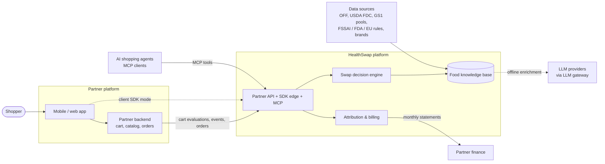

## 6. Logical architecture (C4 level 2)

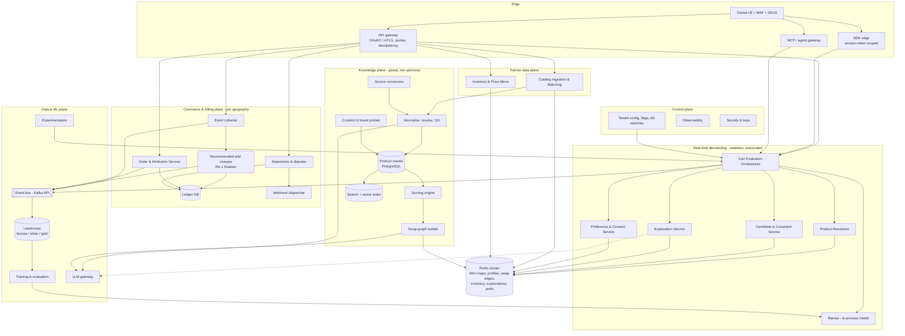

### 6.1 Component catalog

| Component | Responsibility | Reference tech | State | Scaling |
| --- | --- | --- | --- | --- |
| Edge (LB, WAF, gateway) | TLS, WAF, DDoS, OAuth2 / mTLS validation, scopes, quotas, idempotency keys, request IDs | Azure Front Door + API Management (or Envoy/Kong) | Config | Managed |
| SDK edge | Validates short-lived SDK session JWTs. Only `cart-evaluations` and `events` are reachable. | Same gateway, separate audience | None | Managed |
| MCP / agent gateway | Exposes MCP tools over Streamable HTTP. OAuth 2.1 per the MCP authorization spec. Maps tools to internal APIs. | MCP Python SDK | None | HPA |
| Cart Evaluation Orchestrator | Hot-path pipeline: resolve → profile → candidates → filter → rank → explain → label → assemble. Enforces latency budget and degradation ladder. | Python 3.11+, FastAPI on uvicorn | None | HPA on CPU/RPS |
| Product Resolution | Partner SKU → `productId`, with GTIN fallback and unknown-item handling | Library inside orchestrator + Redis | Redis | — |
| Candidate & Constraint Service | Reads swap edges, maps to partner SKUs, filters by availability, allergens, diet, price, pack size, recalls, partner rules | Library + Redis | Redis | — |
| Ranker | Scores candidates (gradient-boosted trees / ONNX) using health delta, substitutability, acceptance propensity and price penalty | ONNX Runtime in-process | Model file | — |
| Explanation Service | Fetches validated explanations from cache; deterministic template fallback | Library + Redis | Redis | — |
| Preference & Consent | Stores and serves shopper constraints and consent flags per partner and `userRef` | Service + PostgreSQL + Redis | PG | HPA |
| Catalog Ingestion & Matching | Bulk and delta feeds, schema validation, matching, review queue, enrichment triggers | Workers + PostgreSQL + object storage | PG, blob | KEDA on queue depth |
| Inventory & Price Mirror | Ingests store availability and price batches and streams | Workers + Redis (+ optional PG) | Redis | KEDA |
| Source connectors | OFF dumps and deltas, USDA FDC releases, GS1 pools, regulatory watchers, recall feeds | Orchestrated pipelines (Airflow / Dagster / Fabric Data Factory) | Lake | Batch |
| Normalize, resolve, QA | Units, nutrient codes, ingredient and additive parsing, allergen derivation, entity resolution, survivorship, QA rules | Spark / Python | Lake, PG | Batch + stream |
| Product master | Canonical products, versions, nutrition, ingredients, additives, allergens, marks, provenance | PostgreSQL 16 (+ pgvector) | PG | Read replicas per geography |
| Scoring engine | Computes all jurisdiction models, HSI, flags and health profiles | Python batch + stream | PG | Batch |
| Swap-graph builder | Candidate generation, rule checks, substitutability scoring, graph validation, blue/green publish | Spark + vector search + ML | Lake, Redis | Batch |
| Curation & brand portals | Human-in-the-loop review, brand submissions, dispute handling, audit trails | Web app + PG | PG | HPA |
| Event collector | Validates and dedupes events, creates RA-1 charges for adds and voids them on undo within the grace period, publishes to the bus | Service + PG | Bus, PG | HPA |
| Order & Attribution | Order ingestion, lifecycle, attribution state machine, fee calculation (FP-1) | Service + PG | PG | HPA |
| Recommended-add charges (RA-1) | Settles PENDING charges after the settlement window (evidence checks, caps), posts RA-1 revenue to the ledger, lists charges for reconciliation | Scheduled finalizer + PG | PG | Low |
| Ledger | Append-only double-entry journal | PostgreSQL (dedicated) | PG | Vertical + replicas |
| Statements & disputes | Month close (FP-1 fees and RA-1 charges), statements, invoices, tax lines, disputes, credit notes | Service + PG | PG | Low |
| Webhook dispatcher | Signed delivery, retries with backoff, DLQ, replay | Service + bus | Bus | KEDA |
| LLM gateway | Model routing, prompt registry, schema-constrained outputs, validation, caching, budgets, logging without PII | Service (Microsoft Foundry / Azure OpenAI or other providers) | Cache | HPA |
| Experimentation | Assignment, holdouts, metric pipelines | In-house or GrowthBook / Statsig-style | PG, lake | — |
| Control plane | Tenant config, feature flags, kill switches, scoring model rollout | Config service + flags | PG | — |

Language choices follow the Python reference implementation ([doc 07](07-reference-implementation.md), ADR-12 in the
[README](../README.md#key-design-decisions)). Other runtimes remain possible for production hot paths if latency
budgets require it.

## 7. Core flows

### 7.1 Partner onboarding and catalog matching

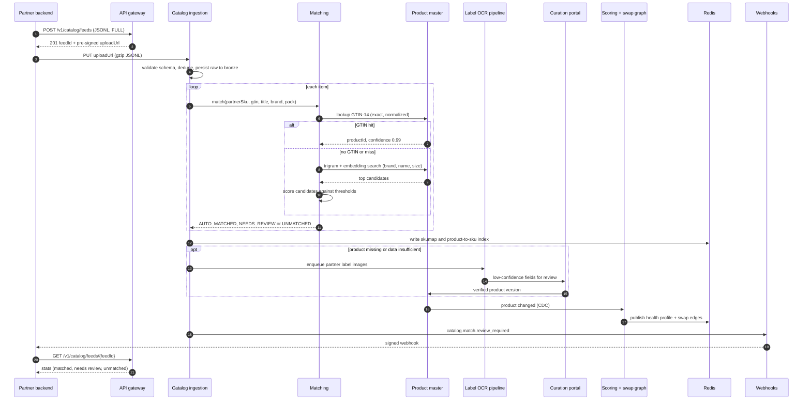

### 7.2 Real-time cart evaluation (server-to-server, recommended)

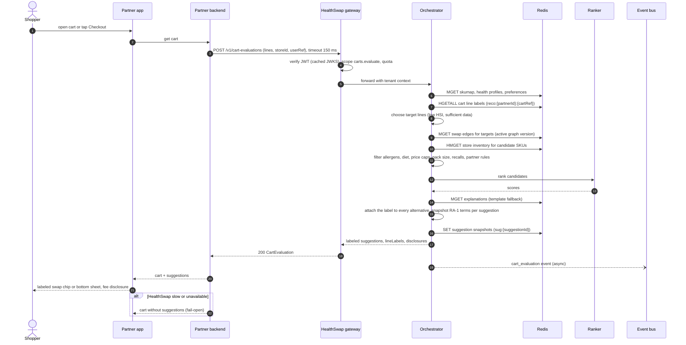

**Latency budget (server-side p95):**

| Step | Budget |
| --- | --- |
| Gateway: token validation (cached JWKS), scopes, quota | 5 ms |
| Request validation + tenant config (in-memory) | 1 ms |
| Resolution: partner SKU → `productId` (local LRU + Redis MGET) | 3 ms |
| Health profiles and preferences (MGET) | 3 ms |
| Swap edges for target lines (MGET, ≤ 50 edges/line) | 5 ms |
| Availability and price for candidate SKUs (one HMGET per store hash) | 6 ms |
| Constraint filtering | 2 ms |
| Ranking (in-process ONNX / GBDT) | 5 ms |
| Explanations (cache, template fallback) | 3 ms |
| Assembly, serialization, async event publish | 3 ms |
| Headroom | 44 ms |
| **Total p95** | **≤ 80 ms** |

The hot path makes no synchronous PostgreSQL calls and no LLM calls.

The label and the RA-1 terms are attached after ranking and selection, so they never change which alternatives are
returned or their order (§9.10). Evaluation and suggestion records are written to PostgreSQL asynchronously; the
`sug:` snapshot in the hot cache lets events for a suggestion be validated before that write lands.

### 7.3 Client SDK mode (faster integration for mid-size partners)

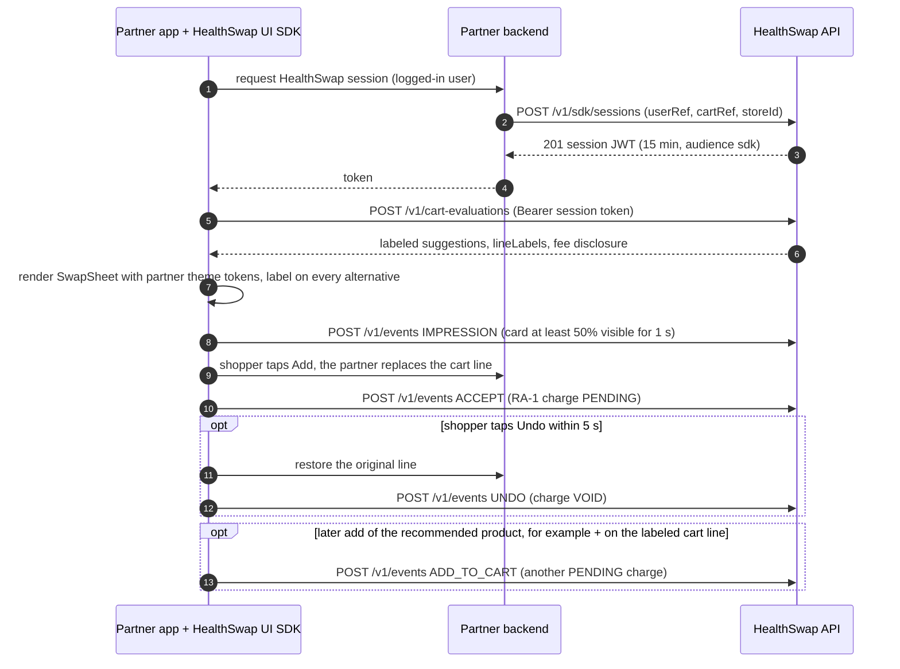

The SDK never mutates the cart itself. The partner's callback does, so the partner keeps control of pricing and
inventory. Events are batched (every 2 s or at 20 events) and flushed with `fetch` `keepalive` when the page is
hidden. SDK sessions are bound to one cart and never receive charge acknowledgements or billing data; the partner
backend reconciles charges with `GET /v1/billing/recommendation-charges`.

### 7.4 Swap → add fee (RA-1) → order → attribution (FP-1) → billing

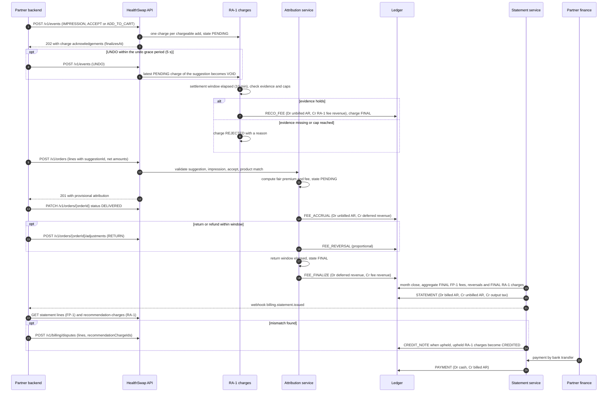

RA-1 and FP-1 run independently: an add settles about 10 minutes after it happened whether or not an order follows,
and a return reverses FP-1 but not RA-1 (§9.10).

### 7.5 Knowledge refresh → re-score → swap-graph publish

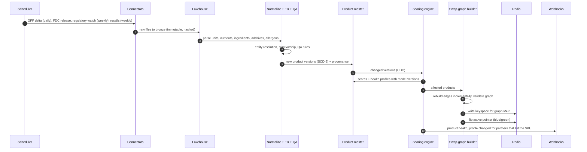

### 7.6 Agent mode (MCP)

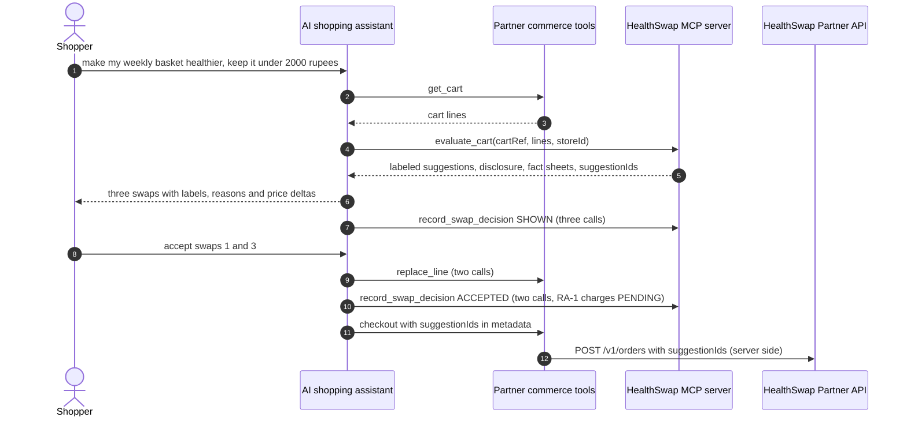

### 7.7 Privacy erasure

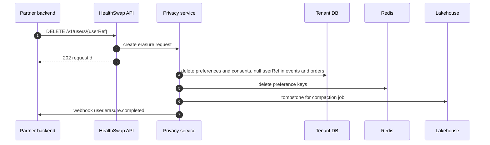

Billing aggregates survive erasure because they hold no `userRef` after finalization (§13).

## 8. Decision engine internals (summary)

The full rules are in [doc 03](03-health-scoring-recommendation-llm.md). Runtime pseudo-code:

```text
evaluateCart(req):
  cfg   = tenantConfig(req.partnerId)                       # in-memory, versioned
  prefs = merge(storedPrefs(req.userRef), req.preferences)  # consent-aware
  if req.context.isMinor != false and cfg.minorsPolicy == STRICT: prefs.personalization = OFF
  lines    = req.lines[: cfg.maxLines]
  products = resolve(lines)                                 # skumap, then GTIN fallback
  profiles = healthProfiles(products, req.market)
  targets  = [l for l in lines if profiles[l].dataSufficient
                                 and profiles[l].hsi < categoryCeiling(l)
                                 and l.isSubstitutable]
  targets  = topK(targets, by = (categoryCeiling - hsi) * qty, k = cfg.maxSuggestionsPerCart * 2)
  for t in targets:
      edges = swapEdges(req.market, activeGraph(req.market), t.productId)  # precomputed, pre-validated
      cands = toPartnerSkus(edges, req.partnerId)                          # product -> partner SKU index
      cands = availability(cands, req.storeId, req.availabilityMode)
      cands = constraints(cands, prefs, t, cfg)    # allergens, diet, price ratio, pack ratio, recalls, brands
      cands = recheckRules(cands, t)               # R2-R4 against current profile versions
      t.alts = rank(cands, features(t, prefs, req.context))[: cfg.maxAltsPerLine]
  final = diversify(targets with alts, maxPerCart = cfg.maxSuggestionsPerCart)
  attachExplanations(final, req.locale)           # validated cache, then template
  attachLabels(final, cfg.fee.recommendationAdd)  # after ranking: label, disclosure, RA-1 terms snapshot (§9.10)
  publishAsync(evaluationEvent)
  return final
```

**Degradation ladder** (automatic, per partner):

| Level | Trigger | Behavior |
| --- | --- | --- |
| L0 | Normal | Full pipeline |
| L1 | Explanation cache miss storm or LLM gateway issues | Template explanations only (no LLM text) |
| L2 | Ranker or feature-store issue | Rank by health delta × substitutability only |
| L3 | Inventory mirror stale (> 10 min) | Return candidates with `requiresAvailabilityCheck = true` |
| L4 | Error budget burn or kill switch | Return empty suggestions with `degraded = true` (HTTP 200) |

## 9. Attribution & fee model

### 9.1 Definitions

For an order line *L* that carries a `suggestionId` *s* whose alternative was accepted:

- `q_alt`: quantity of the suggested alternative on line *L*.
- `q_orig`: quantity of the original line when the suggestion was served (snapshot in *s*).
- `q_rep = min(q_alt, q_orig)`: replaced quantity. Extra units beyond the original quantity are *not* fee-bearing.
- `p_orig`: unit price of the original item at suggestion time, net of line-level discounts and exclusive of tax
  (snapshot in *s*).
- `p_alt`: net unit price actually paid for the alternative. This is after line discounts and the pro-rated
  order-level discount, exclusive of tax: `netAmount / q_alt`.
- `size_orig`, `size_alt`: net quantity per unit (g or ml) of each product.

### 9.2 Fair-premium rule (default, `rule_version = FP-1`)

$$\Delta_{pack} = p_{alt} - p_{orig}$$

$$\Delta_{size} = p_{alt} - p_{orig}\cdot\frac{size_{alt}}{size_{orig}}$$

$$premium_{unit} = \max\left(0,\ \min(\Delta_{pack},\ \Delta_{size})\right)$$

$$fee = \text{round}\left(r \cdot premium_{unit}\cdot q_{rep}\right),\quad r = 0.10\ \text{(contract)}$$

Taking the minimum guarantees HealthSwap earns only on the *health premium*: never on extra volume (bigger pack),
and never more than the shopper actually paid extra. If sizes are unknown or not comparable (different units),
only Δ_pack is used. Caps per line, per order and per month are applied afterwards. Rounding is half-even to the
currency minor unit.

### 9.3 Worked examples

| # | Original (snapshot) | Alternative (paid) | Δpack | Δsize | Premium/unit | Qty | Fee |
| --- | --- | --- | --- | --- | --- | --- | --- |
| IN-1 | Instant noodles 4-pack 280 g, ₹56 | Millet noodles 4-pack 256 g, ₹89 list; ₹8 order coupon allocated to the line, ₹170.00 net for 2 = ₹85 net per unit | 29.00 | 85 − 56×256/280 = 33.80 | **29.00** | 2 | ₹5.80 |
| IN-2 | Cream biscuits 500 g, ₹100 | Whole-wheat digestive 1 kg, ₹240 | 140.00 | 240 − 200 = 40.00 | **40.00** | 1 | ₹4.00 (not ₹14) |
| IN-3 | Flavored yogurt 400 g, ₹60 | Plain yogurt 400 g, ₹45 | −15.00 | −15.00 | **0** | 1 | ₹0 (cheaper swaps are still shown) |
| US-1 | Frosted cereal 13.5 oz, $4.29 | Whole-grain low-sugar cereal 12 oz, $5.49 | 1.20 | 5.49 − 4.29×12/13.5 = 1.68 | **1.20** | 1 | $0.12 |

At evaluation time the IN-1 alternative's normalized price ratio is (89/256) / (56/280) = 1.74 at its list price,
within India's price guard of 1.75 (`priceGuards.maxNormalizedPriceRatio`, §18). If the IN-1 shopper later returns
one unit, a reversal of ₹2.90 is posted. The IN-1 numbers match the examples in [api/openapi.yaml](../api/openapi.yaml)
(`normalizedPriceRatio` 1.74, `netAmount` 170.00) and the unit tests in
[tests/domain/test_fair_premium.py](../tests/domain/test_fair_premium.py). With RA-1, the same cart also earns two add
fees: see [doc 06 §10](06-recommended-label-and-add-fee.md#10-interaction-with-fp-1-worked-example-in-1).

### 9.4 Attribution lifecycle

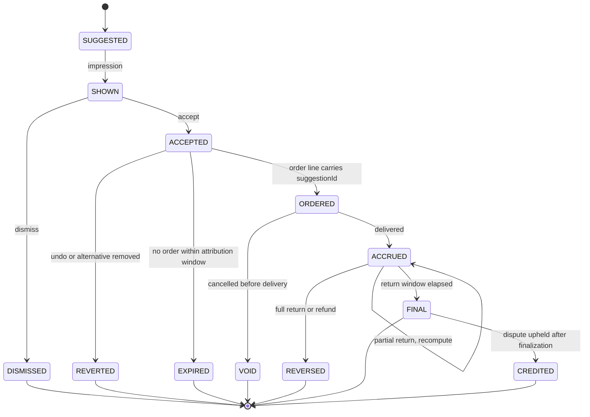

The attribution window defaults to the cart session plus 24 h and is configurable per partner. Return windows
are per partner and fulfillment type. For example, quick-commerce perishables may have a 2-day window; US
scheduled delivery may have 30 days.

In the API (`AttributionState` in [openapi.yaml](../api/openapi.yaml)), ORDERED is `PENDING`, and an order line that
fails the evidence checks is `REJECTED` with a `rejectionReason` (for example `NO_IMPRESSION`, `NO_ACCEPT`,
`PRODUCT_MISMATCH`). RA-1 charges have their own lifecycle (§9.10).

### 9.5 Edge cases

| Case | Rule |
| --- | --- |
| Price changes between suggestion and order | `p_orig` comes from the suggestion snapshot; `p_alt` is the actual net paid |
| Original also re-added to the order | `q_rep = max(0, min(q_alt, q_orig − q_orig_in_order))`; no fee if the original is still fully present |
| Shopper accepts several alternatives for one line | Only the last accepted alternative before order placement is attributable |
| Picker or fulfillment substitution of the alternative | No fee (`PICKER_SUBSTITUTION` voids the line) |
| Partial delivery | Fee on delivered quantity only |
| Bundles, BOGO, free items | Use pro-rated net amounts. If `p_alt ≤ p_orig`, fee = 0. |
| Tax-inclusive prices (India MRP includes GST) | All prices use the partner's contracted price basis on both sides (snapshot and order). If fees are contracted ex-tax, the partner sends `taxRate` on cart and order lines and HealthSwap converts both sides. |
| Membership or loyalty discounts | Included in net price |
| Currency | The order currency. Statements are issued per currency. |
| Suggestion not served by HealthSwap, or no impression/accept event | Not attributable; rejected with a reason code |

### 9.6 Ledger postings (double entry, append-only)

Account and entry names are those of the schema and of
[ledger.py](../src/healthswap/domain/commerce/ledger.py).

| Entry kind | Event | Debit | Credit |
| --- | --- | --- | --- |
| `FEE_ACCRUAL` | FP-1 fee accrued (delivered) | `UNBILLED_AR` | `DEFERRED_REVENUE` |
| `FEE_REVERSAL` | FP-1 reversal before finalization | `DEFERRED_REVENUE` | `UNBILLED_AR` |
| `FEE_FINALIZE` | FP-1 fee finalized (return window elapsed) | `DEFERRED_REVENUE` | `FEE_REVENUE` |
| `RECO_FEE` | RA-1 charge FINAL (settlement window elapsed, evidence holds); key `RECO_FEE:<chargeId>` | `UNBILLED_AR` | `RECO_FEE_REVENUE` |
| `STATEMENT` | Statement issued | `BILLED_AR` (net fee + tax) | `UNBILLED_AR` (net fee), `OUTPUT_TAX` (tax) |
| `PAYMENT` | Payment received | `CASH` | `BILLED_AR` |
| `CREDIT_NOTE` | Dispute upheld after the statement was issued | `FEE_REVENUE` (FP-1 part), `RECO_FEE_REVENUE` (RA-1 part), `OUTPUT_TAX` (tax) | `BILLED_AR` (total) |

RA-1 revenue is recognized when the charge becomes FINAL: unlike FP-1 there is no return contingency, so there is no
deferral. Every posting is balanced, has no negative amounts and carries an idempotency key, so a retried job cannot
post twice; postings are written by the `hs_ledger_writer` role only.

Corrections are always reversing entries, never updates. The schema enforces balance and immutability with
triggers ([db/schema.sql](../db/schema.sql)).

### 9.7 Statements, disputes, tax

- Month close runs on business day 1. Statements are issued by day 5 with line-level detail available through the
  API. The partner has a contractual window (for example 15 days) to dispute specific lines. Payment terms follow
  the contract (for example net 30).
- **Statement totals** cover both fee rules:
  - `premiumFee` (FP-1) + `recommendationFee` (RA-1) = `grossFee`; `recommendationChargeCount` is the number of
    billed adds.
  - `netFee` = `grossFee` − `reversals` − `credits`.
  - `tax` = round((`grossFee` − `reversals`) × `taxRate`) − tax already credited; `totalDue` = `netFee` + `tax`.
  - Statement lines (`/lines`) itemize FP-1 (`FEE`, `REVERSAL`, `CREDIT`). RA-1 charges are listed with
    `GET /billing/statements/{statementId}/recommendation-charges` and summed in the totals.
  - Month close bills the FINAL RA-1 charges finalized before the end of the closed month; later ones go to the next
    statement. The invoice number is `HS-<geography>-<yyyy>-<mm>-<nnnnnn>`.
- **Disputes** name FP-1 lines (`lines`), RA-1 charges (`recommendationChargeIds`) or both, within
  `disputeWindowDays`. An upheld dispute posts a credit note (fee plus tax); a credited RA-1 charge becomes CREDITED.
- **Tax** (get professional advice):
  - India: GST on the service invoice to the partner, plus withholding (TDS) as applicable. FP-1 and RA-1 are both
    service fees to the partner and are taxed on the same statement at the partner's `taxRate`.
  - US: B2B service fees are generally not subject to sales tax, but this varies by state.
  - Store tax lines separately in the ledger.
- Reconciliation API: partners pull statement lines and match them to their order IDs, and match RA-1 charges to
  their own event log by `eventId`. Mismatches go to `POST /billing/disputes`.

### 9.8 Anti-gaming and audit

- A fee requires all of the following:
  1. A suggestion served by HealthSwap.
  2. An impression event.
  3. An accept event in the same session.
  4. An order line referencing the `suggestionId`.
  5. The ordered product matches the suggested alternative.
  6. The partner's price caps were in effect.
- An RA-1 charge requires all of the following (§9.10):
  1. A suggestion served by HealthSwap to this partner, with RA-1 terms snapshotted when it was served.
  2. An `ACCEPT` or `ADD_TO_CART` event that names one of the suggestion's alternatives.
  3. The add happened inside the suggestion's attribution window.
  4. An impression no later than 5 s after the add (`requireImpression`).
  5. No `UNDO` within the undo grace period, and no cap reached.
- Replayed events are deduplicated by `eventId` (one charge per event). SDK sessions are bound to one cart and never
  see charges or billing data. Events more than 5 minutes in the future are rejected.
- Anomaly detection runs on acceptance rates, fee per order, event-to-order ratios and, for RA-1, add-to-impression
  ratios, undo timing and adds per suggestion. The contract gives mutual audit rights: sampled order evidence from
  the partner, and evaluation logs from HealthSwap.
- Neutrality audit (monthly):
  - Share of shown suggestions that are cheaper than the original.
  - Correlation between price uplift and rank position.
  - Health uplift distribution by price bucket.
  - Same alternatives in the same order with RA-1 enabled and disabled.

### 9.9 Customer-paid variant (optional, not recommended)

The partner adds a disclosed line item ("Healthier-swap service fee") equal to the computed fee, shown **before**
payment. It is never pre-selected and is refunded on return. The partner remains the merchant of record and
remits to HealthSwap. Risks: lower acceptance, drip-pricing and dark-pattern scrutiny (India CCPA Guidelines for
Prevention and Regulation of Dark Patterns, 2023), plus extra tax complexity.

### 9.10 Recommended-add fee (RA-1)

Every recommended alternative carries the label "Recommended by HealthSwap". Where the partner contract includes RA-1,
each add of a labeled alternative to the cart earns HealthSwap a small fixed fee from the partner, independent of
FP-1. The full specification is [doc 06](06-recommended-label-and-add-fee.md); the decision is ADR-11 in the
[README](../README.md#key-design-decisions).

| Item | Rule |
| --- | --- |
| Amount and currency | Per partner contract (`fee.recommendationAdd`, §18). Default INR 1.00 per add event (`PER_ADD_EVENT`); `PER_UNIT` charges amount × max(1, quantity). RA-1 applies when it is enabled, the amount is above 0 and its currency equals the cart currency. The terms are snapshotted on each suggestion when it is served, so a contract change never re-prices served suggestions. |
| Chargeable events | `ACCEPT` (when `chargeAccept` is true, the default) and `ADD_TO_CART` naming a recommended alternative in `alternativePartnerSku`: one charge per event. `IMPRESSION`, `DISMISS`, `UNDO` and `DETAILS_VIEWED` are never charged. |
| Evidence | Checked at finalization, in this order: suggestion served by HealthSwap (`NOT_SERVED_BY_HEALTHSWAP`), SKU among its alternatives (`SKU_NOT_RECOMMENDED`), add inside the attribution window (`OUTSIDE_ATTRIBUTION_WINDOW`), impression no later than 5 s after the add (`NO_IMPRESSION`), caps (`CAP_REACHED`). A failed check makes the charge REJECTED with that reason. |
| Undo grace | An `UNDO` within `undoGraceSeconds` (5 s) of the add voids the latest PENDING charge of the suggestion (reason `UNDONE_WITHIN_GRACE`). A later undo is recorded but voids nothing. |
| Settlement window | `finalizesAt` = max(`occurredAt` + `settleAfterSeconds`, received time + max(`undoGraceSeconds`, 1 s)): 10 minutes after the add by default, so late impressions and undos count. A finalizer runs every 30 s. |
| Lifecycle | `PENDING` → `VOID` (undo within grace), `FINAL` (evidence holds, `RECO_FEE` posted) or `REJECTED`; `FINAL` → `CREDITED` (dispute upheld) |
| Additivity with FP-1 | Independent rules with separate evidence chains and revenue accounts: an add can earn RA-1 and the delivered order line can also earn FP-1. A return reverses FP-1, not RA-1. FP-1 caps do not include RA-1. |
| Caps | Optional `maxChargeableAddsPerSuggestion` and `monthlyCap` (calendar month, UTC). A capped charge is rejected whole, never partially billed. |
| Billing | FINAL charges are billed at the next month close next to FP-1 and taxed at the partner's rate (§9.7) |
| Disputes and credits | `POST /billing/disputes` with `recommendationChargeIds` (for example reason `NOT_ADDED_TO_CART`) within the dispute window; an upheld dispute credits the charge and posts a credit note (amount plus tax). |
| Fee-neutral ranking | The label and the RA-1 terms are attached after the alternatives are filtered, ranked and selected; ranker features contain no commercial signal ([doc 03 §7](03-health-scoring-recommendation-llm.md#7-runtime-ranking-and-cart-level-selection)). Cheaper alternatives earn the same amount. |
| Shopper-facing | The label and the disclosures never state the amount; SDK sessions never receive charges. |

IN-1 with RA-1 at INR 1.00 ([doc 06 §10](06-recommended-label-and-add-fee.md#10-interaction-with-fp-1-worked-example-in-1)):
the two FINAL adds (INR 2.00) are billed with the FP-1 fee of INR 5.80, so the statement shows gross 7.80, net 4.90
after the 2.90 return reversal, GST 0.88 and a total due of 5.78.

## 10. Data architecture

### 10.1 Stores

| Store | Reference tech | Contents | Residency | Retention |
| --- | --- | --- | --- | --- |
| Product master (KB) | PostgreSQL 16 + pgvector | Products, versions, nutrition, ingredients, additives, allergens, marks, provenance, recalls, regulatory packs, scores, health profiles, swap-graph versions | Global (non-personal); read replicas per geography | Indefinite (versioned) |
| Tenant OLTP | PostgreSQL 16 with row-level security | Partners, stores, catalog mapping, preferences, consent, DSAR | Partner's geography | Contract term + 30 days |
| Transactions | PostgreSQL (time-partitioned) | Evaluations, suggestions, events, orders, attribution, RA-1 charges | Partner's geography | 90 days hot, then lake |
| Ledger | PostgreSQL (dedicated, strict roles) | Journal, statements, disputes | Partner's geography | Statutory (for example 8 years) |
| Hot cache | Redis cluster | SKU maps, profiles, swap edges, inventory, explanations, prefs, dismissals, cart line labels, suggestion snapshots | KB parts replicated; tenant parts in-geo | TTL-based |
| Search and vector | OpenSearch or Azure AI Search, plus pgvector | Product search, fuzzy matching, ANN candidates | Global | Rebuildable |
| Event bus | Kafka API (Event Hubs, Confluent, MSK) | Evaluation, suggestion, RA-1 charge, order, attribution, catalog and KB change events | In-geo | 7–30 days |
| Lakehouse | Object storage + Delta / Iceberg | Raw sources (bronze), conformed (silver), marts and features (gold) | Personal data in-geo | Policy-based |
| Object storage | Blob / S3 | Feed files, label images, OCR artifacts | Per source licence | Per policy |

### 10.2 Hot-cache key design

| Key | Value | Notes |
| --- | --- | --- |
| `skumap:{partnerId}:{partnerSku}` | `productId`, match confidence | Written by catalog matching |
| `p2sku:{partnerId}:{productId}` | Set of partner SKUs | Maps swap-graph products back to the partner catalog |
| `gtin:{gtin14}` | `productId` | GTIN fallback for SKUs that are not mapped yet |
| `hp:{market}:{productId}` | Health profile (msgpack, versioned) | Written by the scoring engine |
| `cat:{market}:{categoryId}` | Category HSI ceiling (60th percentile) | Selects target lines |
| `catmap:{market}:{fromCategory}` | Set of approved target categories | Cross-category swaps |
| `swap:{market}:{graphVersion}:{productId}` | Top-50 edges (msgpack) | Blue/green keyspace |
| `swap:active:{market}` | Active `graphVersion` | Atomic pointer flip |
| `inv:{partnerId}:{storeId}` | Hash: `partnerSku` → in-stock, price, MRP, timestamp | One hash per store keeps lookups to one round trip; stale entries count as unknown |
| `expl:{market}:{locale}:{from}:{to}:{factsHash}` | Validated explanation | Invalidated when facts change |
| `pref:{partnerId}:{userRef}` | Preferences + consent flags | TTL 30 days; source of truth is PostgreSQL |
| `dismiss:{partnerId}:{userRef}:{fromProductId}:{toProductId}` | `1` | Written on `DISMISS`: the swap is not suggested again to this user until the TTL, the market's cool-down (7 days in IN and US), expires. Without a `userRef` the key uses `cart:{cartRef}` instead. |
| `reco:{partnerId}:{cartRef}` | Hash: `partnerSku` → `suggestionId` | Cart line labels: written on `ACCEPT` and `ADD_TO_CART` and returned as `lineLabels` for lines still in the cart; TTL until the suggestion's attribution window ends (1 h if it already has) |
| `sug:{suggestionId}` | Suggestion snapshot: original line, alternatives, RA-1 terms, windows | Written on the hot path so events validate before the asynchronous database write; TTL = attribution window + 1 h |
| `eval:{partnerId}:{evaluationId}` | Evaluation response | Serves `GET /cart-evaluations/{evaluationId}`; TTL = evaluation lifetime (30 min) |
| `cfg:{partnerId}` | Tenant config | Also cached in-process with pub/sub invalidation. The reference implementation keeps only the in-process copy (partner directory, refreshed within 15 s). |

### 10.3 Event topics

| Topic | Key | Producer → consumers | Retention |
| --- | --- | --- | --- |
| `hs.cart-evaluations.v1` | evaluationId (product page and search: first suggestionId) | Orchestrator → lake, experimentation | 7 d |
| `hs.suggestion-events.v1` | suggestionId | Event collector → attribution, lake | 7 d |
| `hs.reco-charges.v1` | chargeId | Event collector (PENDING, VOID) and RA-1 finalizer (FINAL, REJECTED) → lake, anomaly detection | 30 d |
| `hs.orders.v1` | orderId | Order service → attribution, lake | 30 d |
| `hs.attribution.v1` | orderId | Attribution → ledger, statements, lake | 30 d |
| `hs.billing.v1` | — | Reserved for billing events; declared, no producer yet | 30 d |
| `hs.webhook-requests.v1` | partnerId | Any service → webhook dispatcher (fan-out to the partner's endpoints) | 7 d |
| `hs.catalog-changes.v1` | partnerId | Catalog ingestion → matching, enrichment | 7 d |
| `hs.inventory-updates.v1` | partnerId:storeId | Partner streams → inventory mirror | 1 d |
| `hs.kb-product-changes.v1` | productId | Product master CDC → scoring, swap graph, search, webhook dispatcher (`product.health_profile.changed`) | Compacted |
| `*.dlq` | — | All consumers | 14 d |

Every message also carries its `partnerId` (none for knowledge-base topics), so keys only need to be unique within a
tenant. Services write messages to a transactional outbox in the same transaction as the change, and a relay
publishes them. In the reference implementation the bus is in-process, the consumers are the lake sink (every topic)
and the webhook fan-out, and attribution and the RA-1 finalizer work on PostgreSQL directly
([doc 07 §7](07-reference-implementation.md#7-background-workers-and-events)).

### 10.4 Entity overview

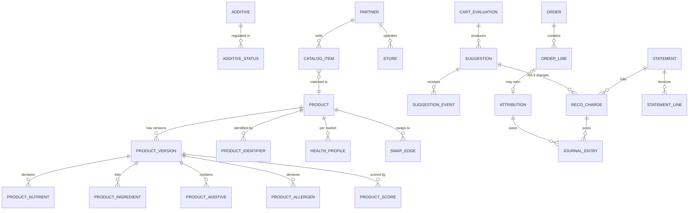

The full DDL is in [db/schema.sql](../db/schema.sql).

## 11. API design overview

The full contract is in [api/openapi.yaml](../api/openapi.yaml).

**Conventions:**

- Base paths are per geography, for example `https://api.in.healthswap.example/v1` and `https://api.us.healthswap.example/v1`.
- Versioning: URI major version. Additive changes are non-breaking. Deprecations get 12 months' notice and a `Sunset` header.
- `Idempotency-Key` header is required on POSTs that create resources; keys are retained 24 h.
- Errors use RFC 9457 `application/problem+json` with a stable `code`.
- Cursor pagination (`cursor`, `limit`).
- Money is a decimal string plus ISO 4217 currency. Timestamps are RFC 3339 UTC.
- W3C `traceparent` is accepted and propagated.
- Rate-limit headers: `RateLimit-Limit`, `RateLimit-Remaining`, `RateLimit-Reset`. 429 responses include `Retry-After`.

| Area | Endpoints |
| --- | --- |
| SDK sessions | `POST /sdk/sessions` |
| Catalog | `POST /catalog/item-batches`, `POST /catalog/feeds`, `GET /catalog/feeds/{feedId}`, `GET/DELETE /catalog/items/{partnerSku}`, `PUT /catalog/items/{partnerSku}/match` |
| Inventory | `POST /stores/{storeId}/inventory-batches` |
| Products | `GET /products/lookup`, `GET /products/{productId}`, `GET /products/{productId}/alternatives` (with `cartRef`: `suggestionId` and chargeable labels) |
| Decisioning | `POST /cart-evaluations`, `GET /cart-evaluations/{evaluationId}` |
| Events | `POST /events` (`IMPRESSION`, `ACCEPT`, `ADD_TO_CART`, `UNDO`, `DISMISS`, `DETAILS_VIEWED`; 202 with `rejected[]` and, for server-to-server callers, RA-1 `charges`) |
| Orders | `POST /orders`, `GET/PATCH /orders/{orderId}`, `POST /orders/{orderId}/adjustments`, `GET /orders/{orderId}/attribution` |
| Shoppers | `GET/PUT /users/{userRef}/preferences`, `DELETE /users/{userRef}` |
| Billing | `GET /billing/statements`, `GET /billing/statements/{statementId}`, `GET /billing/statements/{statementId}/lines`, `GET /billing/statements/{statementId}/recommendation-charges`, `GET /billing/recommendation-charges`, `GET /billing/recommendation-charges/{chargeId}`, `POST /billing/disputes`, `GET /billing/disputes/{disputeId}` |
| RA-1 fields | `recommendation` (`RecommendationLabel`) on every alternative; `lineLabels` and `disclosures.feeDisclosure` on evaluations; `charges` (`RecommendationChargeAck`) on event batch results; `premiumFee`, `recommendationFee` and `recommendationChargeCount` in statement totals; `recommendationChargeIds` and reason `NOT_ADDED_TO_CART` on disputes |
| Transparency | `GET /scoring-models`, `GET /status` |
| Webhooks | `catalog.match.review_required`, `product.health_profile.changed`, `billing.statement.issued`, `billing.dispute.updated`, `user.erasure.completed` (no RA-1-specific webhook: partners read charges through the billing API) |

The operator plane is not part of the partner contract: it is a private admin API (scope `hs.admin`) with, among
others, `PUT /admin/partners/{partnerId}/config`, `POST /admin/partners/{partnerId}/kill-switch`,
`POST /admin/jobs/finalize-reco-charges`, `POST /admin/jobs/month-close`, `POST /admin/disputes/{disputeId}/resolve`
and `GET /admin/ledger/trial-balance`.

**Webhook security:**

- Header: `HealthSwap-Signature: t=<unix>,v1=<hex HMAC-SHA256(secret, t + "." + body)>`. Reject anything older than 5 minutes.
- Delivery is at-least-once with exponential backoff for up to 24 h, then DLQ. Replay is available on request.

## 12. Security architecture

| Area | Controls |
| --- | --- |
| Identity | OAuth 2.0 client credentials (JWT, 10 min TTL, audience-bound). Optional mTLS with certificate-bound tokens (RFC 8705) for enterprise partners. SDK session JWTs (ES256, 15 min) scoped to partner + `userRef` + `cartRef`. Optional app attestation pass-through. |
| Authorization | Scope checks per route. Object-level checks on every query (`partner_id`) plus PostgreSQL row-level security as defense in depth. Tenant-scoped cache keys and topic ACLs. |
| Transport and data | TLS 1.2+ (1.3 preferred) and HSTS. AES-256 at rest. Optional per-partner customer-managed keys. Secrets in Key Vault / KMS with rotation. No secrets in code or images. |
| Abuse | WAF and bot rules, per-client and per-tenant quotas, payload caps (≤ 200 lines, ≤ 1,000 catalog items, ≤ 5,000 inventory rows, ≤ 500 events), schema validation, strict JSON parsing |
| SSRF | Partners upload through pre-signed URLs. HealthSwap does not fetch arbitrary partner URLs. Image fetches go through an egress proxy with domain allowlists. |
| Supply chain | SBOM, dependency and container scanning, signed images, admission policies, IaC policy-as-code |
| LLM security | See below |
| Audit | Immutable audit log for config, curation, billing and privacy actions. Access reviews. Just-in-time admin access. |
| Assurance | SAST/DAST, annual third-party pen test, bug bounty after GA, SOC 2 Type II, ISO 27001/27701 |

**LLM security** (OWASP Top 10 for LLM Applications):

- Product text from OCR, partners or OFF is untrusted. It is delimited and treated as data, never as instructions.
- Extraction calls have no tools. Output is schema-constrained and validated.
- No PII is ever sent to an LLM.
- Content filtering, per-job budgets, and model and prompt version pinning.

**OWASP API Security Top 10 (2023) mapping:**

| Risk | Mitigation |
| --- | --- |
| API1 BOLA | `partner_id` predicate on every object access + RLS; IDs are UUIDv7, not sequential |
| API2 Broken authentication | Short-lived tokens, mTLS option, credential rotation, no API keys in mobile apps |
| API3 Broken object property level authorization | Response allowlists per schema; no mass assignment |
| API4 Unrestricted resource consumption | Quotas, payload caps, timeouts, cost budgets on LLM jobs |
| API5 Broken function level authorization | Scopes per route; admin APIs on a separate private plane |
| API6 Unrestricted access to sensitive business flows | Fees only via the full evidence chains (§9.8, §9.10); anomaly detection |
| API7 SSRF | Pre-signed uploads, egress proxy, allowlists |
| API8 Security misconfiguration | IaC baselines, CIS benchmarks, drift detection |
| API9 Improper inventory management | Single gateway, API catalog, versioning and sunset policy |
| API10 Unsafe consumption of APIs | Strict validation of third-party data (OFF, USDA, retailer APIs, LLM outputs) |

## 13. Privacy, consumer protection and regulatory compliance

### 13.1 Roles

| Situation | HealthSwap role |
| --- | --- |
| Partner integrations | Processor under GDPR; acting on behalf of the Data Fiduciary under India's DPDP Act. The partner is controller / Data Fiduciary. A DPA defines purposes, sub-processors (including LLM providers, which receive only non-personal product data), security, breach notification and deletion. |
| Own consumer app (if built) | Controller / Data Fiduciary |

### 13.2 Data inventory

| Category | Examples | Personal? | Purpose | Retention |
| --- | --- | --- | --- | --- |
| Product data | Nutrition, ingredients, images | No | Scoring, matching | Indefinite (versioned) |
| Cart data | Partner SKUs, quantities, prices + `userRef` | Pseudonymous | Decisioning | 90 days hot |
| Preferences | Diet, allergens, goals | Yes; may be health-related | Constraints, personalization (with consent) | Until withdrawn or erased |
| Events | Impression, accept, add to cart, undo, dismiss | Pseudonymous | Attribution, RA-1 charges, experimentation | 90 days hot, then aggregated |
| Orders, attribution and RA-1 charges | Lines, net amounts, suggestion links, chargeable adds | Pseudonymous until finalized | Billing | `userRef` removed at FINAL (RA-1 charges: when VOID, FINAL or REJECTED); financial records kept per statute |

### 13.3 Principles

- **Data minimization**: never names, emails, phone numbers, addresses, payment data or device IDs. `userRef` is a
  partner-side keyed hash. It is optional, and suggestions work without it.
- **Consent**: health-related preferences and personalization are processed only when the partner passes a consent
  flag and notice version. Consent records are stored.
- **Children**: if `isMinor` is true or unknown and the partner policy is strict, there is no personalization and no
  behavioral features. This aligns with DPDP Act §9 (no tracking or behavioral monitoring of children, no targeted
  advertising directed at them).
- **Residency**: tenant and personal data stays in the partner's geography (India, US, EU). Only non-personal product
  data is global. DPDP Act 2023 and DPDP Rules 2025 apply on a phased schedule. GDPR transfer rules apply in the EU.
  For the US, consider state privacy laws and consumer-health-data laws (for example Washington's My Health My
  Data Act).
- **Rights**: erasure and access through the API (§7.7). Breach notification runbooks cover each regime.

### 13.4 Consumer protection

- **No dark patterns**:
  - No auto-swap, no pre-selected swaps (basket sneaking), no guilt copy (confirm-shaming), no false urgency.
  - Frequency caps (nagging).
  - Fees disclosed (drip pricing).
  - These follow India's CCPA Guidelines for Prevention and Regulation of Dark Patterns (2023) and the Consumer
    Protection (E-Commerce) Rules 2020.
- **Material connection disclosure**: shoppers are told HealthSwap may earn a fee (FTC Endorsement Guides; equivalent
  consumer-law principles elsewhere). The "Recommended by HealthSwap" label and the fee disclosure accompany every
  recommended alternative before the shopper acts; neither states the amount (§9.10).
- **Sponsored content** is always labeled and only allowed among already-eligible healthier options.

### 13.5 Food claims

- Comparative, factual statements only ("27% less sugar per 100 g than the item in your cart"). No disease or medical
  claims. No regulated terms such as "healthy" unless the product meets that jurisdiction's definition:
  - US: FDA "healthy" criteria, computed as a flag.
  - India: FSSAI Advertising & Claims Regulations 2018 for nutrition claims.
  - EU: Regulation 1924/2006 for nutrition and health claims.
- Show comparative claims only above jurisdiction thresholds (claim thresholds in the regulatory pack).
- Official scheme logos (Nutri-Score, Health Star Rating) are used only under their usage terms. Otherwise show
  HealthSwap's own neutral grade.
- **EU AI Act**: AI-generated explanation text is labeled where transparency obligations apply.

## 14. Reliability and resilience

- **Topology**:
  - Multi-AZ in every region.
  - Two regions per geography in active-active for the hot path (for example India: Central + South; US: East + West).
  - The global KB has a single writer and read replicas in each geography.
- **Fail-open contract**: server SDKs give cart evaluation a 150 ms deadline and use a circuit breaker (the reference
  Python SDK opens it after 5 consecutive failures and lets one probe through after 30 s). Browser SDKs use a longer
  deadline because they call across the internet (1.5 s in the reference web SDK). On failure they show the cart
  without suggestions.
- **SLOs and error budgets**:
  - Decisioning availability 99.95%, latency p99 ≤ 150 ms.
  - Ingestion 99.9%.
  - Webhook delivery ≥ 99.9% within 15 min.
- **Data protection**:
  - OLTP point-in-time restore, cross-region replicas: RPO ≤ 5 min, RTO ≤ 30 min.
  - The ledger additionally has a daily immutable snapshot.
  - The KB and swap graph can be rebuilt from the lake.
- **Safe change**:
  - Canary releases with automatic rollback on SLO burn.
  - Blue/green swap-graph activation with validation gates: edge-count delta, rule-violation sample = 0, allergen spot checks.
  - Per-partner kill switch.
- **Chaos and game days**: Redis shard loss, region evacuation, stale inventory, LLM provider outage, poisoned source data.

## 15. Performance and capacity planning

**Planning assumptions (to be validated with partners):**

- A large Indian quick-commerce partner places about 1.5 M orders per day.
- About 5 debounced evaluations per order gives 7.5 M evaluations per day: 87 RPS on average and about 350 RPS at
  a 4× peak.
- With several such partners, US partners and agents, plan for **3–5k RPS steady with headroom to 10k RPS per
  geography**.

**Per-evaluation work:**

- About 12 lines, ≤ 6 target lines, ≤ 50 edges per line.
- The ~300 candidate inventory checks collapse into one HMGET on the store hash.
- About 6 Redis round trips in total. At 5k RPS that is about 30k round trips/s, which a small Redis cluster handles.

**Hot-cache memory per geography (order of magnitude):**

| Dataset | Estimate |
| --- | --- |
| Swap edges: 1.5 M products × 30 edges × ~48 B | ~2.2 GB |
| Health profiles: 1.5 M × ~600 B | ~0.9 GB |
| SKU maps: 10 partners × 300k SKUs × ~100 B (both directions) | ~0.6 GB |
| Inventory: 5 partners × 1,500 stores × 8k SKUs × ~40 B | ~2.4 GB |
| Explanations: 5 M pairs × 2 locales × ~300 B | ~3 GB |
| **Total (before replicas)** | **~9–10 GB** |

**Write volumes:**

- About 45 M suggestion events per day for a large partner (~13 GB/day raw). Partitions are moved to the lake after 90 days.
- Inventory updates are about 170/s per large partner.

## 16. Observability

- **Tracing**: OpenTelemetry end to end, propagating partner `traceparent`. Exemplars link latency outliers to traces.
- **Technical metrics**: RED per endpoint and partner, Redis hit ratios, inventory staleness, graph version age,
  degradation level, webhook lag, DLQ depth.
- **Business metrics** (per partner, per placement, per experiment arm):
  - Coverage: % of lines resolved and scored.
  - Eligible-cart rate, suggestion CTR, acceptance rate, swap-back (undo) rate.
  - IHGMV and fees (FP-1 and RA-1); RA-1 adds per 1,000 impressions, undo rate and rejection rate by reason.
  - Health uplift: Δ HSI per accepted swap; grams of sugar and milligrams of sodium avoided per 1,000 orders.
  - Checkout conversion delta (guardrail).
- **Data and ML metrics**:
  - Source freshness, QA rule failure rates, curation backlog.
  - Ranker calibration and drift.
  - LLM validation failure rate, explanation fallback rate, tokens and cost per job.
- **Alerting**: SLO burn rates (multi-window), anomaly detectors (acceptance drop, fee spikes, coverage drop),
  security signals. Logs are structured and PII-scrubbed.

## 17. Deployment architecture

The design is cloud-agnostic. The Azure reference mapping below has AWS and GCP equivalents.

| Concern | Azure reference | AWS | GCP |
| --- | --- | --- | --- |
| Edge, WAF, global LB | Azure Front Door + WAF | CloudFront + WAF + Global Accelerator | Cloud Load Balancing + Cloud Armor |
| API gateway | Azure API Management | API Gateway | Apigee / API Gateway |
| Compute | AKS (+ KEDA) | EKS | GKE |
| OLTP | Azure Database for PostgreSQL Flexible Server (pgvector) | RDS / Aurora PostgreSQL | Cloud SQL / AlloyDB |
| Cache | Azure Managed Redis | ElastiCache / MemoryDB | Memorystore |
| Event bus | Event Hubs (Kafka API) | MSK | Pub/Sub or Confluent |
| Lakehouse | ADLS Gen2 + Databricks or Microsoft Fabric | S3 + Databricks / EMR | GCS + Databricks / BigQuery |
| Search + vector | Azure AI Search (or OpenSearch) | OpenSearch Service | Vertex AI Vector Search |
| LLM and models | Microsoft Foundry (Azure OpenAI and partner models) | Bedrock | Vertex AI |
| Agent orchestration (offline enrichment workflows, optional assistant) | Microsoft Agent Framework (.NET / Python) | Bedrock Agents | Vertex AI Agent Builder |
| OCR | Azure AI Document Intelligence and/or multimodal LLM | Textract | Document AI |
| Secrets and keys | Key Vault (HSM-backed for signing keys) | KMS + Secrets Manager | Cloud KMS + Secret Manager |
| Identity (workforce, portals) | Entra ID, Entra External ID | IAM Identity Center, Cognito | Cloud Identity, Identity Platform |
| Observability | Azure Monitor, Application Insights, Managed Prometheus + Grafana | CloudWatch, AMP, AMG | Cloud Operations |
| IaC and CI/CD | Bicep or Terraform; GitHub Actions or Azure DevOps | Terraform / CDK | Terraform |

**Geography topology:**

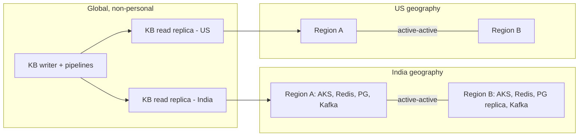

**Environments:**

- dev, test, sandbox (partner-facing, synthetic data), staging, and prod per geography.
- Infrastructure is provisioned through IaC with policy gates.
- Secrets are injected at runtime through workload identity.

**Recommended stack:**

| Area | Technology |
| --- | --- |
| Services | Python 3.11+ (FastAPI on uvicorn), as in the reference implementation; other runtimes for hot-path services if latency budgets require it |
| Data and ML | Python |
| Server SDKs | Python reference SDK (`sdk/python`); other languages generated from the OpenAPI contract |
| Android SDK | Kotlin |
| iOS SDK | Swift |
| Web SDK | JavaScript ES module without dependencies or build step (`sdk/web`) |

## 18. Multi-tenancy and configuration

Every partner has a versioned configuration document. Changes are audited and roll out progressively. In the
reference implementation the document is replaced as a whole with `PUT /admin/partners/{partnerId}/config`, validated,
written to the audit log (`CONFIG_REPLACED`) and picked up by every instance within 15 s.

```json
{
  "markets": ["IN"],
  "fee": {
    "rate": 0.10, "rule": "FP-1", "caps": { "perLine": "50.00", "perOrder": "120.00", "currency": "INR" },
    "recommendationAdd": {
      "enabled": true, "rule": "RA-1", "amount": "1.00", "currency": "INR", "basis": "PER_ADD_EVENT",
      "undoGraceSeconds": 5, "settleAfterSeconds": 600, "requireImpression": true, "impressionToleranceSeconds": 5,
      "chargeAccept": true, "maxChargeableAddsPerSuggestion": null, "monthlyCap": null
    }
  },
  "returnWindowDays": { "QUICK_COMMERCE": 2, "SCHEDULED_DELIVERY": 7 },
  "attributionWindowHours": 24,
  "placements": ["CART", "CHECKOUT"],
  "maxSuggestionsPerCart": 3,
  "maxAlternativesPerLine": 2,
  "priceGuards": { "maxNormalizedPriceRatio": 1.75, "maxAbsPremiumPerUnit": "150.00" },
  "priceBasis": "TAX_INCLUSIVE",
  "packSizeRatio": { "min": 0.5, "max": 2.0 },
  "availabilityMode": "MIRROR",
  "scoringProfile": "IN_DEFAULT_V1",
  "sponsored": { "allowed": false },
  "blockedBrands": [],
  "excludedCategories": ["infant-foods", "alcohol", "supplements"],
  "minorsPolicy": "STRICT",
  "locales": ["en-IN", "hi-IN", "ta-IN"],
  "killSwitch": false
}
```

`fee.recommendationAdd` holds the RA-1 terms (§9.10, [doc 06 §7](06-recommended-label-and-add-fee.md#7-partner-configuration)):

| Field | Default | Meaning |
| --- | --- | --- |
| `enabled` | `true` | RA-1 on or off for new suggestions |
| `rule` | `RA-1` | Rule version stamped on suggestions and charges |
| `amount` | `1.00` | Fee per add event, or per unit with `PER_UNIT`; 0 means not contracted |
| `currency` | `INR` | Must equal the cart currency, otherwise RA-1 does not apply |
| `basis` | `PER_ADD_EVENT` | `PER_ADD_EVENT` or `PER_UNIT` |
| `undoGraceSeconds` | `5` | Undo window, 0–3600 |
| `settleAfterSeconds` | `600` | Settlement window, at least `undoGraceSeconds` |
| `requireImpression` | `true` | An impression is required for FINAL |
| `impressionToleranceSeconds` | `5` | Clock-skew tolerance between client timestamps and the suggestion |
| `chargeAccept` | `true` | `ACCEPT` is chargeable (`ADD_TO_CART` always is) |
| `maxChargeableAddsPerSuggestion` | `null` | At most this many FINAL charges per suggestion |
| `monthlyCap` | `null` | At most this RA-1 amount per calendar month |

The reference implementation's configuration has further fields, among them `currency`, `taxRate`,
`paymentTermsDays`, `disputeWindowDays`, `inventoryStalenessSeconds`, `disabledPlacements`, `experiment`
(`holdoutPercent`) and `explorationRate`. Service settings that are not per partner (database, cache, LLM provider and
deployments, finalizer intervals, rate limits, webhooks) live in [config/settings.toml](../config/settings.toml),
overridden by `config/settings.<environment>.toml` and `HS_<SECTION>__<KEY>` environment variables
([doc 07 §8](07-reference-implementation.md#8-configuration)).

## 19. Testing strategy

| Layer | Approach |
| --- | --- |
| Unit and property-based | Fee math (rounding, caps, partial returns), unit conversions, rule engine. Property: fee ≤ r × (actual extra paid), always ≥ 0. |
| Scoring golden sets | Official worked examples and calculators for each model. OFF-computed Nutri-Score and NOVA as regression vectors (data use under ODbL). Nutritionist-reviewed edge cases. |
| Contract tests | OpenAPI-driven fuzzing (for example Schemathesis), consumer-driven contracts with SDKs, backward-compatibility checks in CI |
| Data quality | QA rules as code (doc 02 §10), drift monitors, curated audit samples per release |
| Performance | Load tests at 2× forecast peak with production-like cache sizes; soak tests; latency SLO gates |
| Resilience | Fault injection (Redis, regions, LLM gateway), kill-switch drills |
| Security | SAST, DAST, dependency and container scanning, pen tests, LLM red-teaming (prompt injection through product text) |
| LLM evaluation | Task golden sets: extraction field accuracy, substitutability agreement with humans, explanation factuality = 100% numeric match, zero banned claims |
| UX | Usability studies, dark-pattern review checklist, accessibility audits (WCAG 2.2 AA), localization QA |
| Billing | End-to-end simulations with synthetic orders, returns, disputes and RA-1 add events (undo within grace, late impressions, caps); month-close dry runs reconciled against partner reports |

## 20. Top risks

See the full register in [doc 05](05-implementation-roadmap.md#8-risk-register).

| Risk | Mitigation |
| --- | --- |
| Wrong allergen or diet information leads to harm | Deterministic allergen logic, strict "may contain" mode, conservative defaults, "check the label" disclosure, rapid takedown, liability terms |
| Poor Indian data coverage | Partner label images + OCR + curation, GS1 India DataKart licensing, brand portal, prioritization by sales velocity |
| Perceived upselling | Fee-neutral ranking, cheaper swaps shown, disclosures, published methodology, neutrality audits |
| Regulatory model changes (FSSAI INR, FDA FOP) | Pluggable versioned models, regulatory watch, re-score pipeline |
| Partner builds this in-house | Cross-platform data network, methodology credibility, faster integration, neutral third party |

## Appendix A — Error codes

| HTTP | `code` | Meaning |
| --- | --- | --- |
| 400 | `HS-REQ-INVALID` | Schema validation failed (see `errors[]`) |
| 400 | `HS-REQ-TOO-LARGE` | Line, item or event limits exceeded |
| 401 | `HS-AUTH-INVALID` | Missing or invalid token |
| 403 | `HS-AUTH-SCOPE` | Token lacks the required scope |
| 404 | `HS-NOT-FOUND` | Resource not found (or not visible to this partner) |
| 409 | `HS-IDEMPOTENCY-CONFLICT` | Same `Idempotency-Key` with a different request, or the first request is still being processed |
| 409 | `HS-ORDER-EXISTS` | The `orderId` was already reported |
| 409 | `HS-ORDER-STATE` | Invalid order state transition |
| 409 | `HS-DISPUTE-RESOLVED` | The dispute is already resolved (admin plane) |
| 422 | `HS-UNKNOWN-STORE` | `storeId` not registered |
| 422 | `HS-UNSUPPORTED-MARKET` | Market not enabled for this partner |
| 422 | `HS-CURRENCY-MISMATCH` | Cart or order currency differs from the partner's currency |
| 422 | `HS-DISPUTE-STATE` | The statement is not ISSUED or DISPUTED |
| 422 | `HS-DISPUTE-WINDOW-CLOSED` | The dispute window (`disputeWindowDays`) has closed |
| 422 | `HS-DISPUTE-CHARGE-UNKNOWN` | A disputed RA-1 charge is not FINAL on this statement |
| 422 | `HS-DISPUTE-LINE-UNKNOWN` | A disputed FP-1 line is not billed on this statement |
| 422 | `HS-ATTRIBUTION-REJECTED` | Reserved. The reference implementation accepts the order (201) and reports a non-attributable line as attribution state `REJECTED` with a `rejectionReason`. |
| 429 | `HS-RATE-LIMITED` | Quota exceeded; honor `Retry-After` |
| 503 | `HS-DEGRADED` | Temporary unavailability (decisioning returns 200 with `degraded=true` instead when possible) |

**Event rejections.** `POST /events` answers 202 and processes the valid events of a batch. Each rejected event is
listed in `rejected[]` with one of these codes, checked in this order:

| `code` | When |
| --- | --- |
| `HS-EVENT-UNKNOWN-SUGGESTION` | Unknown or expired `suggestionId`, including another tenant's suggestion |
| `HS-AUTH-SESSION-SCOPE` | An SDK session reported an event for a suggestion of another cart |
| `HS-EVENT-TIME` | `occurredAt` is more than 5 minutes in the future |
| `HS-EVENT-SKU-NOT-RECOMMENDED` | `ACCEPT` or `ADD_TO_CART` without `alternativePartnerSku`, or with a SKU the suggestion did not recommend |
