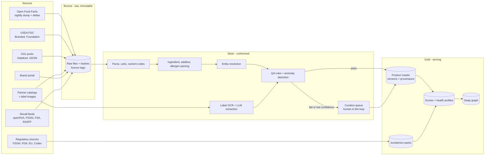
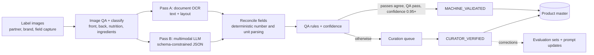

# 02 — Food Knowledge Base: building a multi-market composition database

> Goal: one canonical, versioned, provenance-tracked record per grocery product sold in India, the US and later
> markets. Each record covers nutrition, ingredients, additives, allergens, dietary marks, processing level and
> regulatory status, and is accurate enough to drive healthier-swap decisions.

## 1. Reality check: what exists and what doesn't

| Need | Does a regulator publish it? | Where the data really comes from |
| --- | --- | --- |
| Rules: what must be on a label, permitted additives, claim thresholds, allergen lists | **Yes**. FSSAI regulations (India), FDA 21 CFR and inventories (US), EU regulations, Codex standards. | Curated into versioned **jurisdiction packs** (§8) |
| Generic food composition (rice, dal, apples, milk) | **Yes, from nutrition institutes**. ICMR-NIN IFCT 2017 (India), USDA FoodData Central Foundation / SR Legacy / FNDDS (US), UK CoFID, and others. | Licensed or open tables mapped to generic products |
| **Branded product (SKU) composition** | **No.** FSSAI and FDA require the label but do not publish a product database. | Brand-submitted data (USDA FDC Branded Foods via data partners, GS1 data pools such as GS1 India DataKart and GDSN), Open Food Facts, partner catalogs (back-of-pack images), brand portal, label OCR |

The "full-fledged DB of all grocery items" is therefore an **aggregation and curation product**, not a download. It
is a core moat of the business.

## 2. Data domains

| Domain | Key fields | India (FSSAI L&D Regulations 2020) | US (21 CFR 101) |
| --- | --- | --- | --- |
| Identity | GTIN, brand, name, generic name, net quantity, pack count, category | Mandatory name, net quantity, FBO details, FSSAI licence number | Statement of identity, net quantity, manufacturer |
| Nutrition | Energy, protein, carbohydrate, total sugars, added sugars, total fat, saturated fat, trans fat, cholesterol, sodium, fibre, micronutrients | Mandatory nutrition information including added sugars, saturated and trans fat, sodium; per 100 g/ml or per serve with %RDA per serve | Nutrition Facts: calories, total/saturated/trans fat, cholesterol, sodium, total carbohydrate, dietary fibre, total and added sugars, protein, vitamin D, calcium, iron, potassium |
| Ingredients | Ordered list, sub-ingredients, percentages (QUID) | Descending order; additives declared by class title + INS number | Descending order of predominance; additives by common or usual name |
| Additives | INS / E number, name, functional class | INS numbers on pack | Names (for example "Red 40") |
| Allergens | Contains / may contain | Mandatory declaration list (gluten cereals, crustaceans, milk, eggs, fish, peanuts and tree nuts, soy, sulphites ≥ 10 mg/kg). Verify in the current compendium. | 9 major allergens (FALCPA + FASTER Act: milk, eggs, fish, crustacean shellfish, tree nuts, peanuts, wheat, soybeans, sesame) |
| Dietary and certification marks | Veg / non-veg symbol, vegan logo, organic, fortified (+F), halal, kosher | Veg/non-veg symbol mandatory; vegan logo (Vegan Foods Regulations 2022); Jaivik Bharat (organic); +F (fortification) | USDA Organic, third-party certifications (voluntary) |
| Claims | Low sugar, high fibre, ... | FSSAI Advertising & Claims Regulations 2018 | 21 CFR 101.13 and 101.54–101.65 (including "healthy") |
| Processing | NOVA group (derived) | — | — |
| Safety | Recalls, compliance flags | Food Recall Procedure Regulations 2017 | FDA enforcement reports |

## 3. Identifiers

- **GTIN normalization**: accept GTIN-8, -12 (UPC-A), -13 (EAN-13) and -14. Left-pad to 14 digits, validate the
  mod-10 check digit, and store as `primary_gtin CHAR(14)`.
- **Prefixes are not origin**: the `890` prefix means the barcode was issued by GS1 India. It does not prove the
  product was made in India. Restricted-circulation numbers (for example the `02x` and `2xx` ranges used for
  variable-measure, in-store items) are retailer-specific and **must not** be treated as global keys. Map them by
  partner SKU instead.
- **Loose produce**: IFPS PLU codes (4 digits; 5 digits with a leading 9 for organic) map to generic products.
- **Non-GTIN items** (private label without GTIN, local brands, bakery): create `INTERNAL` products keyed by
  partner SKU and link them across partners through entity resolution (§6).
- **Cross-references**: `FDC_ID`, `OFF_CODE` and `ONDC_ITEM` are stored in `kb.product_identifier`.

## 4. Source inventory

**Trust tiers** (used for survivorship, §7):

| Tier | Sources |
| --- | --- |
| T1 | Brand-verified |
| T2 | Authoritative or contractual datasets |
| T3 | Partner and network catalogs, curator-verified OCR |
| T4 | Community data |
| T5 | Machine-extracted, not yet verified |

### 4.1 Global / multi-market

| Source | What you get | Access | Licence / terms | Cadence | Tier |
| --- | --- | --- | --- | --- | --- |
| **Open Food Facts (OFF)** | Branded products worldwide: nutrition, ingredients, additives, allergens, labels, NOVA, Nutri-Score, images | Nightly full exports (JSONL, Parquet, CSV, MongoDB) + 14-day daily deltas. API v3 limited to 15 product reads/min/IP. Exports are for bulk use. | Database ODbL 1.0 (attribution + share-alike), contents DbCL, images CC BY-SA | Daily | T4 |
| Codex GSFA + INS list | Additive names, INS numbers, functional classes, provisions by food category | FAO/WHO online database | Public | Quarterly check | Reference |
| JECFA evaluations (WHO) | Acceptable daily intakes, evaluations | Online | Public | Quarterly | Reference |
| IARC Monographs | Hazard classifications (for example aspartame Group 2B, 2023) | Online lists | Public | Quarterly | Reference |
| GS1 GPC | Global Product Classification bricks for taxonomy alignment | Download | GS1 terms | Semiannual | Reference |
| GS1 data pools / GDSN (for example 1WorldSync, Syndigo, Salsify) | Brand-authored attributes including nutrition and ingredients | Commercial subscription | Contract | Continuous | T1–T2 |
| Verified by GS1 (GS1 Registry Platform) | GTIN key attributes (brand, company, description, image) | Member API | GS1 terms | Continuous | T2 (identity only) |

### 4.2 India

| Source | What you get | Access | Licence / terms | Cadence | Tier |
| --- | --- | --- | --- | --- | --- |
| FSSAI regulations (Labelling & Display 2020; Food Products Standards & Food Additives 2011, Appendix A; Contaminants, Toxins & Residues 2011; Advertising & Claims 2018; Vegan Foods 2022; Fortification 2018; Organic Food 2017; Food Recall Procedure 2017; Safe Food and Balanced Diets for Children in School 2020) | Mandatory label content, permitted additives and limits, claim thresholds, symbols, recall procedure | Regulations, compendiums and amendments on fssai.gov.in, curated into the IN pack | Government publication | Monitor notifications weekly | Reference |
| FSSAI FoSCoS | FBO licence and registration verification | Public lookup (no bulk API) | Government terms | On demand | Validation |
| ICMR-NIN IFCT 2017 | Composition of 528 key Indian foods | Publication (licensed) | NIN copyright; obtain a licence for commercial embedding | Rare | T2 (generic) |
| **GS1 India DataKart** (+ Smart Consumer app) | National product data repository: brand-uploaded GTIN-890 product data and images, FSSAI licence mapping, synced with the GS1 registry | Solution-provider or partner agreement | Contract | Continuous | T1–T2 |
| ONDC retail catalogs | Seller catalogs including statutory pre-packaged food fields (nutrition and additive text, FSSAI licence numbers; verify field names in the current ONDC retail contract) | As a network participant via `on_search` | ONDC network policies | Continuous | T3 |
| Partner catalogs (quick-commerce and e-grocery) | Titles, brand, pack, category, back-of-pack images (e-commerce operators must show mandatory label information before purchase) | Partner feed under contract | Partner-owned, used under contract | Daily + deltas | T3 |

### 4.3 United States

| Source | What you get | Access | Licence / terms | Cadence | Tier |
| --- | --- | --- | --- | --- | --- |
| **USDA FoodData Central: Branded Foods** | Brand-submitted label nutrition and ingredients with GTIN/UPC for hundreds of thousands of products | Bulk CSV/JSON (latest release Oct 2026, ~3 GB JSON) + API (1,000 req/h/IP, data.gov key) | **CC0** (public domain); cite FDC | Each release | T2 |
| USDA FDC: Foundation, SR Legacy, FNDDS | Generic food composition | Bulk + API | CC0 | Each release | T2 (generic) |
| FDA Substances Added to Food inventory | Food and color additives (21 CFR 172/173, 73/74), GRAS (182/184), prior-sanctioned (181), prohibited (189), delisted colors | Online inventory / download | Public | Monthly check | Reference |
| FDA GRAS Notices inventory | Notices and FDA responses | Online | Public | Monthly | Reference |
| FDA "healthy" final rule (Dec 2024) and FOP proposed rule (Jan 2025) | Criteria and thresholds | Federal Register and FDA pages | Public | On change | Reference |
| openFDA food enforcement | Food recalls 2004–present | REST API, weekly updates | openFDA terms | Weekly | Safety |
| Retailer developer APIs (Kroger Products, Walmart Affiliate, Instacart Developer Platform) | Live product attributes, availability, price | Program APIs | Program terms usually **restrict storage and use**. Use at request time within the program; do not ingest into the master. | — | Runtime only |

### 4.4 Other markets (phase 2+)

| Market | Composition and product data | Rules for the jurisdiction pack |
| --- | --- | --- |
| EU | OFF (dense coverage), GS1 data pools, national composition tables (EuroFIR network) | Reg. 1169/2011 (labeling, 14 allergens), Reg. 1333/2008 (additives, EU additives database), Reg. 1924/2006 (claims), Nutri-Score where adopted, EFSA OpenFoodTox |
| UK | OFF, GS1 UK, CoFID (McCance & Widdowson's) | Retained FIC rules, 2004/05 Nutrient Profiling Model (HFSS), FSA traffic-light FOP, FSA alerts |
| Canada | GS1 Canada, Canadian Nutrient File | Food and Drug Regulations, Lists of Permitted Food Additives, mandatory "High in" FOP symbol (from 2026) |
| Australia / NZ | GS1 AU, Australian Food Composition Database | FSANZ Food Standards Code, Health Star Rating (voluntary), PEAL allergen labeling |
| Singapore, Brazil, Mexico, Chile | GS1 local, OFF | Nutri-Grade (SG beverages), ANVISA magnifying-glass FOP (BR), NOM-051 octagons (MX), Ley 20.606 "ALTO EN" (CL) |

## 5. Licensing strategy and guardrails

1. **Field-level licence tags.** Every stored value carries `license_code` and a `source_record_id`
   (`kb.field_provenance`). This makes any of the compliance options below executable without re-engineering.
2. **Open Food Facts (ODbL)**:
   - Attribute OFF wherever its data is used publicly ("Contains data from Open Food Facts, available under the
     Open Database License").
   - If an *adapted database* that includes OFF data is used publicly (and serving partners counts as public use
     under ODbL), that adapted database must be offered under ODbL.
   - Pick one strategy with counsel:
     - **(a)** Keep OFF-derived records as an isolated ODbL layer, contribute corrections back, and keep proprietary
       layers separate.
     - **(b)** Use OFF only for discovery and validation, and capture values from primary sources (brand, GS1,
       label images you are licensed to use).
     - **(c)** Openly publish the derived database under ODbL and keep the moat in operations, scoring and
       integrations.
   - Don't display OFF images in partner UIs (CC BY-SA, possible third-party rights). Partners use their own images.
3. **USDA FDC (CC0)**: free use; cite FDC.
4. **GS1 data pools and DataKart**: negotiate permitted uses (scoring, display, derived works), sublicensing to
   partners, and retention after termination.
5. **Partner catalogs**: partner-owned. Contracts should include a *catalog enrichment* clause: the partner allows
   factual label data (nutrition, ingredients) read from its images to improve the canonical record, and in return
   receives enriched structured data. Without that clause, keep partner-derived facts tenant-scoped.
6. **Retailer program APIs**: use only as their terms allow (typically live calls, no bulk storage).
7. **Composition tables**: IFCT 2017 requires a licence for commercial use. USDA tables are CC0. Check each national
   table's licence (for example the UK Open Government Licence).
8. **Never scrape** partner websites or apps. It breaches terms of service, creates legal exposure and destroys
   partner trust.

## 6. Ingestion architecture

**Mechanics:**

- **Bronze** stores raw objects unchanged, with SHA-256 hashes, fetch metadata and licence tags. Bronze is the
  replay source for every downstream table.
- **Silver** jobs are idempotent and deterministic for a given input hash and code version. They run in batch for
  dumps and releases, and as streams for partner deltas and brand edits.
- **Gold** writes create new product versions (SCD-2) and emit CDC events (`hs.kb-product-changes.v1`), which trigger
  re-scoring and incremental swap-graph rebuilds.
- **OFF specifics**:
  - Filter by `countries_tags` for the target markets.
  - Process the nightly delta files in timestamp order.
  - Run a weekly full-dump reconciliation, because deltas don't carry deletions.
- **USDA specifics**: load each Branded release, diff on `fdcId` / GTIN and modified dates, and keep previous versions
  for audits.

## 7. Normalization, parsing, resolution and survivorship

### 7.1 Normalization rules

| Topic | Rule |
| --- | --- |
| Basis | Store per 100 g (solids) and per 100 ml (liquids) as primary, plus per serving with serving size. Never guess densities; mark mixed cases (liquids declared per 100 g) for review. |
| Energy | 1 kcal = 4.184 kJ. Store kcal canonically and keep kJ when declared. |
| Salt and sodium | Salt = sodium × 2.5 (EU convention). US and India labels declare sodium (mg); EU labels declare salt (g). Store both, flag which one was declared. |
| Carbohydrate definition | US "total carbohydrate" includes dietary fibre. EU declares available carbohydrate. Store `carb_definition` and convert for models that need it. |
| Added sugars | Declared in the US and India, not in the EU. Models that need added sugars fall back to total sugars when it is unknown. |
| Vitamins | Normalize to metric (for example vitamin D: 1 µg = 40 IU). |
| Nutrient vocabulary | INFOODS tagnames (`ENERC_KCAL`, `PROCNT`, `CHOCDF`, `SUGAR`, `SUGAD`, `FAT`, `FASAT`, `FATRN`, `CHOLE`, `NA`, `FIBTG`) plus custom codes (`SALT`, `FVLN_PCT`) |
| Fruit / vegetable / legume / nut % | From QUID percentages when declared. Otherwise a deterministic estimator over the ingredient list, stored with `is_estimated = true`. |

### 7.2 Ingredient, additive and allergen parsing

- **Languages**: Indian labels are in English and/or Hindi (Devanagari), sometimes with regional languages. US labels
  are in English, sometimes Spanish. Use language ID per segment.
- **Tokenizer** handles nested parentheses and brackets, percentages, "and/or" lists, and class titles with INS
  numbers, for example `Emulsifier (INS 322(i))`, `Raising agents (INS 500(ii), 503(ii))`, `Colour (INS 150d)`.
  It also handles US names such as `Red 40`, `Yellow 5 Lake`, `Caramel color`, and EU codes such as `E330`.
- **Ingredient taxonomy**: canonical ingredients with aliases per language (for example *maida* → refined wheat
  flour; *atta* → whole wheat flour; *til* → sesame; *groundnut* → peanut; *vanaspati* → partially hydrogenated
  vegetable fat). Flags include `ADDED_SUGAR`, `REFINED_FLOUR`, `WHOLE_GRAIN`, `PHO`, `NNS` (non-sugar sweetener),
  `FRUIT_VEG_LEGUME`.
- **Additive master**: INS ↔ E-number ↔ US names ↔ CAS ↔ aliases, plus Codex functional classes. For example,
  INS 129 = E129 = Allura Red AC = FD&C Red No. 40.
- **Allergens** are derived two ways and then reconciled:
  1. From "Contains" / "May contain" statements.
  2. From the ingredient taxonomy (for example *whey* → MILK, *semolina / suji* → GLUTEN_CEREALS + WHEAT).

  Precautionary statements map to `MAY_CONTAIN`. Allergen logic is fully deterministic. LLMs never decide allergens.
- **Dietary marks**:
  - The veg / non-veg symbol comes from the label image or partner attribute.
  - The vegan logo is per the FSSAI Vegan Foods Regulations 2022.
  - "Jain-friendly" is not regulated. It may only be **inferred** (no meat, egg, onion, garlic or root vegetables)
    and is labeled as inferred.
  - Halal and kosher come only from certification marks.

### 7.3 Entity resolution

1. **GTIN exact match**: same product, unless brand or size conflict, which flags possible GTIN reuse or bad data.
2. **Blocking** without GTIN: normalized brand + category + net-quantity bucket.
3. **Pairwise classifier** (gradient-boosted trees). Features:
   - Name trigram similarity and multilingual title embedding cosine.
   - Brand match and size equality.
   - Per-100 g nutrition vector cosine and ingredient Jaccard.
   - Front-image perceptual hash distance.

   Thresholds: ≥ 0.95 auto-merge, 0.75–0.95 review, < 0.75 new product.
4. **Clustering** with constraints: never merge two different GTINs unless they are linked as multipack or alias.
5. **Product families**: the same recipe across pack sizes (equal per-100 g nutrition and ingredients) shares a
   `family_id`, so new pack sizes inherit verified composition after a light check.

### 7.4 Survivorship (field-level)

- Pick the value from the highest trust tier with the most recent label version. Keep every candidate value in
  `kb.field_provenance` with `is_selected` set on the chosen one.
- If the top two sources disagree beyond tolerance (macros > 10% relative, sodium > 15%, any allergen difference),
  mark the field `CONFLICT` and send it to curation. **Never average conflicting values.**
- OFF (T4) never overrides T1–T3. Unverified machine extraction (T5) can only fill gaps, and only after passing QA.
  An LLM is **never** the source of a nutrient number.

### 7.5 Data sufficiency

| Level | Criteria | Usable as |
| --- | --- | --- |
| `SUFFICIENT` | Energy, sugars, saturated fat, sodium/salt, protein, fibre (or a model-allowed estimate); ingredients ≥ 90% tokens resolved; allergen data with confidence ≥ 0.98 or curator/brand verified; category assigned; net quantity | Original **and** alternative |
| `PARTIAL` | HSI computable with estimates; some fields missing | Original only (it can receive suggestions) |
| `INSUFFICIENT` | HSI not computable | Neither (no suggestions involve this product) |

## 8. Jurisdiction packs (regulatory reference data)

A jurisdiction pack is a versioned, effective-dated bundle in `reg.*`:

| Element | India | US | EU |
| --- | --- | --- | --- |
| Mandatory nutrients and bases | FSSAI L&D 2020 | 21 CFR 101.9 | Reg. 1169/2011 Annex XV |
| Allergen list | FSSAI L&D 2020 | FALCPA + FASTER (9) | Reg. 1169/2011 Annex II (14) |
| Additive permissions and limits | FPS&FA 2011 Appendix A | 21 CFR 172/173/182/184, 73/74, 189 | Reg. 1333/2008 Annex II |
| Additive concern tiers | Derived (doc 03 §2.3) | Derived | Derived |
| Claim thresholds | Advertising & Claims 2018 | 21 CFR 101.13, 101.54–101.65 | Reg. 1924/2006 Annex |
| FOP scheme | INR draft (2022), status to verify | Nutrition Info box (proposed Jan 2025) | Nutri-Score (where adopted) |
| Daily values / reference intakes | ICMR-NIN based references used by FSSAI | 21 CFR 101.9(c) | Reg. 1169/2011 Annex XIII |

**Example claim thresholds to encode.** These are illustrative; verify each against the current official text.

- "Low sugar": ≤ 5 g sugars per 100 g (solids) or ≤ 2.5 g per 100 ml (liquids). This is the common Codex / EU /
  FSSAI pattern.
- Comparative claims ("less", "reduced") need a minimum relative difference. Codex guidance uses ≥ 25% for
  macronutrients; EU "reduced" claims use ≥ 30%.

The explanation engine only uses claim-style wording when the threshold is met (doc 03 §8).

**Process:**

- A regulatory analyst watches official notifications weekly. Changes go through a pack PR with citations
  (`reg.document`) and nutrition-scientist review.
- After publish, affected products are re-scored and partners are notified.

## 9. Label OCR and LLM extraction pipeline

- **Verbatim first**: the LLM transcribes table cells and ingredient text *as printed*. Numbers, units and bases are
  parsed **deterministically** downstream. This sharply reduces hallucination risk. The extraction schema is in
  [doc 03 §9.4](03-health-scoring-recommendation-llm.md#94-prompt-and-schema-examples).
- **Dual-pass agreement** (OCR engine vs multimodal LLM) is required for auto-acceptance.
- **Allergen and diet fields**: if the shopper has declared allergens, OCR-sourced allergen data can only be used for
  an *alternative* after curator or brand verification.
- **Multilingual**: Devanagari and regional scripts are supported. Bilingual labels are reconciled.
- **Cost control**: batch inference, deduplication by image perceptual hash, and prioritization by sales velocity.

## 10. Data quality rules (as code)

The rules run on every ingested record (`QaRules` in
[quality.py](../src/healthswap/domain/knowledge/quality.py)). Values are per 100 g (solids) or per 100 ml (liquids),
and a missing value counts as 0 in sums. *C* is carbohydrate as declared. *C_avail* is available carbohydrate: *C* −
fibre (at least 0) when the label uses the US total-carbohydrate definition (`TOTAL_INCL_FIBRE`), otherwise *C*.
Salt (g) is the declared salt or 2.5 × sodium (g); sodium (mg) is the declared sodium or 400 × salt (g). Review and
quarantine findings open curation tasks (QA-11 and QA-14 at P1, the others at P2).

| ID | Check | Action on fail |
| --- | --- | --- |
| QA-01 | Energy consistency: \|E − (4·P + 4·C_avail + 9·F + 2·Fibre)\| ≤ max(15% of E, 20 kcal); checked when energy, protein, carbohydrate and fat are declared | Review |
| QA-02 | Sugars ≤ C + 0.5 g | Reject field (sugars dropped) |
| QA-03 | Added sugars ≤ total sugars + 0.5 g | Reject field (added sugars dropped) |
| QA-04 | Saturated + trans fat ≤ total fat + 0.5 g | Reject field (saturated and trans fat dropped) |
| QA-05 | Mass balance, solids only: P + F + C + salt ≤ 105 g per 100 g, adding fibre only when *C* is available carbohydrate. US total carbohydrate already includes fibre, so fibre is not counted twice. | Review |
| QA-06 | Sodium ≤ 40,000 mg (40 g) per 100 g; robust z-score within category ≤ 4 (category-level job, not in the reference implementation) | Review |
| QA-07 | Per-serving energy ≈ energy per 100 × serving size / 100 (±5%) | Review |
| QA-08 | Salt ≈ 2.5 × sodium (±10%) when both declared | Review |
| QA-09 | Unit sanity: sodium declared in "g" with a value > 10 is read as mg | Auto-fix with a finding, then review (`QaRules.fix_sodium_unit`; not yet called by the reference connectors) |
| QA-10 | Ingredient-derived allergens ⊆ allergens declared as contained (for example "milk solids" requires MILK) | Flag; conservative union for safety |
| QA-11 | Veg symbol contradicted by ingredients (gelatin, egg, fish sauce) | Flag + quarantine from veg-constrained swaps |
| QA-12 | Last verification older than 24 months (730 days) | Re-verify queue (review) |
| QA-13 | GTIN check digit valid | Reject identifier; the reference ingestion rejects the record (`HS-REQ-INVALID`, "QA-13 invalid GTIN") |
| QA-14 | Additive prohibited in the market of sale (Tier A) | Compliance flag; product quarantined from swaps |

Example for QA-05, from `test_qa05_does_not_double_count_us_fibre` in
[tests/domain/test_knowledge.py](../tests/domain/test_knowledge.py): a US label with 10 g protein, 2 g fat and 85 g
total carbohydrate that includes 10 g fibre sums to 97 g and passes. The same values under the AVAILABLE definition
add the fibre (107 g) and go to review.

## 11. Reformulation and versioning

- A new normalized label hash creates a new `kb.product_version`: `valid_from` is set and the previous version is
  closed. Scores and health profiles are computed **per version**. Suggestions record the version IDs they used, so
  any decision can be replayed for audits.
- **Detection signals**: partner image hash changes, brand portal updates, FDC release diffs, OFF edits.
- **Overlap window** (old and new stock coexist): allergens use the **union** of versions, and eligibility uses the
  more conservative nutrient values until the partner confirms the new version.

## 12. Recalls and safety

| Feed | Market | Handling |
| --- | --- | --- |
| openFDA food enforcement (weekly) | US | Match by UPC or code info + fuzzy description match. Classification I/II → quarantine. |
| FSSAI recall notices | IN | Semi-automated ingestion with analyst confirmation |
| FSA alerts | UK | API ingestion |
| RASFF Window | EU | Ingestion + analyst triage |

Quarantined products are never suggested as alternatives. Optionally, partners get a webhook when a product in
their catalog matches a recall.

## 13. Coverage strategy

- **Prioritize by demand**: rank the partner's SKUs by cart frequency and work down the list.
- **Coverage targets**: ≥ 90% of cart lines (by count) `SUFFICIENT` in pilot categories before launch; ≥ 80%
  overall at general availability.
- **Pilot categories (India)**: beverages, biscuits and cookies, namkeen and chips, instant noodles and pasta,
  breakfast cereals and oats, flavored milk and yogurt, bread, sauces and spreads, ready-to-eat / ready-to-cook mixes,
  frozen snacks.
- **Pilot categories (US)**: cereals, beverages, salty snacks, yogurt, bread, frozen meals, cookies and crackers,
  sauces and dressings.
- **Fresh and loose items** map to generic composition data (IFCT 2017, USDA Foundation / SR Legacy). These are rarely
  swap targets.
- **Dashboards** show coverage by partner, category and source, plus curation backlog burn-down and QA failure rates.

## 14. Brand portal

- **Ownership proof**: GS1 company-prefix verification (GS1 India or Verified by GS1) plus FSSAI licence match for
  India.
- **Submission**: structured attributes (GDSN-like), label images, certificates, reformulation notices. QA rules run
  on submit, with a diff against the current version.
- **Publishing**: the brand-verified (T1) version goes live after checks, with random audits.
- **Integrity**: brands can dispute *data*, never buy *scores*. Score disputes are answered with the methodology and
  fact sheet.
- **Insights** (future, aggregated and anonymized): how often a product is swapped away, and reformulation
  opportunities. Data-sharing contracts must allow this.

## 15. Curation operations

- **Roles**: data curator, nutrition scientist (approves substitution maps and scoring edge cases), regulatory
  analyst (jurisdiction packs), QA lead.
- **Tooling**: side-by-side image vs extracted fields, keyboard-first flows, audit trail, blind double-annotation on
  samples to measure inter-annotator agreement.
- **SLAs**: P1 (top 1,000 SKUs of a live partner) 24 h; P2 72 h; P3 best effort.
- **Quality**: ≥ 98% field accuracy on weekly audits; curator calibration sessions monthly.

## 16. Build sequence for the knowledge base

1. Fix the canonical model ([db/schema.sql](../db/schema.sql)), the nutrient vocabulary and a category taxonomy
   aligned to GS1 GPC with India-specific leaves (namkeen, papad, achaar, ghee, paneer, atta, besan, poha, dosa
   batter, ...).
2. Stand up the lake (bronze, silver, gold), the PostgreSQL master and an orchestrator.
3. Ingest USDA FDC (Branded + Foundation + SR Legacy). This is the CC0 quick win for the US.
4. Ingest OFF (full dump + daily deltas) into an isolated ODbL layer, filtered to target countries.
5. Build the IN and US jurisdiction packs: allergens, Codex INS master + FSSAI Appendix A + FDA inventories, claim
   thresholds, FOP thresholds, daily values.
6. Implement normalization, parsers and the QA rules, each with golden tests.
7. Entity resolution v1 (GTIN), then v2 (fuzzy + embeddings + images).
8. Run the scoring engine on gold ([doc 03](03-health-scoring-recommendation-llm.md)).
9. Build the OCR pipeline and curation portal. Fill India gaps from pilot-partner label images.
10. License and integrate GS1 India DataKart and a US data pool.
11. Launch the brand portal.
12. Wire up recall feeds.
13. Build coverage dashboards and the prioritization loop with pilot-partner sales data.
14. Release process: versioned snapshots, data release notes, one-click rollback.
