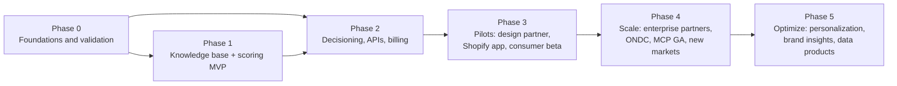

# 05 — Implementation Roadmap: steps to build HealthSwap end to end

> Phases are ordered by dependency and gated by exit criteria, not by calendar dates. Each phase ends with a
> go / no-go review.

## 1. Delivery principles

- **Prove value before scale.** A shadow-mode report on a real partner catalog is the most persuasive sales asset.
- **Data and methodology first.** Without a credible knowledge base and published scoring, no partner will
  integrate.
- **Contract-first engineering.** [openapi.yaml](../api/openapi.yaml) and [schema.sql](../db/schema.sql) are the
  source of truth. Generate SDKs and server stubs from them.
- **Safety and trust are features.** Allergen correctness, neutrality and dark-pattern-free UX are release criteria,
  not polish.

## 2. Phase plan

| Phase | Objectives | Key deliverables | Exit criteria |
| --- | --- | --- | --- |
| **0 Foundations and validation** | Validate who pays and how much; legal guardrails; methodology draft; landing zones | Partner interview synthesis (≥ 9 conversations across IN, US and Shopify grocers); counsel memos (claims, privacy, ODbL, tax); Nutrition Advisory Board formed; methodology v0; cloud landing zones per geography; security baseline | At least 2 design partners sign LOIs; fee model confirmed (who pays, caps); no legal blockers |
| **1 Knowledge base + scoring MVP** | Credible composition data and scores for pilot categories | USDA FDC + OFF ingestion; IN/US jurisdiction packs; parsers and QA rules; entity resolution v1/v2; curation portal + OCR v1; scoring models with official test vectors; HSI calibration; swap graph v1 for 10 pilot categories | ≥ 90% `SUFFICIENT` coverage of the design partner's top SKUs in pilot categories; nutritionist panel ≥ 95% agreement on 500 sampled swaps; zero allergen or diet violations in audits |
| **2 Decisioning, APIs, billing** | Production-grade hot path and money path | Gateway + OAuth + quotas; catalog and inventory services; cart evaluation orchestrator; explanations (templates + validated LLM); events; orders, attribution and fee engine; ledger, statements, disputes; webhooks; privacy service; observability; server and UI SDKs; MCP server | Load test at 2× forecast peak with p99 ≤ 150 ms; fee engine property tests green; month-close dry run balanced; pen test with no open highs; SOC 2 Type I readiness |
| **3 Pilots** | Measured impact with real shoppers | Design partner live (shadow → dogfood → A/B); Shopify app submitted and approved; consumer app beta (optional) with Instacart / Kroger hand-offs | A/B shows positive IHGMV and AOV with no significant conversion harm; undo < 10%; complaints < 0.05% of impressions; statements reconciled at 100% |
| **4 Scale** | More partners, channels and markets | Enterprise integrations (IN q-commerce, US grocers); second region pair per geography; ONDC integration; MCP GA; UK/EU (Nutri-Score) and Canada packs; brand portal GA; SOC 2 Type II, ISO 27001/27701 | SLOs met for 3 consecutive months; ≥ 3 paying enterprise partners; gross margin positive per partner |
| **5 Optimize** | Better acceptance, deeper value | Consent-based personalization and goals; better substitutability models; brand reformulation insights (aggregated); catalog-enrichment SaaS; public-health impact reports | Continuous improvement targets per KPI (§7) |

## 3. Step-by-step build checklist

| # | Track | Step |
| --- | --- | --- |
| 1 | A. Foundations | Engage counsel for food law and claims (FSSAI, FDA/FTC, EU), privacy (DPDP, GDPR, US state laws), data licensing (ODbL, GS1, IFCT) and tax (GST/TDS, US). |
| 2 | A. Foundations | Form the Nutrition Advisory Board. Draft and circulate methodology v0 (doc 03). |
| 3 | A. Foundations | Run partner discovery. Confirm the fee payer, caps, return windows, placements and data-sharing appetite. |
| 4 | A. Foundations | Choose a cloud and geographies (India and US first). Build landing zones with IaC, policy-as-code and workload identity. |
| 5 | A. Foundations | Set up the security baseline: SSO / MFA, secrets vault, central logging, CI/CD with SAST, SCA, SBOM and signed images. |
| 6 | B. Knowledge base | Apply [schema.sql](../db/schema.sql) through a migration tool. Load reference seeds (nutrients, allergens, jurisdictions, marks). |
| 7 | B. Knowledge base | Build the lakehouse (bronze, silver, gold) and the orchestrator. Add connectors for USDA FDC releases and OFF dumps and deltas, with licence tagging. |
| 8 | B. Knowledge base | Implement normalization and parsers (units, nutrients, ingredients, additives, allergens, dietary marks) plus the QA rules (doc 02 §10), each with golden tests. |
| 9 | B. Knowledge base | Publish the IN and US jurisdiction packs, with citations recorded in `reg.document`. |
| 10 | B. Knowledge base | Entity resolution v1 (GTIN) and v2 (blocking + pairwise model + clustering + families). |
| 11 | B. Knowledge base | Curation portal v1 and OCR pipeline v1 (dual-pass agreement, human in the loop). |
| 12 | B. Knowledge base | Build the category taxonomy (GPC-aligned + India leaves) and pilot substitution maps. Get board approval. |
| 13 | C. Scoring and swap graph | Implement `IN_INR_DRAFT` / `HSR`, `NUTRISCORE_2023`, `US_FDA_FOP`, `US_FDA_HEALTHY`, `UK_NPM_2004`, NOVA and additive tiers. Validate against official calculators and test vectors. |
| 14 | C. Scoring and swap graph | Implement HSI and health profiles. Calibrate grades per category. Publish to cache. |
| 15 | C. Scoring and swap graph | Add embeddings and ANN retrieval. Label substitutability with an LLM (sampled) plus human gold. Train a calibrated classifier. |
| 16 | C. Scoring and swap graph | Build the swap-graph builder with validation gates and blue/green publishing. |
| 17 | D. Decisioning, money path, operations | API gateway: OAuth 2.0, scopes, quotas, idempotency, RFC 9457 errors. Use OpenAPI-first code generation. |
| 18 | D. Decisioning, money path, operations | Catalog ingestion and matching (pre-signed uploads, match states, review webhooks). |
| 19 | D. Decisioning, money path, operations | Inventory mirror (`MIRROR`) and `PARTNER_FILTER` mode. |
| 20 | D. Decisioning, money path, operations | Cart evaluation orchestrator with the latency budget, degradation ladder and kill switches. |
| 21 | D. Decisioning, money path, operations | Explanation templates (en-IN, hi-IN, en-US first), plus LLM pre-generation behind the validator chain. |
| 22 | D. Decisioning, money path, operations | Event collector and experiment assignment, with holdouts. |
| 23 | D. Decisioning, money path, operations | Orders, the attribution state machine and the fee engine (fair-premium rule FP-1), with property-based tests. |
| 24 | D. Decisioning, money path, operations | Ledger (append-only, balanced), month close, statements, invoices, disputes, credit notes. |
| 25 | D. Decisioning, money path, operations | Webhook dispatcher: signing, retries, DLQ, replay. |
| 26 | D. Decisioning, money path, operations | Privacy service: consent records, erasure, retention jobs, DSAR runbooks. |
| 27 | D. Decisioning, money path, operations | Observability: SLOs, dashboards, burn-rate alerts, business KPI pipelines, public status page. |
| 28 | E. SDKs and channels | Server SDKs (TypeScript, .NET, Java/Kotlin, Python, Go) generated from OpenAPI, with resilience defaults. |
| 29 | E. SDKs and channels | UI SDKs (Android, iOS, Web) with theming, accessibility, localization and event batching. |
| 30 | E. SDKs and channels | MCP server: tool schemas, OAuth, agent policy, rate limits. |
| 31 | E. SDKs and channels | Shopify app: theme app extension, webhooks, usage billing, compliance webhooks, app review. |
| 32 | E. SDKs and channels | Optional consumer app beta: scanning; Instacart Developer Platform and Kroger Cart hand-offs. |
| 33 | F. Readiness and pilots | Pen test, SOC 2 Type I, DPA and sub-processor list, security questionnaire pack. |
| 34 | F. Readiness and pilots | Publish methodology v1 and the neutrality policy. |
| 35 | F. Readiness and pilots | Onboard the design partner: catalog → enrichment → shadow report → dogfood → A/B. |
| 36 | F. Readiness and pilots | Reconciliation dry run with partner finance. |
| 37 | F. Readiness and pilots | Go / no-go review → staged ramp. |
| 38 | G. Scale | Second region pair per geography; DR drills; capacity reviews. |
| 39 | G. Scale | ONDC integration (technology provider and/or own buyer app). |
| 40 | G. Scale | New market packs (UK/EU, Canada), brand portal GA, SOC 2 Type II, ISO 27001/27701. |

## 4. Team and roles (initial core)

| Function | Roles |
| --- | --- |
| Product | Product manager (platform), product manager (partners and SDKs) |
| Engineering | Architect / tech lead; 4 backend (.NET); 2 data engineers; 1 ML engineer; 1 AI/LLM engineer; 2 SDK engineers (mobile + web); 1 SRE/platform; security engineer (shared) |
| Nutrition and data | Lead nutrition scientist; regulatory analyst (IN/US); 3–6 data curators (scaled to backlog) |
| Business | 1–2 partnerships / BD; finance ops (fractional); external counsel |
| Governance | Nutrition Advisory Board (3–5 independent experts) |

## 5. Engineering practices

- **Monorepo** per plane (decisioning, knowledge, billing) with shared contracts. Trunk-based development with
  feature flags.
- **Environments**: dev → test → sandbox (partner-facing, synthetic data) → staging → prod per geography. Promotion
  through pipelines with automated gates: contract tests, load-test SLO gates, data-quality gates.
- **Data releases**: knowledge-base and swap-graph releases are versioned artifacts with release notes and one-click
  rollback.
- **Incident management**: on-call rotations, severity matrix, partner communications templates, post-incident
  reviews.

## 6. Unit economics (illustrative; validate in pilots)

$$Fees_{day} = Orders \cdot r_{eligible} \cdot r_{shown} \cdot r_{accept} \cdot swaps_{per\ cart} \cdot \overline{premium} \cdot fee\ rate \cdot (1 - r_{return})$$

| Input | IN partner (example) | US partner (example) |
| --- | --- | --- |
| Orders/day | 1,000,000 | 500,000 |
| Eligible carts (≥ 1 eligible line) | 60% | 60% |
| Shown (placement and frequency caps) | 50% | 50% |
| Accept rate (carts) | 6% | 6% |
| Swaps per accepting cart | 1.2 | 1.2 |
| Average fair premium | ₹35 | $1.40 |
| Fee rate | 10% | 10% |
| Return/void rate | 2% | 3% |
| **Fees/day** | **≈ ₹74,000** (≈ ₹2.7 crore/yr) | **≈ $1,470** (≈ $0.54 M/yr) |
| Partner incremental GMV/day (premium only) | ≈ ₹7.6 lakh | ≈ $15,100 |

**Implications:**

- Revenue from the 10% fee alone is modest per partner. It is meaningful only across many partners.
- Pair it with:
  - SaaS (M3): catalog enrichment, dashboards and compliance checks.
  - Shopify and other app-store scale (M4).
  - Later, labeled brand programs.
- The biggest early variable cost is likely curation labor and OCR backlog for India. Infrastructure is dominated by
  Redis memory, event throughput, PostgreSQL HA, lake compute for graph builds, and LLM batch jobs. Size these with
  the provider's pricing calculator once partner volumes are known.

## 7. KPIs and guardrails

| Group | KPI |
| --- | --- |
| North star | Accepted healthier swaps per 1,000 orders; Incremental Healthy GMV |
| Health impact | Mean ΔHSI per accepted swap; sugar (g) and sodium (mg) avoided per 1,000 orders; share of baskets with improved HSI |
| Funnel | Coverage (lines scored), eligible-cart rate, impression rate, acceptance rate, undo rate |
| Partner outcomes | AOV uplift; checkout conversion delta (guardrail); repeat-purchase rate of swapped items |
| Platform | Availability, p95/p99 latency, degradation-level minutes, inventory staleness, graph age |
| Data | Field accuracy (audits), QA failure rate, curation backlog and SLA, source freshness |
| Finance | Fee revenue, reconciliation match rate, dispute rate, days sales outstanding |
| Trust | Share of cheaper suggestions, rank–price correlation, complaint rate, allergen incidents (target 0) |

## 8. Risk register

| # | Risk | Likelihood | Impact | Mitigation | Owner |
| --- | --- | --- | --- | --- | --- |
| 1 | Large platforms decline or delay partnerships | High | High | Shadow-mode value reports; start with mid-size partners, Shopify and ONDC; consumer app to prove demand; flexible commercial models (M3) | BD lead |
| 2 | Partner builds it in-house | Medium | High | Cross-platform knowledge base and methodology credibility, neutral third party, faster integration, catalog-enrichment value | CEO / product |
| 3 | Incorrect allergen or diet data causes harm | Low | Critical | Deterministic rules, verified allergen data for alternatives, strict mode, "check the label" disclosure, rapid takedown, insurance | Nutrition lead |
| 4 | Poor India data coverage or quality | High | High | Partner image OCR + curation, DataKart licensing, brand portal, velocity-based prioritization | Data lead |
| 5 | Perceived upselling or conflict of interest | Medium | High | Fee-neutral ranking, cheaper swaps shown, disclosures, published neutrality audits | Product |
| 6 | Regulatory changes (FSSAI FOP, FDA FOP, additive bans) | High | Medium | Pluggable versioned models, regulatory watch, fast re-score pipeline | Regulatory analyst |
| 7 | Health or claims compliance violation in copy | Medium | High | Claim thresholds, banned-term filters, legal-reviewed templates, no LLM free text without validation | Legal + AI lead |
| 8 | ODbL or data-licence non-compliance | Medium | High | Field-level licence tags, chosen ODbL strategy, attribution, contribute-back process | Legal + data lead |
| 9 | Privacy breach or residency violation | Low | Critical | No direct identifiers, in-geo storage, encryption, least privilege, audits, breach runbooks | Security lead |
| 10 | Latency or availability issues hurt partner conversion | Medium | High | Fail-open SDKs, precomputed graph, cache-only hot path, SLO gates, kill switches | SRE lead |
| 11 | LLM hallucination or prompt injection through product text | Medium | Medium | Verbatim extraction, deterministic parsing, validators, no tools in extraction, red-teaming | AI lead |
| 12 | Fee disputes and reconciliation friction | Medium | Medium | Evidence chain, line-level statements, reconciliation API, clear contract definitions | Finance ops |
| 13 | Low acceptance rates | Medium | High | Substitutability quality, price guards, better placements, A/B iteration, goal-based framing | Product + ML |
| 14 | Data poisoning from community sources | Low | Medium | Trust tiers, anomaly detection, OFF never overrides T1–T3 | Data lead |
| 15 | Cost overrun (LLM / curation) | Medium | Medium | Batch inference, distillation, caching, prioritization, budget alerts | Engineering manager |

## 9. Go / no-go gates

| Gate | Questions | Evidence |
| --- | --- | --- |
| G0 → Phase 1 | Is there a buyer and a viable fee model? Any legal blockers? | LOIs, counsel memos |
| G1 → Phase 2 | Is the data credible for pilot categories? | Coverage dashboard, nutritionist audit, QA metrics |
| G2 → Pilot | Is it safe, fast and billable? | Load and resilience tests, pen test, fee/ledger tests, privacy runbooks |
| G3 → Scale | Does it create value without harming conversion or trust? | A/B readout, reconciliation report, complaint and neutrality metrics |

## 10. Immediate next actions

1. Hold 10 partner discovery calls (4 India quick-commerce / e-grocery, 3 US grocers, 3 Shopify food merchants). Use
   them to validate the fee payer, caps and placements.
2. Get counsel opinions on the ODbL strategy, comparative-claim wording (IN/US) and the DPA template.
3. Build a vertical prototype:
   - USDA FDC + OFF for 3 categories (cereals, biscuits/cookies, soft drinks).
   - Scoring + eligibility rules.
   - 200 swaps hand-reviewed by a nutritionist.
   - The `/cart-evaluations` endpoint running against the prototype graph.
4. Create a clickable `SwapSheet` prototype (en-IN, hi-IN, en-US) and run a dark-pattern review.
5. Offer a design partner a no-cost shadow-mode report on their catalog export.
