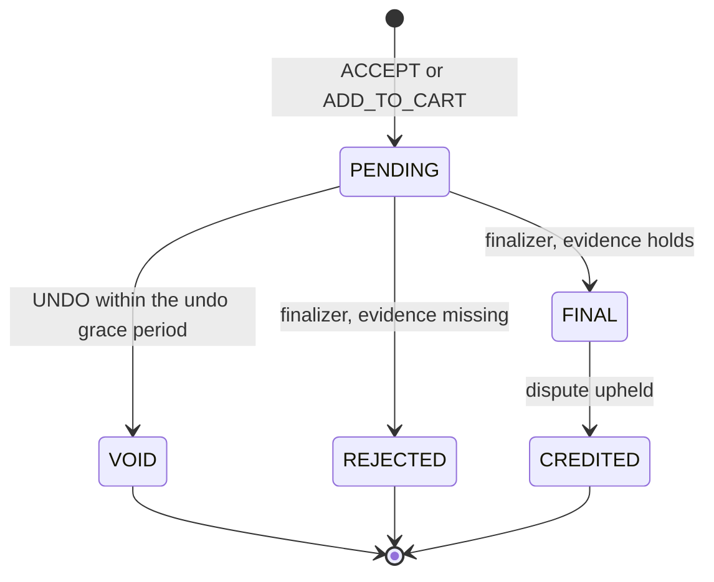

# 06 — Recommended Label and Recommended-Add Fee (RA-1)

| | |
| --- | --- |
| Document | HealthSwap "Recommended by HealthSwap" label and RA-1 recommended-add fee: specification |
| Version | 1.0 (draft) |
| Related | [01 HLD](01-hld.md) · [04 Integration playbook](04-partner-integration-playbook.md) · [07 Reference implementation](07-reference-implementation.md) · [08 Manual test guide](08-manual-test-guide.md) · [OpenAPI](../api/openapi.yaml) · [Schema](../db/schema.sql) |

---

This document specifies RA-1 as the Python reference implementation ([07](07-reference-implementation.md)) implements
it. The JSON examples are real responses of that implementation, taken from the walkthrough in
[08 §6](08-manual-test-guide.md#6-c-api-walkthrough). Where the design would need more than the code does, the text says
"not implemented in the reference implementation".

## 1. Summary

Every alternative that HealthSwap recommends carries the label **"Recommended by HealthSwap"**. Each time a shopper adds
such a labeled product to the cart, the partner owes HealthSwap a small fixed fee: the recommended-add fee, rule RA-1.

| Item | RA-1 |
| --- | --- |
| Who pays | The partner (platform-paid). The fee is never added to the shopper's bill and its amount is never shown to shoppers |
| What is charged | One fee per ACCEPT or ADD_TO_CART event that adds a recommended, labeled alternative to the cart |
| Default amount | INR 1.00 per add event (`PER_ADD_EVENT`); per-unit billing (`PER_UNIT`) is configurable |
| Evidence | The suggestion was served by HealthSwap, the added SKU is one of its alternatives, the label was shown (IMPRESSION) and the add happened inside the attribution window |
| Undo | An UNDO within 5 seconds voids the charge |
| Settlement | PENDING at the add, FINAL or REJECTED after a 10-minute settlement window |
| Billing | Monthly statement next to FP-1, taxed at the partner's rate (18% GST in India) |
| Relation to FP-1 | Additive and independent: an add can earn RA-1, and the delivered order can also earn FP-1 |
| Ranking | Never a ranking input; the same alternatives in the same order whether RA-1 is enabled or not |

## 2. Business rule and rationale

**Rule.** For a partner with RA-1 enabled, every ACCEPT or ADD_TO_CART event of a HealthSwap-recommended alternative
creates a charge of the contracted amount. The charge becomes billable (FINAL) only when the evidence chain holds
after the settlement window ([§5](#5-evidence-checks-at-finalization)). It is billed on the monthly statement and can be
disputed like an FP-1 line.

Rationale:

- **It pays for the recommendation itself, not for the price difference.** FP-1 earns only when the shopper buys a more
  expensive alternative, keeps it and the order is delivered. A cheaper healthier swap earns nothing under FP-1 (example
  IN-3 in [01 §9](01-hld.md#9-attribution--fee-model)), which is the conflict of interest that ADR-06 has to contain.
  RA-1 earns the same fixed amount for a cheaper and a pricier alternative: the PureSip lemon water at INR 5.00 less than
  the cola earns INR 1.00 like the MilletMagic noodles at INR 33.00 more.
- **Small, fixed and per event.** The partner can reconcile every charge with its own event log by `eventId`. RA-1 does
  not need order data and settles in 10 minutes instead of after the return window.
- **Disclosed where the shopper decides.** The label and the fee disclosure make the material connection visible next
  to the recommendation (FTC Endorsement Guides; India CCPA 2023 guidelines on dark patterns). Neither states the amount.
- **Charged only with evidence.** A charge needs a served suggestion, a shown label and a recommended SKU; undone adds
  are voided. Partners do not pay for adds that HealthSwap did not cause or that the shopper never saw labeled.

## 3. Label and disclosure requirements

### 3.1 The label object

Every alternative carries a `recommendation` object (OpenAPI `RecommendationLabel`), and the evaluation carries the fee
disclosure in `disclosures.feeDisclosure`. A real label from a QuickBasket evaluation:

```json
{
  "code": "HEALTHSWAP_RECOMMENDED",
  "text": "Recommended by HealthSwap",
  "shortText": "HealthSwap pick",
  "disclosure": "HealthSwap may receive a fee from QuickBasket when you add a recommended item to your cart or buy a suggested swap. Recommendations are ranked on nutrition, not fees.",
  "chargeable": true,
  "feeRule": "RA-1"
}
```

| Field | Meaning |
| --- | --- |
| `code` | Always `HEALTHSWAP_RECOMMENDED` |
| `text` | The label to render next to the product name |
| `shortText` | Compact form for tight layouts (chips, small tiles) |
| `disclosure` | Material-connection disclosure for the "Why am I seeing this?" details; mentions the add fee only when RA-1 applies |
| `chargeable` | True when adding this alternative is billable under RA-1 (RA-1 contracted and a cart known); tells the partner, not the shopper |
| `feeRule` | `RA-1` when chargeable, otherwise absent |

The amount is never part of the label, the disclosure or any response to an SDK session. A product-page request without
a cart returns the label with `chargeable: false`, no `feeRule` and the general disclosure, because there is no cart to
which an add could be attributed:

```json
{
  "code": "HEALTHSWAP_RECOMMENDED",
  "text": "Recommended by HealthSwap",
  "shortText": "HealthSwap pick",
  "disclosure": "HealthSwap may receive a fee from QuickBasket when you choose a suggested item. Suggestions are ranked on nutrition, not fees.",
  "chargeable": false
}
```

### 3.2 Texts per locale

The texts come from `ShopperCopy` in [labels.py](../src/healthswap/domain/recommendation/labels.py). The requested
locale is normalized to the market's locales (IN: en-IN, hi-IN; US: en-US, es-US; other markets: `en-<market>`); Hindi
and Spanish locales get their language, every other locale gets English. `{partner}` is the partner's display name.

| Language | `text` | `shortText` |
| --- | --- | --- |
| English | Recommended by HealthSwap | HealthSwap pick |
| Hindi | HealthSwap द्वारा सुझाया गया | HealthSwap की पसंद |
| Spanish | Recomendado por HealthSwap | Selección de HealthSwap |

| Language | Disclosure when RA-1 applies | Disclosure otherwise |
| --- | --- | --- |
| English | HealthSwap may receive a fee from {partner} when you add a recommended item to your cart or buy a suggested swap. Recommendations are ranked on nutrition, not fees. | HealthSwap may receive a fee from {partner} when you choose a suggested item. Suggestions are ranked on nutrition, not fees. |
| Hindi | जब आप सुझाया गया आइटम कार्ट में जोड़ते हैं या सुझाया गया विकल्प खरीदते हैं, तो HealthSwap को {partner} से शुल्क मिल सकता है। सुझाव पोषण के आधार पर तय होते हैं, शुल्क के आधार पर नहीं। | जब आप सुझाया गया आइटम चुनते हैं, तो HealthSwap को {partner} से शुल्क मिल सकता है। सुझाव पोषण के आधार पर तय होते हैं, शुल्क के आधार पर नहीं। |
| Spanish | HealthSwap puede recibir una tarifa de {partner} cuando agregas un artículo recomendado a tu carrito o compras un cambio sugerido. Las recomendaciones se clasifican por nutrición, no por tarifas. | HealthSwap puede recibir una tarifa de {partner} cuando eliges un artículo sugerido. Las sugerencias se clasifican por nutrición, no por tarifas. |

The wording has not had legal review per market; see the open questions in the [README](../README.md#open-questions-for-stakeholders).

### 3.3 Placement and rendering rules

1. **On every recommended alternative.** Render `recommendation.text` (or `shortText` where space is tight) as text next
   to the product name, on every surface that shows the alternative: cart, checkout, product page (PDP), search and
   agent conversations.
2. **On the cart line after the add.** The next evaluation of the same cart returns `lineLabels` for each line that
   holds a product the shopper added from a suggestion. Render the label on that line. The label stays for the
   suggestion's attribution window (24 hours by default) as long as the line is in the cart; an UNDO does not remove it,
   removing the line does.
3. **Disclosure before the decision.** Show `disclosures.feeDisclosure` once near the suggestions, before the shopper
   acts (the web SDK renders it above the cards), and the label's `disclosure` in the details ("Why?") view.
4. **Never state the amount** to shoppers, in any language or channel. The API does not give it to client devices.
5. **Keep the original equally easy.** Offer "Keep original" (DISMISS) next to "Add", never preselect the alternative
   and keep a visible Undo for at least the undo grace period (5 seconds).
6. **Sponsored is separate.** A sponsored alternative would need its own "Sponsored" tag in addition to the label. The
   reference implementation never returns sponsored alternatives (`sponsored` is always `false`); the web SDK renders the
   tag if it is true.
7. **Agents.** MCP tool results put `disclosure` next to the alternatives and `label` on each alternative; the tool
   instructions tell the agent: "Show every alternative with its label. Call record_swap_decision with SHOWN when you
   present it, then ACCEPTED or ADDED_TO_CART when the shopper adds it."

### 3.4 Accessibility

The target is WCAG 2.2 AA. The web SDK ([sdk/web](../sdk/web/healthswap-web.js)) shows how the requirements map to
markup:

- The label is real text (not an image), so screen readers announce it with the product name.
- Add, Keep original, Undo and Why? are `<button>` elements with descriptive accessible names (for example "Add
  MilletMagic … instead of Swaad …"), reachable by keyboard.
- The result of an action ("Swapped to …", "Kept …") is announced through a `role="status"` live region; focus moves to
  the Undo button; the visual countdown is `aria-hidden`.
- "Why?" is a disclosure button with `aria-expanded` and `aria-controls`.
- API data is inserted with `textContent` only, and only http(s) links are rendered.

## 4. What counts as a chargeable add

### 4.1 Event types

Partners report what the shopper did with `POST /v1/events` (OpenAPI `SuggestionEvent`, 1 to 500 events per batch).

| Event | Report it when | RA-1 effect |
| --- | --- | --- |
| `IMPRESSION` | The labeled alternative was shown. The web SDK sends it once per suggestion after at least 50% of the card was visible for 1 second; MCP `SHOWN` maps to it | Evidence for the finalizer; never charged |
| `ACCEPT` | The shopper accepted the swap and the alternative replaced the original cart line | One charge when `chargeAccept` is true (default) |
| `ADD_TO_CART` | Any other add of a recommended alternative: a re-add after an undo, "+" on a labeled cart line, an add from a product page, search result or agent | One charge per event |
| `UNDO` | The shopper reverted the swap or removed the added product | Voids the latest PENDING charge of the suggestion (same SKU when given) if it happened within the undo grace period; otherwise only recorded |
| `DISMISS` | The shopper kept the original | Never charged; hides this swap for the same user (or cart, without a user) for the market's cool-down: 7 days in IN and US |
| `DETAILS_VIEWED` | The shopper opened the explanation | Recorded only |

Chargeable events must name the added product in `alternativePartnerSku`. Only events of a suggestion that carries
RA-1 terms create charges: if RA-1 was not contracted when the suggestion was served, the events are recorded and the
line label still appears, but nothing is charged.

### 4.2 Quantity

`quantity` is the number of units added by this action (greater than 0, default 1).

| Basis | Amount of one charge | Example with INR 1.00 |
| --- | --- | --- |
| `PER_ADD_EVENT` (default) | The contracted amount, whatever the quantity | ACCEPT of 2 packs: INR 1.00 |
| `PER_UNIT` | amount × max(1, quantity), rounded to the currency's minor unit | ADD_TO_CART of 3 packs: INR 3.00; of 0.5 kg: INR 1.00; of 2.5 kg: INR 2.50 |

Raising the quantity of a labeled cart line is an add of the extra units (ADD_TO_CART with `quantity` = units added);
lowering it is not an event.

### 4.3 Checks at ingestion

The batch is answered with HTTP 202. Each event is checked in this order; a failing event is listed in `rejected` and
the others are processed:

| Code | Message | When |
| --- | --- | --- |
| `HS-EVENT-UNKNOWN-SUGGESTION` | Unknown or expired suggestionId | The suggestion does not exist for this partner (including another tenant's suggestion) |
| `HS-AUTH-SESSION-SCOPE` | The suggestion belongs to another cart session | An SDK session reports an event for a suggestion of another cart |
| `HS-EVENT-TIME` | occurredAt is in the future | `occurredAt` is more than 5 minutes ahead of the server clock |
| `HS-EVENT-SKU-NOT-RECOMMENDED` | alternativePartnerSku must be one of the suggestion's recommended alternatives | ACCEPT or ADD_TO_CART without `alternativePartnerSku`, or with a SKU the suggestion did not recommend |

A malformed batch (for example a missing `eventId` or more than 500 events) fails as a whole with 400 `HS-REQ-INVALID`.
Events are processed in `occurredAt` order, then by their position in the batch. The attribution window is not checked
at ingestion; the finalizer enforces it.

A real rejection:

```json
{
  "accepted": 0,
  "duplicates": 0,
  "rejected": [
    {
      "eventId": "84796b72-c9d3-4503-a396-ff81f95d92ea",
      "code": "HS-EVENT-SKU-NOT-RECOMMENDED",
      "message": "alternativePartnerSku must be one of the suggestion's recommended alternatives"
    }
  ]
}
```

### 4.4 Duplicates and idempotency

`eventId` is generated by the client and unique per partner. A repeated `eventId` is counted in `duplicates` and has no
effect; a server-to-server caller gets the acknowledgement of the charge that the first delivery created, so retries are
safe. Charges are also unique per partner and `eventId` in the database.

### 4.5 Undo grace

An UNDO voids the latest PENDING charge of the same suggestion (and SKU, when the UNDO names one) whose add happened at
or before the UNDO, if the UNDO happened no more than `undoGraceSeconds` (default 5) after the add. The charge becomes
VOID with reason `UNDONE_WITHIN_GRACE`. A later UNDO is recorded but does not void anything: the shopper saw the label and
added the product. A re-add after an undo is a new ADD_TO_CART and a new charge.

## 5. Evidence checks at finalization

The finalizer settles PENDING charges whose `finalizesAt` has passed (business clock), oldest first, at most 500 per
partner per run. It runs in the background every 30 seconds (`scheduler.reco_finalizer_seconds`) and on demand
(`POST /admin/jobs/finalize-reco-charges`, `hs jobs finalize`). Rows are locked with `FOR UPDATE SKIP LOCKED`, so several
workers can run at once.

For each charge it gathers the evidence and applies the checks in this order:

| Order | Reason | The charge is REJECTED when |
| --- | --- | --- |
| 1 | `NOT_SERVED_BY_HEALTHSWAP` | No suggestion record exists. The record is written asynchronously by the evaluation recorder: while it is missing and the charge was received less than 1 hour ago, the charge is skipped and stays PENDING |
| 2 | `SKU_NOT_RECOMMENDED` | The added SKU is not one of the suggestion's alternatives (defense in depth; ingestion already rejects such events) |
| 3 | `OUTSIDE_ATTRIBUTION_WINDOW` | The add happened more than `impressionToleranceSeconds` before the suggestion was created, or after its attribution window (`attributionWindowHours`, 24 hours by default) |
| 4 | `NO_IMPRESSION` | `requireImpression` is true and there is no IMPRESSION for the suggestion, or the first one happened more than `impressionToleranceSeconds` (5 s) after the add |
| 5 | `CAP_REACHED` | `maxChargeableAddsPerSuggestion` FINAL or CREDITED charges already exist for the suggestion, or this charge would push the partner's FINAL and CREDITED RA-1 amount in the add's calendar month (UTC) above `monthlyCap` |
| — | *(none)* | Otherwise the charge becomes FINAL and the fee is posted to the ledger |

The IMPRESSION may arrive later than the add (batched client events) as long as it happened no more than 5 seconds after
it. A capped charge is rejected as a whole, never partially billed. `FEE_NOT_CONTRACTED` is reserved in the contract but
never assigned: when RA-1 is not contracted no charge is created at all. `UNDONE_WITHIN_GRACE` is the reason of VOID
charges ([§4.5](#45-undo-grace)).

A real REJECTED charge (an add from a product page that was never shown):

```json
{
  "chargeId": "01a20e0e-da30-7558-bbf2-dec3934f4a5c",
  "eventId": "a125f83d-c3ee-4d90-9e38-64d3da23e24b",
  "eventType": "ADD_TO_CART",
  "suggestionId": "01a20e0e-da25-74ae-b852-5b14e7faa5e5",
  "cartRef": "c_manual_14e6eff0",
  "placement": "PDP",
  "alternativePartnerSku": "SKU-MLT-256",
  "quantity": 1.0,
  "basis": "PER_ADD_EVENT",
  "amount": {
    "amount": "1.00",
    "currency": "INR"
  },
  "state": "REJECTED",
  "rejectionReason": "NO_IMPRESSION",
  "ruleVersion": "RA-1",
  "occurredAt": "2026-11-24T14:56:24.104000Z",
  "finalizedAt": "2026-11-27T14:56:24.265428Z"
}
```

## 6. Charge lifecycle



| State | Meaning | Set by |
| --- | --- | --- |
| `PENDING` | Recorded at the add; waiting for the settlement window | Event ingestion |
| `VOID` | Undone within the grace period (reason `UNDONE_WITHIN_GRACE`) | UNDO event |
| `FINAL` | Evidence holds; revenue recognized; billed at the next month close (`statementId` is set then) | Finalizer |
| `REJECTED` | Evidence missing (`rejectionReason`, [§5](#5-evidence-checks-at-finalization)) | Finalizer |
| `CREDITED` | Billed, then credited by an upheld dispute (`creditedAmount`) | Dispute resolution (admin plane) |

Timing:

- `finalizesAt = max(occurredAt + settleAfterSeconds, receivedAt + max(undoGraceSeconds, 1 s))`. With the defaults an
  add that arrives at once settles 10 minutes after it happened (C3 in 08: add at 14:56:23.983, `finalizesAt`
  15:06:23.983). An add reported an hour late settles 5 seconds after it was received, so the window does not reopen.
- The settlement window lets late batched events (impressions, undos) count before the decision.
- `finalizedAt` is the business time of the VOID, FINAL or REJECTED decision. The PENDING acknowledgement carries
  `finalizesAt`; settled charges carry `finalizedAt`.
- Month close bills every FINAL charge that has no statement yet and was finalized before the end of the closed month
  (UTC). A charge finalized after that goes to the next statement.

## 7. Partner configuration

RA-1 terms live in the partner configuration document, `fee.recommendationAdd`. QuickBasket's seeded configuration
(from `GET /admin/partners`):

```json
{
  "rule": "RA-1",
  "basis": "PER_ADD_EVENT",
  "amount": "1.00",
  "enabled": true,
  "currency": "INR",
  "monthlyCap": null,
  "chargeAccept": true,
  "undoGraceSeconds": 5,
  "requireImpression": true,
  "settleAfterSeconds": 600,
  "impressionToleranceSeconds": 5,
  "maxChargeableAddsPerSuggestion": null
}
```

| Field | Default | Meaning | Validation message |
| --- | --- | --- | --- |
| `enabled` | `true` | RA-1 on or off for new suggestions | |
| `rule` | `RA-1` | Rule version stamped on suggestions and charges | |
| `amount` | `1.00` | Fee per add event, or per unit with `PER_UNIT`; 0 means not contracted | `fee.recommendationAdd.amount must be >= 0` |
| `currency` | `INR` | Must equal the partner's currency, otherwise RA-1 does not apply | `fee.recommendationAdd.currency must be ISO 4217` |
| `basis` | `PER_ADD_EVENT` | `PER_ADD_EVENT` or `PER_UNIT` ([§4.2](#42-quantity)) | `fee.recommendationAdd.basis must be PER_ADD_EVENT or PER_UNIT` |
| `undoGraceSeconds` | `5` | UNDO window | `fee.recommendationAdd.undoGraceSeconds must be 0-3600` |
| `settleAfterSeconds` | `600` | Settlement window | `fee.recommendationAdd.settleAfterSeconds must be >= undoGraceSeconds` |
| `requireImpression` | `true` | An IMPRESSION is required for FINAL | |
| `impressionToleranceSeconds` | `5` | Clock-skew tolerance between client timestamps and the suggestion | |
| `chargeAccept` | `true` | ACCEPT is chargeable (ADD_TO_CART always is) | |
| `maxChargeableAddsPerSuggestion` | `null` | At most this many FINAL charges per suggestion | |
| `monthlyCap` | `null` | At most this RA-1 amount per calendar month | |

`amount` and `monthlyCap` accept JSON numbers or decimal strings. Related settings elsewhere in the document:
`currency`, `taxRate` (0.18), `attributionWindowHours` (24), `disputeWindowDays` (15), `paymentTermsDays` (30),
`placements`, `killSwitch`, `disabledPlacements` and `experiment.holdoutPercent`. The demo tenant Hometown Grocer (US)
has RA-1 disabled with amount 0.01 USD.

RA-1 applies to a suggestion when `enabled` is true, `amount` is above 0 and `currency` equals the cart currency. The
terms are snapshotted on each suggestion when it is served, so a later contract change never re-prices it: switching
RA-1 off stops it for new suggestions, while adds of suggestions served before keep their served terms until the
attribution window ends.

The configuration is replaced as a whole with `PUT /admin/partners/{partnerId}/config`, validated and written to the
audit log (`CONFIG_REPLACED`). An invalid document is rejected without changes, for example:

```json
{
  "type": "https://healthswap.example/problems/hs-req-invalid",
  "title": "Request validation failed",
  "status": 400,
  "detail": "Invalid partner configuration",
  "instance": "/admin/partners/6f1d0c2a-5b7e-4c1a-9d3e-1a2b3c4d5e01/config",
  "code": "HS-REQ-INVALID",
  "traceId": "ac1301f2ad3c4d83a65c56a1b41b8878",
  "errors": [
    {"field": "/", "message": "fee.recommendationAdd.amount must be >= 0"},
    {"field": "/", "message": "fee.recommendationAdd.basis must be PER_ADD_EVENT or PER_UNIT"},
    {"field": "/", "message": "fee.recommendationAdd.currency must be ISO 4217"},
    {"field": "/", "message": "fee.recommendationAdd.undoGraceSeconds must be 0-3600"},
    {"field": "/", "message": "fee.recommendationAdd.settleAfterSeconds must be >= undoGraceSeconds"}
  ]
}
```

A change takes effect at once on the API instance that received it and within 15 seconds on other instances (partner
directory cache). There is no partner-facing configuration API and no contract-versioning workflow; that is not
implemented in the reference implementation.

## 8. API surface

| Operation | Scope | RA-1 role |
| --- | --- | --- |
| `POST /v1/cart-evaluations` | `carts.evaluate` or SDK session | Labels every alternative (`recommendation`), returns `lineLabels` and `disclosures.feeDisclosure`, snapshots the RA-1 terms on each suggestion |
| `GET /v1/cart-evaluations/{evaluationId}` | `carts.evaluate` or SDK session | The same evaluation while it lives (30 minutes) |
| `GET /v1/products/{productId}/alternatives` | `products.read` or SDK session | PDP and SEARCH alternatives; `suggestionId` and chargeable labels only when a `cartRef` is given |
| `POST /v1/events` | `events.write` or SDK session | Event ingestion; `charges` acknowledgements for server-to-server callers only |
| `GET /v1/billing/recommendation-charges` | `billing.read` | Charges, newest first; filters `period`, `state`, `cartRef`, `suggestionId`, `statementId`; keyset `cursor` and `limit` (default 100, at most 200) |
| `GET /v1/billing/recommendation-charges/{chargeId}` | `billing.read` | One charge |
| `GET /v1/billing/statements`, `GET /v1/billing/statements/{statementId}` | `billing.read` | Totals with `recommendationFee` and `recommendationChargeCount` |
| `GET /v1/billing/statements/{statementId}/recommendation-charges` | `billing.read` | The RA-1 charges billed on a statement |
| `POST /v1/billing/disputes`, `GET /v1/billing/disputes/{disputeId}` | `billing.write`, `billing.read` | Disputes of RA-1 charges (`recommendationChargeIds`) and FP-1 lines |
| MCP `evaluate_cart`, `find_healthier_alternatives`, `record_swap_decision` | `carts.evaluate` or `products.read` | Agent placement (`AGENT`); `record_swap_decision` maps SHOWN, ACCEPTED, ADDED_TO_CART, DISMISSED and UNDONE to the events above |
| `PUT /admin/partners/{partnerId}/config`, `POST /admin/partners/{partnerId}/kill-switch`, `POST /admin/jobs/finalize-reco-charges`, `POST /admin/jobs/month-close`, `POST /admin/disputes/{disputeId}/resolve`, `GET /admin/ledger/trial-balance` | `hs.admin` | Operator plane |

The PENDING acknowledgement of an ACCEPT (quantity 2), as returned to the partner's server:

```json
{
  "accepted": 2,
  "duplicates": 0,
  "charges": [
    {
      "eventId": "0a23709f-84c9-4dac-801e-1497cf99f457",
      "chargeId": "01a20e0e-d9c1-77cd-befb-11a3f4d4c48f",
      "state": "PENDING",
      "amount": {"amount": "1.00", "currency": "INR"},
      "finalizesAt": "2026-11-24T15:06:23.983000Z"
    }
  ]
}
```

The same charge after finalization and month close (`GET /v1/billing/recommendation-charges/{chargeId}`):

```json
{
  "chargeId": "01a20e0e-d9c1-77cd-befb-11a3f4d4c48f",
  "eventId": "0a23709f-84c9-4dac-801e-1497cf99f457",
  "eventType": "ACCEPT",
  "suggestionId": "01a20e0e-d9aa-74e1-8de9-43fd666454a9",
  "cartRef": "c_manual_14e6eff0",
  "placement": "CART",
  "alternativePartnerSku": "SKU-MLT-256",
  "quantity": 2.0,
  "basis": "PER_ADD_EVENT",
  "amount": {"amount": "1.00", "currency": "INR"},
  "state": "FINAL",
  "ruleVersion": "RA-1",
  "occurredAt": "2026-11-24T14:56:23.983000Z",
  "finalizedAt": "2026-11-27T14:56:24.265428Z",
  "statementId": "01a20e0e-db42-7163-925c-2272691b0e71"
}
```

A line label in the next evaluation of the same cart:

```json
[
  {
    "lineId": "1",
    "partnerSku": "SKU-MLT-256",
    "suggestionId": "01a20e0e-d9aa-74e1-8de9-43fd666454a9",
    "label": {
      "code": "HEALTHSWAP_RECOMMENDED",
      "text": "Recommended by HealthSwap",
      "shortText": "HealthSwap pick",
      "disclosure": "HealthSwap may receive a fee from QuickBasket when you add a recommended item to your cart or buy a suggested swap. Recommendations are ranked on nutrition, not fees.",
      "chargeable": true,
      "feeRule": "RA-1"
    }
  }
]
```

Money is `{"amount": "<decimal string>", "currency": "<ISO 4217>"}`; quantities are JSON numbers.

## 9. Ledger, statement and disputes

### 9.1 Ledger postings

Every posting is balanced, has no negative amounts and carries an idempotency key, so a retried job cannot post twice.
Postings are written by the `hs_ledger_writer` database role only.

| Posting | When | Debit | Credit |
| --- | --- | --- | --- |
| `RECO_FEE` (key `RECO_FEE:<chargeId>`) | Charge becomes FINAL | `UNBILLED_AR` amount | `RECO_FEE_REVENUE` amount |
| `STATEMENT` | Month close | `BILLED_AR` net fee + tax | `UNBILLED_AR` net fee; `OUTPUT_TAX` tax |
| `CREDIT_NOTE` | Dispute upheld | `FEE_REVENUE` FP-1 part; `RECO_FEE_REVENUE` RA-1 part; `OUTPUT_TAX` tax | `BILLED_AR` total |
| `PAYMENT` | Payment recorded | `CASH` | `BILLED_AR` |

RA-1 revenue is recognized when the charge becomes FINAL: there is no return contingency, unlike FP-1, whose fee is
deferred (`DEFERRED_REVENUE`) until the return window ends.

### 9.2 Statement

Month close (`POST /admin/jobs/month-close`, `hs billing month-close`) issues one statement per partner and period with
invoice number `HS-<geography>-<yyyy>-<mm>-<nnnnnn>`:

- `premiumFee` (FP-1) + `recommendationFee` (RA-1) = `grossFee`; `recommendationChargeCount` is the number of billed adds.
- `netFee` = `grossFee` − `reversals` − `credits`.
- `tax` = round((`grossFee` − `reversals`) × `taxRate`) − tax already credited; `totalDue` = `netFee` + `tax`.
- Statement lines (`/lines`) are FP-1 lines only (`FEE`, `REVERSAL`, `CREDIT`). RA-1 charges are listed by
  `/recommendation-charges` and summed in the totals; a credited RA-1 charge shows `creditedAmount`.
- The partner receives the `billing.statement.issued` webhook ([§11](#11-webhooks)).

### 9.3 Disputes

The partner disputes RA-1 charges with `POST /v1/billing/disputes` and `recommendationChargeIds` (and FP-1 lines with
`lines`, or both); `reason` is one of `ORDER_NOT_DELIVERED`, `PRICE_MISMATCH`, `NOT_ATTRIBUTABLE`, `DUPLICATE`,
`NOT_ADDED_TO_CART` and `OTHER`. The statement becomes DISPUTED.

| Error | Status | When |
| --- | --- | --- |
| `HS-REQ-INVALID` | 400 | Neither `lines` nor `recommendationChargeIds` |
| `HS-DISPUTE-STATE` | 422 | The statement is not ISSUED or DISPUTED |
| `HS-DISPUTE-WINDOW-CLOSED` | 422 | More than `disputeWindowDays` (15) after the statement was issued |
| `HS-DISPUTE-CHARGE-UNKNOWN` | 422 | A charge is not FINAL on this statement (already credited, another statement, unknown) |
| `HS-DISPUTE-LINE-UNKNOWN` | 422 | An FP-1 line is not billed on this statement |
| `HS-DISPUTE-RESOLVED` | 409 | Resolving a dispute that is already resolved |

The operator resolves it with `POST /admin/disputes/{disputeId}/resolve` and `decision` `UPHELD` (everything disputed),
`PARTIALLY_UPHELD` (`upheldChargeIds`, `upheldLines`), `REJECTED` or `UNDER_REVIEW`. Upheld charges become CREDITED and a
credit note of the amount plus tax is posted; the partner gets `billing.dispute.updated`. A real upheld dispute:

```json
{
  "disputeId": "01a20e0e-db8b-71aa-8cb6-dc0bbfef7375",
  "statementId": "01a20e0e-db42-7163-925c-2272691b0e71",
  "status": "UPHELD",
  "reason": "NOT_ADDED_TO_CART",
  "lines": [],
  "recommendationChargeIds": [
    "01a20e0e-d9dc-72a8-9d3a-f586a508e63b"
  ],
  "comment": "Shopper did not add the item",
  "resolution": "Client logs show a double tap",
  "creditNoteAmount": {"amount": "1.18", "currency": "INR"},
  "openedAt": "2026-11-27T14:56:24.459316Z",
  "resolvedAt": "2026-11-27T14:56:24.490395Z"
}
```

## 10. Interaction with FP-1: worked example IN-1

RA-1 and FP-1 are independent rules with separate evidence chains; one shopper action can earn both. FP-1 (10% of the
fair premium, [01 §9](01-hld.md#9-attribution--fee-model)) needs an accepted suggestion, an order line that references it
and a delivery; RA-1 needs only the add. A return reverses FP-1 but not RA-1, because the add happened.

The QuickBasket cart from [08 §6](08-manual-test-guide.md#6-c-api-walkthrough), in one month on a fresh database:

| Step | What happens | FP-1 | RA-1 |
| --- | --- | --- | --- |
| 1 | Evaluation of 2 × Swaad noodles (INR 56.00, 280 g) and a cola; MilletMagic (INR 89.00, 256 g) is recommended and labeled | | |
| 2 | IMPRESSION, then ACCEPT of 2 MilletMagic packs | | PENDING 1.00 |
| 3 | ADD_TO_CART of 1 more pack | | PENDING 1.00 |
| 4 | ADD_TO_CART, undone after 1 second | | VOID 1.00 |
| 5 | ADD_TO_CART from the product page without an impression | | PENDING 1.00 |
| 6 | Order IN-1: 2 × MilletMagic at INR 89.00 with INR 8.00 order discount, net INR 170.00 (85.00 per unit); fair premium per unit min(85.00 − 56.00, 85.00 − 56.00 × 256/280) = min(29.00, 33.80) = 29.00; × 2 = 58.00 | PENDING 5.80 | |
| 7 | Delivered | ACCRUED 5.80 | |
| 8 | One pack returned | Reversal 2.90 | |
| 9 | Settlement window and return window pass | FINAL | 2 FINAL (steps 2 and 3); step 5 REJECTED `NO_IMPRESSION` |
| 10 | Month close | Fee 5.80, reversal 2.90 | 2 adds, 2.00 |

Statement: gross 5.80 + 2.00 = 7.80; net 7.80 − 2.90 = **4.90**; GST round(4.90 × 18%) = **0.88**; total due **5.78**.

The partner then disputes the ADD_TO_CART charge (reason `NOT_ADDED_TO_CART`) and the operator upholds it: credit note
1.00 + round(1.00 × 18%) = **1.18**; the charge is CREDITED; credits 1.00, net 3.90, tax 0.88 − 0.18 = 0.70, total due
**4.60**. The trial balance afterwards:

| Account | Debit | Credit | Balance |
| --- | --- | --- | --- |
| BILLED_AR | 5.78 | 1.18 | 4.60 |
| DEFERRED_REVENUE | 5.80 | 5.80 | 0.00 |
| FEE_REVENUE | 0.00 | 2.90 | −2.90 |
| OUTPUT_TAX | 0.18 | 0.88 | −0.70 |
| RECO_FEE_REVENUE | 1.00 | 2.00 | −1.00 |
| UNBILLED_AR | 7.80 | 7.80 | 0.00 |

The smoke test ([08 §5](08-manual-test-guide.md#5-b-automated-smoke-test)) and the integration test
`tests/platform/test_billing_flow.py` reproduce the same numbers.

## 11. Webhooks

There is no RA-1-specific webhook. RA-1 reaches partners through the billing webhooks:

| Type | Sent when | `data` |
| --- | --- | --- |
| `billing.statement.issued` | Month close issued a statement | `statementId`, `period`, `totalDue` (FP-1 and RA-1 together) |
| `billing.dispute.updated` | A dispute was resolved or put under review | `disputeId`, `status` |

Charge state changes are published internally on the `hs.reco-charges.v1` topic (outbox, event bus, analytics lake) but
are not delivered to partners: partners read charges with `GET /v1/billing/recommendation-charges`. A charge webhook is
not implemented in the reference implementation.

Deliveries are signed: `HealthSwap-Signature: t=<unix seconds>,v1=<hex HMAC-SHA256(secret, t + "." + raw body)>`, with
the envelope id in `HealthSwap-Webhook-Id`. A real delivered body:

```json
{
  "id": "evt_01a20e0edbc3726aaeb2880d751e9856",
  "data": {
    "status": "UPHELD",
    "disputeId": "01a20e0e-db8b-71aa-8cb6-dc0bbfef7375"
  },
  "type": "billing.dispute.updated",
  "createdAt": "2026-11-24T14:56:24.552286Z",
  "partnerId": "6f1d0c2a-5b7e-4c1a-9d3e-1a2b3c4d5e01",
  "apiVersion": "1.1"
}
```

## 12. Fee-neutral ranking

RA-1 must never change what is recommended or in which order (ADR-06):

- The ranker's 16 features (`RankerFeatures.FEATURE_NAMES`: health delta, substitutability, price ratio, cheaper flag,
  brand switch, pack ratio, placement and daypart flags, goal match, beverage category, NOVA improvement, same brand
  family) contain no commercial signal. The test `test_ranker_features_exclude_commercial_signals` fails if a feature
  name contains `fee`, `margin`, `commission`, `sponsor`, `reco_fee`, `premium` or `revenue`.
- Candidate filtering and ranking do not read the fee configuration. The RA-1 terms are attached to a suggestion after
  the alternatives are chosen, and the label is the same for every alternative.
- Cheaper alternatives stay eligible and earn the same RA-1 amount as pricier ones.
- Training data for the ranker comes from shopper behavior (`hs ml export`, `hs ml simulate`), never from fee outcomes.

## 13. Anti-gaming and audit

| Risk | Control |
| --- | --- |
| Charges for adds HealthSwap did not cause | The suggestion must exist for this partner and the SKU must be one of its alternatives (ingestion and finalizer) |
| Charges for unlabeled or unseen recommendations | IMPRESSION required (`requireImpression`), within 5 seconds of the add |
| Replayed or duplicated client events | `eventId` deduplication per partner; one charge per event |
| Accidental taps | 5-second undo voids the charge |
| Late or back-dated events | `occurredAt` at most 5 minutes in the future; attribution window enforced at finalization; late events settle on receipt time + 5 s |
| Runaway volume | Optional `maxChargeableAddsPerSuggestion` and `monthlyCap`; rate limits on the API |
| Cross-tenant charges | Row-level security on every charge, suggestion and event table; another tenant's suggestion is "unknown" |
| Browser tampering | SDK sessions are bound to one cart, cannot read billing data and never receive charge acknowledgements |
| Disagreement | Every charge is listable with its event id and evidence fields; disputes with credit notes |

Audit trail: suggestion snapshots (`txn.suggestion`) keep the served alternatives and RA-1 terms; events are stored in
`txn.suggestion_event`; charges keep event id, timestamps, state and reason; ledger postings are append-only and balanced;
configuration changes and dispute decisions are written to `audit.change_log`; the PENDING, VOID, FINAL and REJECTED
transitions are also published on `hs.reco-charges.v1` to the analytics lake.

## 14. Privacy

- Partners send a pseudonymous `userRef` (optional; `cartRef` is enough for RA-1).
- A charge stores the `userRef` of its suggestion only while it is PENDING: it is set to null when the charge becomes
  VOID, FINAL or REJECTED. Billing never needs to know who the shopper was.
- Charge listings expose `cartRef`, never `userRef`.
- Shopper erasure (`DELETE /v1/users/{userRef}`) also removes the `userRef` from charges.
- RA-1 data is tenant data and follows its residency rules ([01](01-hld.md)); the reference implementation has a single
  database.

## 15. Edge cases

| Case | Behavior |
| --- | --- |
| Product page and search (`PDP`, `SEARCH`) | `GET /v1/products/{productId}/alternatives` mints a suggestion only when `cartRef` is given (or the SDK session has a cart); without a cart the label is not chargeable and there is no `suggestionId` |
| Agents (`AGENT`) | MCP tools use placement `AGENT`; `record_swap_decision` uses the server clock for `occurredAt` and returns the charge acknowledgement (with the amount) because the caller holds a partner token: agents must not repeat it to shoppers |
| SDK sessions | The browser can evaluate, read alternatives and report events for its own cart; its adds create charges, but responses to the session never include `charges`, and billing endpoints answer 403 |
| Kill switch, disabled placement | No new suggestions (degradation `KILL_SWITCH`, empty alternatives); adds of suggestions served before keep their terms and are still charged; `lineLabels` are still returned for lines added earlier |
| Holdout | Carts in the holdout bucket (`experiment.holdoutPercent`, stable hash of `userRef` or `cartRef`) get no suggestions and therefore no charges. Product-page and search alternatives ignore the holdout: not implemented in the reference implementation |
| Re-adds | Add, undo, add again: the second add is a new charge (PENDING), the first is VOID |
| Several adds of one suggestion | Each event is a charge unless `maxChargeableAddsPerSuggestion` caps them |
| Partial quantities | `PER_ADD_EVENT` ignores quantity; `PER_UNIT` charges at least one unit, then proportionally (2.5 units: 2.50) |
| Quantity decrease, line removal | Not an event and not a refund; within 5 seconds of the add, report UNDO |
| RA-1 disabled or in another currency | Labels are not chargeable and no charge is created; events are still recorded and line labels still appear |
| Contract change | Applies to suggestions served afterwards; served suggestions keep their snapshot |
| Clock skew | Up to 5 seconds tolerated between impression and add; events more than 5 minutes in the future are rejected |
| Order without the add events | RA-1 has nothing to charge, and FP-1 rejects the line (`NO_ACCEPT`): both rules need the shopper's add to be reported |

## 16. Test coverage map

| Rule | Tests |
| --- | --- |
| Default terms, snapshot only when enabled, amount above 0 and same currency | `tests/domain/test_reco_add_fee.py::TestRecoAddFee::test_default_terms_are_one_rupee_per_add_event`, `test_no_snapshot_when_disabled_or_currency_differs` |
| ACCEPT and ADD_TO_CART chargeable, `chargeAccept` | `TestRecoAddFee::test_chargeable_events` |
| Undo grace boundary | `TestRecoAddFee::test_undo_within_grace_voids_after_grace_does_not` |
| `finalizesAt`, late events | `TestRecoAddFee::test_charges_settle_after_the_window_even_for_late_events` |
| Evidence chain and every rejection reason, caps | `TestRecoAddFee::test_full_evidence_chain_is_final`, `test_each_missing_link_is_rejected_with_a_reason`, `test_impression_clock_skew_is_tolerated` |
| Label and disclosure never state the amount (en-IN, hi-IN, en-US, es-US); add wording only when enabled | `TestRecoAddFee::test_label_and_disclosure_never_state_the_amount`, `test_disclosure_mentions_add_fee_only_when_enabled` |
| Configuration validation and JSON mapping | `TestRecoAddFee::test_partner_config_validation_covers_ra1`, `TestPartnerConfigJson`, `tests/api/test_api_flows.py::test_admin_config_rejects_an_invalid_configuration` |
| Ledger: balanced postings, separate RA-1 revenue, statement totals 7.80 / 4.90 / 0.88 / 5.78 | `TestLedger::test_all_postings_balance`, `test_ra1_is_recognized_as_separate_revenue`, `test_statement_totals_combine_fp1_and_ra1`, `test_unbalanced_or_negative_postings_are_impossible` |
| Ingestion order, validation codes and messages, dedupe, undo, dismiss, SDK sessions without acknowledgements | `tests/platform/test_evaluation_events.py::test_events_are_processed_by_occurrence_then_batch_position`, `test_event_validation_order_and_messages`, `test_ingest_dedupes_charges_and_orders_events`, `test_ingest_undo_and_dismiss`, `test_ingest_gives_sdk_sessions_no_charges_and_rejects_foreign_suggestions`, `test_charge_api_shape` |
| Kill switch, placement policy, holdout bucket | `test_evaluation_events.py::test_placement_policy_maps_to_kill_switch`, `test_holdout_bucket_uses_the_first_four_hash_bytes_little_endian`, `tests/platform/test_ra1_flow.py::test_6_kill_switch_stops_suggestions`, `tests/api/test_api_flows.py::test_kill_switch_stops_suggestions_until_switched_off` |
| End to end on PostgreSQL: label, pending, dedupe, void, reject, line labels, PDP, finalizer with time travel, pagination, ledger | `tests/platform/test_ra1_flow.py::test_1` to `test_5`, `test_7_sdk_sessions_are_bound_to_their_cart` |
| IN-1 with RA-1: statement 5.78, invoice number, `ALREADY_CLOSED`, `NOTHING_TO_BILL`, dispute errors, credit note 1.18, webhooks | `tests/platform/test_billing_flow.py::test_a` to `test_g` |
| Over HTTP with OpenAPI response validation: charged, settled, billed, disputable, signed webhook; additive to FP-1; MCP | `tests/api/test_api_flows.py::test_labeled_recommendation_adds_are_charged_settled_billed_and_disputable`, `test_recommended_add_fee_is_additive_and_only_for_labeled_alternatives`, `test_mcp_tools_over_streamable_http`, `test_demo_shop_charge_view_shows_the_ra1_charges_of_its_cart` |
| Tenant isolation and SDK session binding | `tests/api/test_api_security.py::test_tenants_cannot_see_each_others_charges_orders_evaluations_or_suggestions`, `test_sdk_sessions_are_bound_to_their_cart_and_scopes` |
| Fee-neutral ranking | `tests/domain/test_scoring_and_recommendation.py::test_ranker_features_exclude_commercial_signals` |
| Browser end to end | `scripts/smoke_test.py` sections 1 to 9 and [08 §4](08-manual-test-guide.md#4-a-demo-shop) (manual) |
