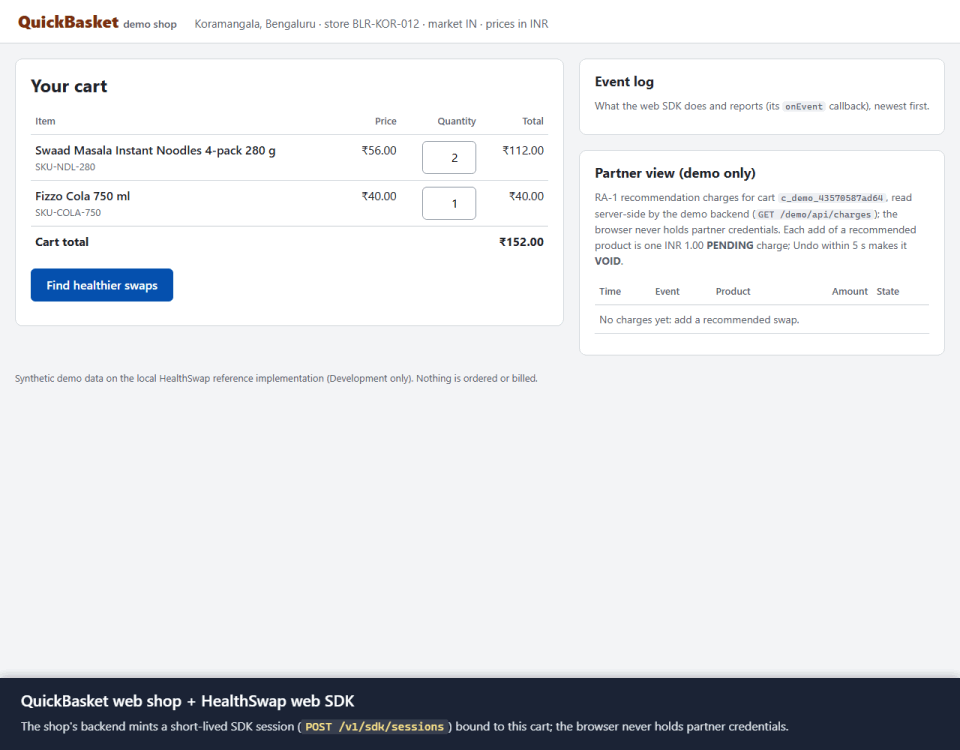
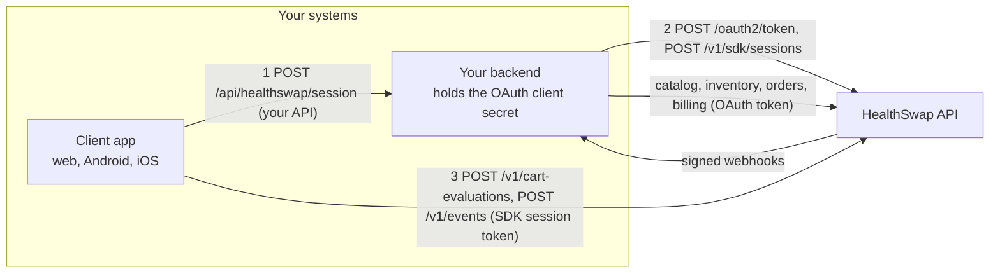

# 09 — Client App Integration Guide

| | |
| --- | --- |
| Document | How a partner's backend and client apps (web, Android, iOS, cross-platform) integrate HealthSwap |
| Version | 1.0 (draft) |
| Related | [04 Integration playbook](04-partner-integration-playbook.md) · [06 RA-1](06-recommended-label-and-add-fee.md) · [07 Reference implementation](07-reference-implementation.md) · [08 Manual test guide](08-manual-test-guide.md) · [10 Codebase guide](10-codebase-guide.md) · [OpenAPI](../api/openapi.yaml) |

---

This guide is for the engineers of a grocery or quick-commerce partner who add HealthSwap to their own apps.
[04](04-partner-integration-playbook.md) covers the business side (integration modes, rollout, contracts); this document
covers the code: what your backend and your client apps call, what they must render and report, and how to test the
integration locally. The requests and responses below are real ones from the local reference implementation
(`python scripts/run_local.py`, demo partner QuickBasket), and the code samples were exercised against it; names such as
`cart`, `carts` and `current_shopper` stand for your own code.

## 1. Demo recording



The storyboard above and the 75-second video [media/client-integration-demo.webm](media/client-integration-demo.webm)
(open it in VS Code or a browser) show the QuickBasket demo shop ([web/demo](../web/demo)), a web client integrated
exactly as section 5 describes. Each caption names the SDK call and the API request behind the step:

| Step | Shopper | Integration |
| --- | --- | --- |
| 1 | Find healthier swaps | `hs.evaluateCart()` → `POST /v1/cart-evaluations` with the SDK session token minted by the shop's backend |
| 2 | Sees two labeled cards | `hs.renderSuggestions()`: "Recommended by HealthSwap" label, fee disclosure, grade, price difference, reason |
| 3 | Looks at them | `hs.trackImpressions()`: one IMPRESSION per card |
| 4 | Opens "Why?" | Nutrient facts, disclosures, methodology link |
| 5 | Adds the millet noodles | ACCEPT; the shop's `onAdd` swaps the cart line; partner view: INR 1.00 PENDING RA-1 charge |
| 6 | Adds the lemon water, then Undo | UNDO within 5 s; the charge becomes VOID |
| 7 | Raises the noodles quantity to 3 | `hs.addToCart()` → ADD_TO_CART → one more PENDING charge |
| 8 | Keeps the cola | DISMISS; no charge, 7-day cool-down |
| 9 | Evaluates again | No new suggestion for the labeled line or the dismissed swap |

Section 12 explains how to record it again.

## 2. Who does what



| Part | Does | Credential |
| --- | --- | --- |
| Your backend | Syncs catalog and inventory; mints SDK sessions; reports orders, deliveries and returns; receives webhooks; reconciles charges | OAuth 2.0 client credentials (client id and secret from your vault) |
| Your client app | Evaluates the cart, renders the labeled suggestions and disclosures, changes the cart when the shopper accepts, reports what the shopper did | An SDK session token: at most 15 minutes, bound to one cart |
| HealthSwap | Matches your products, picks healthier in-stock alternatives, records events, RA-1 charges and FP-1 attributions, issues statements | — |

Four rules hold in every pattern:

- The client secret never leaves your backend. The app holds only the SDK session token, which allows cart evaluations,
  events and product reads (`carts.evaluate`, `events.write`, `products.read`) for one cart.
- HealthSwap never changes your cart. Your code replaces or adds the cart line when the shopper taps Add.
- Fail open. The cart and checkout never wait for HealthSwap; without an answer the cart simply shows no suggestions.
- The fee amount is never shown to shoppers and never sent to client devices.

## 3. Choose an integration pattern

| Pattern | The cart screen calls HealthSwap from | On the device | Best for | Section |
| --- | --- | --- | --- | --- |
| **A. Web SDK** | The browser, with an SDK session | [sdk/web](../sdk/web) (one ES module and one stylesheet) | Web shops: fastest path, the SDK renders the UI | 5 |
| **B. Native app, direct** | The app, with an SDK session | Your own UI and HTTP client | Android, iOS, React Native and Flutter apps that render natively | 6 |
| **C. Server-side** | Your backend, with its OAuth token | Nothing HealthSwap-specific: your cart API carries the suggestions | Apps whose cart screen your backend composes; no HealthSwap token on the device | 7 |

Patterns can be mixed, for example A on the web and C in the apps. Every pattern needs the backend work of sections 4
and 8.

## 4. Backend foundation (all patterns)

### 4.1 Credentials and scopes

HealthSwap issues an OAuth client (id and secret) for each environment, sandbox and production. Keep the secret in your
vault.

| Scope | Needed for |
| --- | --- |
| `catalog.write`, `catalog.read` | Catalog sync: `POST /v1/catalog/item-batches` (up to 1,000 items) or bulk feeds |
| `inventory.write` | Store availability and prices: `POST /v1/stores/{storeId}/inventory-batches` |
| `sdk.sessions.write` | Minting SDK sessions (patterns A and B) |
| `carts.evaluate`, `events.write`, `products.read` | Server-side evaluations, events and product-page alternatives (pattern C) |
| `orders.write`, `orders.read` | Orders, status updates, returns and FP-1 attribution |
| `billing.read`, `billing.write` | RA-1 charges, statements and disputes |
| `users.read`, `users.write` | Shopper preferences and erasure |

The Python server SDK ([sdk/python](../sdk/python), `python -m pip install -e sdk/python`) fetches, caches and refreshes
the client-credentials token. In any other language it is the form POST shown in section 4.4.

### 4.2 Sync the catalog and inventory first

Suggestions come only for cart lines whose SKU HealthSwap has matched to a canonical product, and, in the default
`MIRROR` availability mode, only alternatives that are in stock at the cart's `storeId`. Send the full catalog once
(feed or item batches), then deltas, and stream inventory and prices per store. The demo partners are seeded with both;
the runbook is [04 §3](04-partner-integration-playbook.md#3-partner-integration-runbook-mode-ab).

### 4.3 Identifiers

| Id | Rule |
| --- | --- |
| `cartRef` | Your opaque cart id, at most 128 characters. One per cart session; the SDK session is bound to it |
| `userRef` | Optional pseudonymous shopper id matching `^[A-Za-z0-9_-]{8,128}$`, for example an HMAC of your user id. Never an email address, phone number or name |
| `storeId` | The store whose inventory you sync (required in `MIRROR` mode) |
| `lineId` | Stable id of a cart line; suggestions and labels point back to it |
| `partnerSku` | Your SKU, as sent in the catalog sync |

### 4.4 Mint SDK sessions (patterns A and B)

Add one authenticated endpoint to your API that returns an SDK session for the shopper's current cart. Take the cart
from your server-side state, not from the request: a session lets its holder evaluate that cart and report events for it.

```python
import os

from fastapi import Depends, FastAPI
from healthswap_client import HealthSwapClient

app = FastAPI()
hs = HealthSwapClient(os.environ["HEALTHSWAP_BASE_URL"], os.environ["HEALTHSWAP_CLIENT_ID"],
                      os.environ["HEALTHSWAP_CLIENT_SECRET"])  # the secret comes from your vault; it never reaches an app


@app.post("/api/healthswap/session")
def healthswap_session(shopper: Shopper = Depends(current_shopper)) -> dict:  # your authentication
    cart = carts.active_cart(shopper.id)  # your cart service: never take a cartRef from the client unchecked
    session = hs.create_sdk_session({
        "cartRef": cart.ref, "userRef": shopper.pseudonymous_ref,  # userRef is optional and never PII
        "storeId": cart.store_id, "market": cart.market, "ttlSeconds": 900,
    })
    return {"token": session["token"], "expiresAt": session["expiresAt"]}
```

`Shopper`, `current_shopper` and `carts` stand for your own code. The same in any language, as two HTTP calls (the
local stack serves the token endpoint at `/oauth2/token`; production uses the token URL of your HealthSwap tenant):

```http
POST /oauth2/token
Authorization: Basic base64(client_id:client_secret)
Content-Type: application/x-www-form-urlencoded

grant_type=client_credentials

→ 200 {"access_token": "eyJhbGciOiJFUzI1...", "token_type": "Bearer", "expires_in": 600, "scope": "... sdk.sessions.write"}

POST /v1/sdk/sessions
Authorization: Bearer eyJhbGciOiJFUzI1...
Idempotency-Key: 6c1f3b6e-0f53-4c1e-9a55-1f4f5b0f7d21
Content-Type: application/json

{"cartRef": "c_7f3a91e2", "userRef": "u_9f2c41d7", "storeId": "BLR-KOR-012", "market": "IN", "ttlSeconds": 900}

→ 201 {"token": "eyJhbGciOiJFUzI1...", "tokenType": "Bearer", "expiresAt": "2026-11-25T06:20:52.324653Z",
       "scopes": ["carts.evaluate", "events.write", "products.read"]}
```

A session lives 60 to 900 seconds (`ttlSeconds`, default 900). It is bound to the `cartRef`, `market` and, when given,
`userRef` and `storeId`: evaluating another cart with it answers 403 `HS-AUTH-SCOPE` "The SDK session is bound to
another cart", and it cannot read billing data. Mint a new session for a new cart and when the app gets a 401.

## 5. Web apps with the web SDK (pattern A)

### 5.1 Add the files

Copy [healthswap-web.js](../sdk/web/healthswap-web.js) and [healthswap-web.css](../sdk/web/healthswap-web.css) (version
0.1.0) to your static assets: one ES module without dependencies and no build step. Serve the `.js` file as
`text/javascript`, because browsers refuse module scripts served as `text/plain`. The SDK works under a strict Content
Security Policy without inline scripts or styles. When the API is on another origin, add that origin to `connect-src`
and ask HealthSwap to allow your shop's origin for CORS (`cors.origins`; on the local stack
`HS_CORS__ORIGINS=http://localhost:3000`).

### 5.2 Wire it to your cart

```html
<link rel="stylesheet" href="/static/healthswap/healthswap-web.css">
<div id="healthswap-swaps"></div>
<script type="module" src="/static/js/cart-healthswap.js"></script>
```

```js
// /static/js/cart-healthswap.js — `cart` is your own cart state and API
import { createHealthSwap } from "/static/healthswap/healthswap-web.js";
import { cart } from "./cart.js";

const hs = createHealthSwap({
  baseUrl: "https://api.in.healthswap.example", // the API root; "" when it is served from your origin
  getSessionToken: async () => { // called on first use and again after a 401
    const response = await fetch("/api/healthswap/session", { method: "POST", credentials: "same-origin" });
    if (!response.ok) throw new Error(`HealthSwap session: HTTP ${response.status}`);
    return (await response.json()).token;
  },
  locale: "en-IN",
  onEvent: (event) => console.debug("healthswap", event), // optional: logging and analytics
});
const container = document.getElementById("healthswap-swaps");
hs.trackImpressions(container);

export async function showSwaps() {
  const evaluation = await hs.evaluateCart({ // never rejects: fails open after 1.5 s
    cartRef: cart.ref, market: "IN", storeId: cart.storeId, currency: "INR",
    context: { placement: "CART", channel: "WEB" },
    lines: cart.lines.map((l) => ({
      lineId: l.id, partnerSku: l.sku, quantity: l.quantity, unitPrice: { amount: l.unitPrice, currency: "INR" },
    })),
  });
  hs.renderSuggestions(container, evaluation, {
    onAdd: (d) => cart.replaceLine(d.lineId, { sku: d.partnerSku, quantity: d.quantity, healthswap: d }),
    onUndo: (d) => cart.restoreLine(d.lineId),
    onDismiss: () => {},
  });
  for (const l of evaluation.lineLabels ?? []) cart.setLineLabel(l.lineId, l.label.text);
}

// "+" on a cart line that holds a HealthSwap pick: report the extra units (one more RA-1 add).
export function onQuantityRaised(line, previousQuantity) {
  if (line.healthswap) hs.addToCart(line.healthswap.suggestionId, line.sku, { quantity: line.quantity - previousQuantity });
}
```

The complete, runnable version of this wiring is [web/demo/demo.js](../web/demo/demo.js).

### 5.3 What the SDK does for you

| Call | Does | API |
| --- | --- | --- |
| `evaluateCart(cart)` | Gets the session token, posts the cart and returns the evaluation. Never rejects: after `timeoutMs` (default 1,500 ms) or on any error it returns `{ suggestions: [], degraded: true, failOpen: { reason, detail, status } }` with reason `TIMEOUT`, `CONNECTION_ERROR`, `UNAUTHORIZED`, `RATE_LIMITED`, `SERVER_ERROR` or `REQUEST_REJECTED` | `POST /v1/cart-evaluations` |
| `renderSuggestions(container, evaluation, handlers)` | Renders the fee disclosure above the cards and, per alternative, the label, name, grade, price, price difference, reason and a "Why?" panel. Add reports ACCEPT and calls `onAdd`, the 5-second Undo reports UNDO and calls `onUndo`, Keep original reports DISMISS and calls `onDismiss` | `POST /v1/events` |
| `trackImpressions(root)` | One IMPRESSION per suggestion once at least 50% of an element with `data-hs-suggestion-id` inside `root` has been visible for 1 second | `POST /v1/events` |
| `addToCart(suggestionId, sku, { quantity })` | ADD_TO_CART for any other add of a recommended product: more units of a labeled line, a re-add, an add from a product page | `POST /v1/events` |
| `accept`, `undo`, `dismiss`, `flush` | The same events for your own UI; `flush()` sends the queue now | `POST /v1/events` |

`onAdd` and `onUndo` receive `{ suggestionId, lineId, original, alternative, partnerSku, quantity, label }`, `onDismiss`
receives `{ suggestionId, lineId, original }`. Events are queued, sent every 2 seconds or at 20 events, retried with
backoff (the server deduplicates on `eventId`, so retries are safe) and sent with `fetch` `keepalive` when the page is
hidden or closed. API data is written with `textContent` only and only http(s) links are rendered.

### 5.4 Your own UI, the SDK's plumbing

To render with your own components, keep the SDK for the session, the evaluation and the events: put
`data-hs-suggestion-id="<suggestionId>"` on each suggestion element inside the root you pass to `trackImpressions`, and
call `accept`, `undo`, `dismiss` and `addToCart` from your buttons. Your UI must then follow the rendering rules of
section 6.3. To restyle the SDK's UI instead, set its CSS custom properties (`--hs-accent`, `--hs-label-bg`,
`--hs-radius`, `--hs-font`, ...) on `.hs-suggestions`; every class it uses starts with `hs-`.

## 6. Native apps (pattern B)

This package has no native Android or iOS SDK yet ([04 §4.2](04-partner-integration-playbook.md#42-ui-sdks-android-ios-web-react-native-flutter)
sketches one). A native app calls the API directly with the SDK session token and does what the web SDK does. The web
SDK's source is the reference for the rules below; its non-UI functions (`evaluateCart`, `accept`, `addToCart`, `undo`,
`dismiss`, `flush`) have no DOM dependency and also run on Node.js 20 or later (checked with Node.js 22), so a React
Native app can reuse them with a `crypto.getRandomValues` polyfill (not tested).

### 6.1 Evaluate the cart

```http
POST /v1/cart-evaluations
Authorization: Bearer <SDK session token>
Content-Type: application/json

{
  "cartRef": "c_7f3a91e2", "userRef": "u_9f2c41d7", "market": "IN", "storeId": "BLR-KOR-012", "currency": "INR",
  "locale": "en-IN", "context": {"placement": "CART", "channel": "ANDROID", "appVersion": "5.12.0"},
  "lines": [
    {"lineId": "1", "partnerSku": "SKU-NDL-280", "quantity": 2, "unitPrice": {"amount": "56.00", "currency": "INR"}},
    {"lineId": "2", "partnerSku": "SKU-COLA-750", "quantity": 1, "unitPrice": {"amount": "40.00", "currency": "INR"}}
  ]
}
```

The fields a client renders, from the real response (one of the two suggestions shown; `health`, `explanation.details`
and other fields trimmed):

```json
{
  "evaluationId": "01a21150-0378-7555-88f0-a9de38cfd0ee",
  "degraded": false,
  "suggestions": [
    {
      "suggestionId": "01a21150-037d-7056-9ba3-998a46b224e3",
      "lineId": "1",
      "original": {"partnerSku": "SKU-NDL-280", "title": "Swaad Masala Instant Noodles 4-pack 280 g", "health": {"hsiGrade": "D"}},
      "alternatives": [
        {
          "rank": 1,
          "product": {"partnerSku": "SKU-MLT-256", "title": "MilletMagic Millet Masala Noodles 4-pack 256 g", "health": {"hsiGrade": "C"}},
          "recommendation": {
            "code": "HEALTHSWAP_RECOMMENDED",
            "text": "Recommended by HealthSwap",
            "shortText": "HealthSwap pick",
            "disclosure": "HealthSwap may receive a fee from QuickBasket when you add a recommended item to your cart or buy a suggested swap. Recommendations are ranked on nutrition, not fees.",
            "chargeable": true,
            "feeRule": "RA-1"
          },
          "unitPrice": {"amount": "89.00", "currency": "INR"},
          "unitPriceDelta": {"amount": "33.00", "currency": "INR"},
          "explanation": {
            "short": "3x the fibre per 100 g (6.1 g vs 2.0 g), plus 52% less saturated fat per 100 g",
            "bullets": ["3x the fibre per 100 g (6.1 g vs 2.0 g)", "52% less saturated fat per 100 g"],
            "aiGenerated": true,
            "methodologyUrl": "https://healthswap.example/methodology/IN/v1",
            "disclaimer": "Based on pack label data per 100 g. Always check the label, especially for allergies."
          },
          "suggestedQuantity": 2,
          "sponsored": false,
          "requiresAvailabilityCheck": false
        }
      ],
      "expiresAt": "2026-11-25T06:36:26.168986Z"
    }
  ],
  "lineLabels": [],
  "disclosures": {
    "feeDisclosure": "HealthSwap may receive a fee from QuickBasket when you add a recommended item to your cart or buy a suggested swap. Recommendations are ranked on nutrition, not fees.",
    "labelDisclaimer": "Based on pack label data. Always check the label, especially for allergies.",
    "methodologyUrl": "https://healthswap.example/methodology/IN/v1"
  }
}
```

After the shopper swapped line 1, the next evaluation of the same cart returns that line in `lineLabels`
(`{"lineId": "1", "partnerSku": "SKU-MLT-256", "suggestionId": "...", "label": {...}}`) and no new suggestion for it.

### 6.2 Report what the shopper did

```http
POST /v1/events
Authorization: Bearer <SDK session token>
Content-Type: application/json

{"events": [
  {"eventId": "4b8e7c1a-0d7e-4c55-8f0e-3f5d2b9a6e10", "type": "IMPRESSION",
   "suggestionId": "01a21150-037d-7056-9ba3-998a46b224e3", "occurredAt": "2026-11-25T06:06:26.512Z"},
  {"eventId": "9d2f6a43-5b1c-4e7a-a2d4-7c0e8b3f1a95", "type": "ACCEPT",
   "suggestionId": "01a21150-037d-7056-9ba3-998a46b224e3", "alternativePartnerSku": "SKU-MLT-256", "quantity": 2,
   "occurredAt": "2026-11-25T06:06:31.204Z"}
]}

→ 202 {"accepted": 2, "duplicates": 0}
```

Sending the same batch again answers `{"accepted": 0, "duplicates": 2}`: retries are safe as long as they reuse the
`eventId`s. Invalid events are listed in `rejected` (codes in section 11) while the rest of the batch is processed. Only
server-to-server callers also get the RA-1 charge acknowledgements (`charges`).

| Event | Send it when | RA-1 effect |
| --- | --- | --- |
| `IMPRESSION` | The labeled suggestion was at least 50% visible for 1 second, once per `suggestionId` | Evidence; a charge needs an impression no later than 5 s after the add |
| `ACCEPT` | The shopper tapped Add and the alternative replaced the original line; with `alternativePartnerSku` and `quantity` | One charge (PENDING, FINAL after 10 minutes if the evidence holds) |
| `ADD_TO_CART` | Any other add of a recommended product: more units of a labeled line (`quantity` = units added), a re-add after Undo, an add from a product page | One charge per event |
| `UNDO` | The shopper reverted the swap or removed the added product | Voids the latest add of the suggestion if it is at most 5 s old |
| `DISMISS` | The shopper tapped Keep original | No charge; the swap is not suggested again for 7 days |
| `DETAILS_VIEWED` | The shopper opened "Why?" (optional) | Recorded only |

Lowering a quantity is not an event. Details and the evidence checks: [06 §4 and §5](06-recommended-label-and-add-fee.md#4-what-counts-as-a-chargeable-add).

### 6.3 Rendering rules (every client)

1. Render `recommendation.text` (or `shortText` where space is tight) as text next to the name of every alternative, and
   on every cart line that holds a recommended product: right after Add, and for the lines in `lineLabels`.
2. Show `disclosures.feeDisclosure` once near the suggestions, before the shopper acts.
3. Offer a details view ("Why?") with `explanation.bullets` (or the `BETTER` entries of `explanation.details`),
   `recommendation.disclosure`, `explanation.disclaimer`, a note when `aiGenerated` is true and a link to
   `methodologyUrl`.
4. Show the price, the price difference per unit (`unitPriceDelta`) and the grades of the original and the alternative.
5. Make Keep original as easy as Add, never preselect the alternative, and keep Undo visible for at least 5 seconds.
6. Never show the fee amount. Show a "Sponsored" tag if `sponsored` is true, and check stock yourself before showing an
   alternative with `requiresAvailabilityCheck: true`.
7. Do not show suggestions after their `expiresAt` (30 minutes); evaluate the cart again instead. Events about
   suggestions the shopper saw still count within the attribution window (24 hours).
8. Accessibility: the label is real text; buttons have descriptive names ("Add MilletMagic … instead of Swaad …"); action
   results are announced; targets are at least 44 points ([06 §3.4](06-recommended-label-and-add-fee.md#34-accessibility)).

### 6.4 Native implementation checklist

| Concern | Rule (as the web SDK does it) | Android | iOS |
| --- | --- | --- | --- |
| Session | Fetch from your backend; keep it in memory; on a 401 fetch a new one and repeat the request once; new cart, new session | OkHttp `Authenticator` | `URLSession` with an async retry |
| Evaluate | Show the cart first, add the suggestions when they arrive; give up after about 1.5 s on mobile networks and show none | OkHttp `callTimeout` | `URLRequest.timeoutInterval` |
| Impressions | Once per `suggestionId`, when at least 50% of the card is visible for 1 continuous second with the app in the foreground | `RecyclerView` scroll listener with `View.getGlobalVisibleRect`, or Compose `onGloballyPositioned` with `boundsInWindow()` | `UICollectionView` visible cells intersected with its bounds, or SwiftUI `onGeometryChange` |
| Event ids | Random UUID created once per shopper action; `occurredAt` = action time in UTC with milliseconds | `UUID.randomUUID()`, `Instant.now()` | `UUID()`, `ISO8601DateFormatter` with fractional seconds |
| Delivery | Queue; send every 2 s or at 20 events (at most 500 per request); on a network error, 401, 408, 429 or 5xx resend the same batch with backoff (up to 30 s, honor `Retry-After`); drop it on other 4xx | `WorkManager` for persistent retries | `BGTaskScheduler` or a persisted queue |
| Background | Send the queue when the app goes to the background | `ProcessLifecycleOwner` `ON_STOP` | `didEnterBackgroundNotification` with `beginBackgroundTask` |
| Cart changes | Report more units of a labeled line with ADD_TO_CART; never change the cart from HealthSwap data without a shopper action | Your cart view model | Your cart store |

## 7. Server-side evaluation (pattern C)

Your backend evaluates the cart with its OAuth token and returns the suggestions inside its own cart API; the app
reports the shopper's actions to your backend, which forwards them. Create the `eventId` and `occurredAt` on the device
once per action and pass them through, so that retries on any hop stay deduplicated.

```python
from healthswap_client import HealthSwapClient, events

hs = HealthSwapClient(BASE_URL, CLIENT_ID, CLIENT_SECRET)  # one client per process; thread-safe


def cart_view(shopper, cart) -> dict:
    evaluation = hs.evaluate_cart({  # 150 ms deadline by default; returns failOpen instead of raising
        "cartRef": cart.ref, "userRef": shopper.pseudonymous_ref, "market": "IN", "storeId": cart.store_id,
        "currency": "INR", "locale": "en-IN", "context": {"placement": "CHECKOUT", "channel": "IOS"},
        "lines": [{"lineId": l.id, "partnerSku": l.sku, "quantity": l.quantity,
                   "unitPrice": {"amount": l.unit_price, "currency": "INR"}} for l in cart.lines],
    })
    return {"cart": cart.to_api(), "healthswap": evaluation}  # evaluation["failOpen"] is set when it failed open


def shopper_accepted(action) -> dict:  # the app's report of a tap on Add
    return hs.report_events([events.accept(action.suggestion_id, action.sku, quantity=action.quantity,
                                           event_id=action.event_id, occurred_at=action.occurred_at)])
```

`evaluate_cart` fails open on its deadline, connection errors, 429, 5xx and an open circuit breaker (after 5
consecutive failures, one probe every 30 seconds); it raises `HealthSwapError` only for client-side errors such as 400,
401 (after one re-authentication), 403 and 422.
`report_events` returns the RA-1 acknowledgements to server callers, for example
`{"accepted": 2, "duplicates": 0, "charges": [{"state": "PENDING", "amount": {"amount": "1.00", "currency": "INR"}, ...}]}`.
The `events` module also has `impression`, `add_to_cart`, `undo` and `dismiss`.

## 8. After checkout (backend)

### 8.1 Orders and FP-1 attribution

Report every order, with the `suggestionId` on the lines that came from an accepted swap, then its delivery and any
returns. The FP-1 fee (by default 10% of the fair premium) is computed per line and finalized after the return window.

```python
order = hs.create_order({
    "orderId": "ORD-1001", "cartRef": cart.ref, "userRef": shopper.pseudonymous_ref, "storeId": "BLR-KOR-012",
    "market": "IN", "currency": "INR", "placedAt": events.timestamp(), "fulfillmentType": "QUICK_COMMERCE",
    "lines": [
        {"lineId": "1", "partnerSku": "SKU-MLT-256", "quantity": 2, "unitPrice": {"amount": "89.00", "currency": "INR"},
         "netAmount": {"amount": "178.00", "currency": "INR"}, "suggestionId": suggestion_id},  # from the accepted swap
        {"lineId": "2", "partnerSku": "SKU-COLA-750", "quantity": 1, "unitPrice": {"amount": "40.00", "currency": "INR"},
         "netAmount": {"amount": "40.00", "currency": "INR"}},
    ],
}, idempotency_key="order-ORD-1001")  # stable key: a retry after a restart cannot create a second order
hs.update_order_status("ORD-1001", {"status": "DELIVERED", "occurredAt": events.timestamp()})
hs.create_order_adjustments("ORD-1001", {"adjustments": [
    {"adjustmentId": "ret-1", "lineId": "1", "type": "RETURN", "quantity": 1, "occurredAt": events.timestamp()}]})
```

`order["attribution"]["lines"]` shows the fair premium and fee per line (PENDING until delivery, ACCRUED after it).
The arithmetic is worked through in [08 §C8](08-manual-test-guide.md#c8-fp-1-order-in-1-delivery-and-a-return).

### 8.2 Webhooks

HealthSwap posts signed events to the URL agreed at onboarding: `catalog.match.review_required`,
`product.health_profile.changed`, `billing.statement.issued`, `billing.dispute.updated` and `user.erasure.completed`.
Verify the signature on the raw body before parsing it, deduplicate on the envelope `id` (delivery is at least once) and
answer 2xx quickly:

```python
import json

from healthswap_client import SIGNATURE_HEADER, verify_webhook


def healthswap_webhook(raw_body: bytes, headers) -> int:
    if not verify_webhook(WEBHOOK_SECRET, headers.get(SIGNATURE_HEADER), raw_body):  # rejects signatures older than 5 minutes
        return 401
    envelope = json.loads(raw_body)
    if not seen_before(envelope["id"]):
        enqueue(envelope["type"], envelope["data"])  # process asynchronously
    return 204
```

### 8.3 Reconcile charges

RA-1 charges are listed per cart, suggestion, state or month and match your event log by `eventId`; monthly statements
carry both fees:

```python
for charge in hs.iter_recommendation_charges(period="2026-11", state="FINAL"):  # follows nextCursor
    print(charge["eventId"], charge["eventType"], charge["alternativePartnerSku"], charge["amount"]["amount"])
for statement in hs.iter_statements(period="2026-11"):
    print(statement["statementId"], statement["status"], statement["totals"]["totalDue"]["amount"])
```

Disputes: `hs.create_dispute(...)` with statement lines and/or `recommendationChargeIds`
([08 §C11](08-manual-test-guide.md#c11-dispute-one-ra-1-charge)).

## 9. Test the integration locally

1. Start the stack: `python scripts/run_local.py` ([08 §3](08-manual-test-guide.md#3-setup-from-a-clean-clone)). It
   serves the API on <http://127.0.0.1:8080> with the demo clients `quickbasket-server` (India, RA-1 enabled) and
   `hometown-server` (US, RA-1 disabled); their development secrets are in
   [data/seed/demo/partners.json](../data/seed/demo/partners.json).
2. Point your backend at `HEALTHSWAP_BASE_URL=http://127.0.0.1:8080` with the QuickBasket client, and use the demo SKUs
   (`SKU-NDL-280` and `SKU-COLA-750` at store `BLR-KOR-012`) in your test carts.
3. For a web app on another origin, start the stack with `HS_CORS__ORIGINS=http://localhost:3000` (comma-separated for
   several origins).
4. Compare your client with the demo shop at <http://127.0.0.1:8080/demo>: the same cart must give the same suggestions,
   events and charges.
5. Check the charges of a test cart with `GET /v1/billing/recommendation-charges?cartRef=<cartRef>` (backend token).
   Settlement takes 10 minutes; [08 §C9](08-manual-test-guide.md#c9-time-travel-and-the-finalizers) moves the business
   clock to see FINAL, REJECTED and the statement at once.
6. Run `python scripts/smoke_test.py --base-url http://127.0.0.1:8080` to check the whole platform end to end.

## 10. Go-live checklist

| Area | Check |
| --- | --- |
| Secrets | The client secret and webhook secret are in a vault; no app bundle or browser holds them |
| Sessions | The session endpoint authenticates the shopper and takes the cart from server-side state |
| Fail open | With HealthSwap unreachable (block its host), carts and checkout work and show no suggestions |
| Label | Every recommended alternative and every cart line holding one shows the label; the fee disclosure appears before the decision |
| Events | IMPRESSION fires only after 50% visibility for 1 s; Add, Undo, Keep original and "+" on labeled lines send ACCEPT, UNDO, DISMISS and ADD_TO_CART with stable `eventId`s; the queue survives retries and is sent when the app goes to the background |
| Charges | A test cart's charges are PENDING after the add, VOID after a quick Undo and FINAL after the settlement window |
| Orders | Lines from swaps carry `suggestionId`; deliveries and returns are reported |
| Webhooks | Signatures are verified on the raw body; duplicates are ignored |
| Privacy | `userRef` is pseudonymous; erasure requests are forwarded (`DELETE /v1/users/{userRef}`) |
| Shadow mode | Before showing anything, evaluate real carts for a period and review coverage and latency with HealthSwap ([04 §3](04-partner-integration-playbook.md#3-partner-integration-runbook-mode-ab)) |

## 11. Troubleshooting

| Symptom | Cause | Fix |
| --- | --- | --- |
| 401 `HS-AUTH-INVALID` from the app | The SDK session expired (at most 15 minutes) | Fetch a new session from your backend and repeat the request (the web SDK does this once) |
| 403 `HS-AUTH-SCOPE` "The SDK session is bound to another cart" (or market, store, user) | The session was minted for other cart data | Mint one session per cart with the same `cartRef`, `market`, `storeId` and `userRef` |
| 403 `HS-AUTH-SCOPE` on billing or orders | SDK sessions only allow evaluations, events and product reads | Call those operations from your backend |
| 400 `HS-REQ-INVALID` | The request breaks the contract, for example a number instead of a decimal string in `unitPrice.amount` | Read the field errors in `errors`; schemas are in [openapi.yaml](../api/openapi.yaml) |
| 422 `HS-CURRENCY-MISMATCH` or `HS-UNSUPPORTED-MARKET` | Cart currency or market differs from the partner contract | Use the contracted market and currency |
| `rejected` with `HS-EVENT-SKU-NOT-RECOMMENDED` | ACCEPT or ADD_TO_CART without `alternativePartnerSku`, or with a SKU the suggestion did not recommend | Send the SKU of the alternative the shopper added |
| `rejected` with `HS-EVENT-UNKNOWN-SUGGESTION` | Unknown `suggestionId`, or one of another partner | Use the id from the evaluation |
| `rejected` with `HS-AUTH-SESSION-SCOPE` | An SDK session reported an event for another cart's suggestion | Report events with the session of that cart |
| No suggestions and `degraded: false` | Lines not matched in the catalog (`summary.linesResolved`), already healthy enough, alternatives out of stock or in cool-down, or a holdout cart | Check the catalog match and inventory; [08 §11](08-manual-test-guide.md#11-g-troubleshooting) |
| `degraded: true` with `KILL_SWITCH`, `NO_DATA` or `TIMEOUT_BUDGET` | Placement switched off, no active swap graph for the market, or the compute budget was exceeded | Show the cart without suggestions; contact HealthSwap for `NO_DATA` |
| Charge REJECTED with `NO_IMPRESSION` | No IMPRESSION, or it came more than 5 s after the add | Fix impression tracking (section 6.4) |
| Browser: CORS error | Your shop's origin is not allowed | Ask HealthSwap to add it (`cors.origins`) |
| Browser: "Failed to load module script" | The SDK file is served with a non-JavaScript MIME type | Serve `.js` as `text/javascript` |

## 12. Recording the demo again

The recording is made by [tools/demo-recorder](../tools/demo-recorder/record-demo.mjs), a Playwright script that drives
the demo shop in Microsoft Edge (or Chrome) and adds the captions. With the stack running:

```shell
npm ci --prefix tools/demo-recorder
npx --prefix tools/demo-recorder playwright-core install ffmpeg
node tools/demo-recorder/record-demo.mjs --base-url http://127.0.0.1:8080
```

It writes `docs/media/client-integration-demo.webm` and `docs/media/client-integration-demo.gif` in about two minutes.
Options: `--channel chrome` (or `chromium` after `npx --prefix tools/demo-recorder playwright-core install chromium`),
`--headed` to watch it, `--frames <dir>` to keep the storyboard PNGs.
