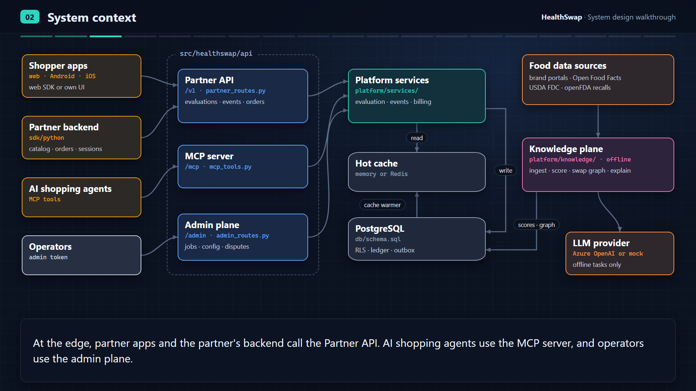
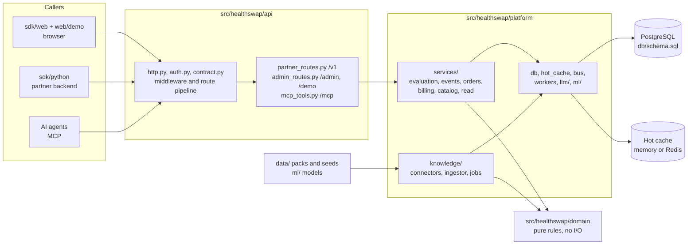
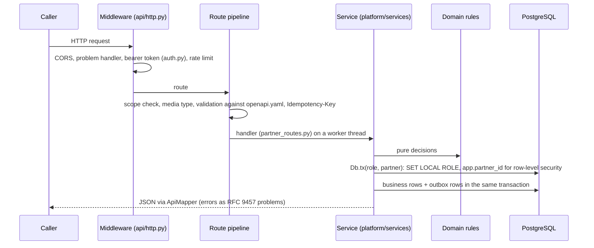
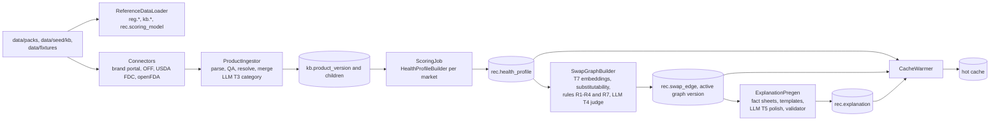
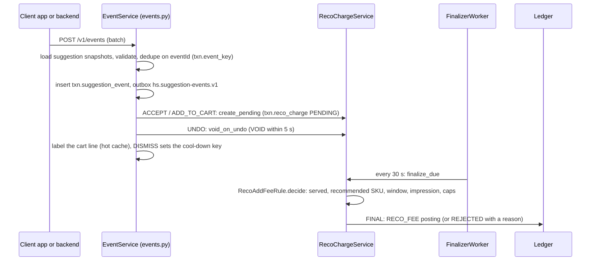
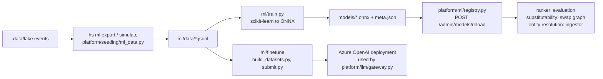

# 10 — Codebase Guide: folders, code flows and how the parts fit

| | |
| --- | --- |
| Document | Map of the repository: which folder holds which code, how each component's code flows and how the components work together |
| Version | 1.0 (draft) |
| Related | [07 Reference implementation](07-reference-implementation.md) · [09 Client app integration](09-client-app-integration.md) · [06 RA-1](06-recommended-label-and-add-fee.md) · [OpenAPI](../api/openapi.yaml) · [Schema](../db/schema.sql) |

---

A short orientation for engineers who change the code. Architecture decisions, configuration and operations are in
[07](07-reference-implementation.md); how partners call the API is in [09](09-client-app-integration.md).

## Video walkthrough

[](media/system-design-walkthrough.mp4)

A narrated system-design video (13:50) explains the workflow, the code flow of each component and how the components
work together, in the same order as this guide. Play the [MP4](media/system-design-walkthrough.mp4) (H.264 and AAC,
with chapter markers) or the [WebM](media/system-design-walkthrough.webm) (VP9 and Opus) in a browser or a media
player; the VS Code Markdown preview shows only the poster. Captions are burned into the picture and are also in a
[WebVTT file](media/system-design-walkthrough.vtt).

| Time | Chapter | What it covers | Read more |
| --- | --- | --- | --- |
| 00:00 | Introduction | What the video covers | |
| 00:21 | 01 What HealthSwap does | Cart to labeled swaps, the FP-1 and RA-1 fees, the design principles | [README](../README.md) |
| 01:07 | 02 System context | Callers, API planes, services, hot cache, PostgreSQL, knowledge plane, LLM provider | [1](#1-the-big-picture) |
| 01:44 | 03 Three layers, one direction | `api` → `platform` → `domain`, the composition root | [2.2](#22-srchealthswap) |
| 02:39 | 04 Repository map | Top-level folders | [2.1](#21-repository) |
| 03:10 | 05 How a request flows | Middleware chain, route pipeline, transaction per unit of work, outbox | [3](#3-how-every-request-flows) |
| 04:08 | 06 Knowledge plane (offline) | Connectors, ingestor, scoring, swap graph, explanations, cache warmer | [4.1](#41-knowledge-plane-from-source-files-to-the-hot-cache) |
| 04:55 | 07 Inside the swap-graph builder | Blocking, retrieval, substitutability, rules R1–R4 and R7, blue/green activation | [4.1](#41-knowledge-plane-from-source-files-to-the-hot-cache) |
| 05:55 | 08 Catalog and inventory sync | SKU matching, review webhook, inventory batches, feed files | [4.2](#42-catalog-and-inventory) |
| 06:30 | 09 Cart evaluation: the hot path | The seven pipeline steps, ranking, the background recorder | [4.3](#43-cart-evaluation-hot-path) |
| 07:46 | 10 Client integration | SDK sessions, web SDK calls, shopper events | [4.8](#48-sdks-demo-shop-and-agents), [09](09-client-app-integration.md) |
| 08:22 | 11 Events and RA-1 charges | Dedupe, charge states, finalizer evidence | [4.4](#44-suggestion-events-and-ra-1-charges) |
| 09:11 | 12 Orders and FP-1 attribution | Attribution evidence, fair premium, worked example IN-1 | [4.5](#45-orders-and-fp-1-attribution) |
| 09:59 | 13 Billing, ledger and disputes | Month close, double-entry ledger, disputes and credit notes | [4.6](#46-billing-ledger-and-disputes) |
| 10:33 | 14 Outbox, event bus and webhooks | Outbox relay, lake sink, webhook fan-out and dispatcher | [4.7](#47-webhooks) |
| 11:09 | 15 ML models and the LLM gateway | ONNX models, training, LLM tasks, fine-tuning | [4.9](#49-ml-and-llm-loop) |
| 12:05 | 16 Security and multi-tenancy | OAuth and scopes, row-level security roles, request and outbound safety | [07](07-reference-implementation.md) |
| 12:48 | 17 Run it and test it | Local stack, test layers, smoke test | [5](#5-tests) |
| 13:21 | Recap | The four ideas to remember | |

The narration uses the offline Windows voice Microsoft Zira (System.Speech), so the video can be rendered again on any
Windows machine without a cloud service. The scenes, diagrams and narration text live in
[tools/demo-recorder/system-design/scenes.mjs](../tools/demo-recorder/system-design/scenes.mjs); `player.js` and
`player.css` next to it draw them, and
[record-system-design.mjs](../tools/demo-recorder/record-system-design.mjs) renders every frame in headless Microsoft
Edge and encodes the result with ffmpeg. After changing a scene:

```powershell
npm ci --prefix tools/demo-recorder
# One PNG per narration beat, to check the layouts
node tools/demo-recorder/record-system-design.mjs --preview $env:TEMP\hs-preview
# The video, the captions and the poster in docs/media (takes about 20 minutes)
node tools/demo-recorder/record-system-design.mjs --rate 1 --ffmpeg <path to ffmpeg.exe>
```

The ffmpeg needs the libx264, aac, libvpx-vp9 and libopus encoders. One way to get it without installing anything is
the binary in the `imageio-ffmpeg` Python wheel: `py -m pip download imageio-ffmpeg --no-deps -d <dir>`, unzip the
wheel and use `imageio_ffmpeg/binaries/ffmpeg-win-*.exe`. `--no-voice` skips the narration (Playwright's own ffmpeg is
then enough for the WebM), and `--poster-only` refreshes just the poster.

## 1. The big picture



One dependency direction: `api` → `platform` → `domain`. The domain layer is deterministic and has no I/O, so every
business rule is unit-tested without a database. `platform/container.py` is the composition root: it builds every
service lazily from the settings and starts the background workers. The partner API never reads PostgreSQL on the cart
hot path and never calls an LLM; the knowledge plane precomputes everything into PostgreSQL, and the cache warmer copies
it into the hot cache.

## 2. Which folder holds what

### 2.1 Repository

| Folder | Holds |
| --- | --- |
| `api/` | `openapi.yaml`: the Partner API contract, also used at runtime to validate every request |
| `db/` | `schema.sql`: schemas `kb` (products), `reg` (regulation), `rec` (scores, swap graph, explanations), `tenant` (partners, catalogs, inventory), `txn` (evaluations, events, orders, charges, outbox), `billing` (ledger, statements, disputes), `audit`; roles and row-level security |
| `config/` | `settings.toml` and `settings.development.toml` |
| `data/packs/` | Market packs `IN.json` and `US.json` (rules and thresholds), `additives.json`, scoring models in `models/` |
| `data/seed/kb/` | The seed knowledge base: `products.json`, `categories.json`, `ingredients.json` |
| `data/seed/demo/` | Demo partners with development-only client secrets (`partners.json`), their catalogs and store inventory |
| `data/fixtures/` | Sample Open Food Facts, USDA FDC and openFDA files for the connectors |
| `src/healthswap/` | The service (section 2.2) and the `hs` CLI (`cli.py`), the dev-database launcher (`devdb.py`), repository paths (`paths.py`) |
| `sdk/python/` | `healthswap_client`: the server-side Python SDK (`client.py`, `events.py`, `webhooks.py`, `resilience.py`, `errors.py`) |
| `sdk/web/` | `healthswap-web.js` and `healthswap-web.css`: the browser SDK |
| `web/demo/` | The QuickBasket demo shop served at `/demo` (`index.html`, `demo.js`, `demo.css`) |
| `ml/` | `train.py` (ONNX models), `finetune/` (Azure OpenAI fine-tuning of the explanation writer), `data/` (exported training data) |
| `scripts/` | `run_local.py` (local stack) and `smoke_test.py` (end-to-end check) |
| `tools/devdb/` | PGlite (PostgreSQL in WebAssembly) behind a Postgres socket, for local runs and integration tests |
| `tools/demo-recorder/` | Playwright script that records the integration demo into `docs/media/` |
| `tests/` | `domain/`, `platform/`, `api/`, `sdk/`, `ml/` test suites (section 5) |
| `docs/` | Design documents 01–06, implementation guides 07–10, `media/` recordings |
| `archive/csharp/` | The earlier C# implementation: archived, unmaintained |
| `.data/` | Runtime state, not versioned: dev database, logs, keys, feed uploads, event lake |

### 2.2 `src/healthswap`

| Package | Module | Holds |
| --- | --- | --- |
| `domain/` | `primitives.py`, `text.py` | Money and rounding, net quantity, GTIN, clocks, UUIDv7 ids, billing periods; text similarity and the deterministic embedder |
| | `knowledge/` | `products.py` (product and nutrition model), `parsing.py` (ingredients, additives, allergens, diet, NOVA), `quality.py` (QA rules, data sufficiency, entity resolution, survivorship) |
| | `scoring/` | `models.py` (nutrient points models, front-of-pack bands, additive tiers, the HSI), `health_profiles.py` (market packs, `HealthProfileBuilder`) |
| | `recommendation/` | `rules.py` (eligibility R1–R7), `ranking.py` (substitutability, ranker features, per-cart selection), `explanations.py` (fact sheets, templates, the validator), `labels.py` (the "Recommended by HealthSwap" label and shopper copy) |
| | `commerce/` | `fees.py` (FP-1 `FairPremiumRule`, RA-1 `RecoAddFeeRule`), `ledger.py` (accounts, balanced postings), `partner_config.py` (the partner configuration document) |
| `platform/` | `settings.py`, `container.py` | Layered settings; the composition root |
| | `db.py`, `tenancy.py`, `errors.py` | Transactions with one database role and tenant each; the caller (`PartnerContext`) and partner directory; `HsError` problems |
| | `cache.py`, `hot_cache.py` | Key-value store (in-process or Redis) and the typed hot-path keys |
| | `bus.py`, `workers.py` | Transactional outbox, relay, in-process bus, lake sink; the background-worker base class |
| | `api_mapper.py`, `jsonutil.py`, `netjson.py` | Internal models to API JSON; JSON conventions |
| | `knowledge/` | `connectors.py` (source files to candidates), `ingestor.py` (into `kb`), `kb_reader.py` (products back out, recalls), `reference_data.py` (packs and taxonomy), `jobs.py` (`ScoringJob`, `SwapGraphBuilder`, `ExplanationPregen`) |
| | `services/` | `evaluation.py` (cart evaluation, alternatives, `EvaluationRecorder`), `events.py` (events, RA-1 charges, finalizer worker), `orders.py` (orders, FP-1 `AttributionEngine`), `billing.py` (statements, disputes, payments), `catalog.py` (catalog, feeds, inventory, preferences, privacy), `infrastructure.py` (webhooks, idempotency, ledger writer, data protection), `read.py` (product reads, transparency, `CacheWarmer`) |
| | `llm/`, `ml/`, `seeding/` | LLM gateway and offline mock; ONNX model registry with heuristic fallbacks; demo seeder and ML data export |
| `api/` | `app.py` | `create_app()`: middleware order, OAuth and discovery routes, route registration, worker lifecycle |
| | `http.py`, `auth.py`, `contract.py` | Problem, authentication and rate-limit middleware and the per-route pipeline; ES256 tokens, the development OAuth server and SDK sessions; `openapi.yaml` compiled to validators |
| | `partner_routes.py`, `admin_routes.py`, `mcp_tools.py` | `/v1`; `/admin` and `/demo`; `/mcp` |

## 3. How every request flows



After the commit, `OutboxRelay` publishes the outbox rows to `InProcessEventBus`, which feeds the webhook fan-out and the
lake sink (`.data/lake/bronze/<topic>/...`), the training-data source of `ml/`.

## 4. Component flows

### 4.1 Knowledge plane: from source files to the hot cache



Entry points: `hs seed --demo` (`DemoSeeder`, all of it plus demo tenants), `hs kb ingest|recalls|score|build-graph|explain|rebuild`
and `POST /admin/jobs/kb-rebuild`. LLM tasks (`platform/llm/gateway.py`) run only here, never on the request path, with
validated JSON output, budgets and an audit row each.

### 4.2 Catalog and inventory

`POST /v1/catalog/item-batches` → `CatalogService.upsert` matches each SKU to a canonical product (GTIN first, then entity
resolution: automatic match or review) into `tenant.catalog_item`, updates the SKU map in the hot cache and queues a
`catalog.match.review_required` webhook for the items that need review. Items that carry their own label data but match
no product go to `CatalogEnrichment` on a background job, which ingests them into the knowledge base and re-scores the
market. Bulk feeds use `FeedService` (create, pre-signed upload, background processing).
`POST /v1/stores/{storeId}/inventory-batches` → `InventoryService.upsert` → `tenant.store_inventory` and the hot cache.

### 4.3 Cart evaluation (hot path)

`POST /v1/cart-evaluations` → `EvaluationService.evaluate`, reading only the hot cache:

1. Resolve lines to products (SKU map, then GTIN) and load their health profiles.
2. Kill switch, placement policy and holdout arm (no suggestions; `degraded` with `KILL_SWITCH` where it applies).
3. Shopper constraints: stored preferences with consent, request preferences, the minors policy.
4. Target lines: substitutable, scored, below the category's 60th-percentile HSI, not already a HealthSwap pick.
5. Candidates from the active swap graph, filtered by the request-time rules (R5–R7), the dismiss cool-down, stock and
   price guards, then ranked (`domain/recommendation/ranking.py` with the ONNX ranker or its heuristic).
6. Per-cart selection: at most the configured number of suggestions, one per category.
7. Explanations, the RA-1 label and a suggestion snapshot (hot cache) per suggestion; `lineLabels` for lines that hold an
   earlier pick.

The response returns at once; `EvaluationRecorder` writes `txn.cart_evaluation` and `txn.suggestion` in the background and
emits `hs.cart-evaluations.v1`. `GET /v1/products/{id}/alternatives` (product pages) and the MCP tools reuse the same
service.

### 4.4 Suggestion events and RA-1 charges



### 4.5 Orders and FP-1 attribution

`POST /v1/orders` (Idempotency-Key required) → `OrderService.create` → `AttributionEngine.attribute_order`: for each line
with a `suggestionId` it checks the evidence (served by HealthSwap, same product, accepted, shown no later than 5 s after
the accept, placed within the attribution window) and computes the fair premium and fee with `FairPremiumRule`
(`domain/commerce/fees.py`) → `txn.attribution` PENDING. `PATCH /v1/orders/{id}`
with DELIVERED accrues the fee (ledger posting, ACCRUED, finalizes after the return window); `POST .../adjustments`
(returns, refunds, price adjustments, substitutions) reverses parts of it; the finalizer worker (every 60 s) makes it
FINAL. Every step emits `hs.orders.v1` or `hs.attribution.v1`.

### 4.6 Billing, ledger and disputes

`hs billing month-close` or `POST /admin/jobs/month-close` → `BillingService.close_month`: one statement per partner and
month with the FINAL FP-1 attributions and RA-1 charges, tax, an invoice number, a balanced ledger posting
(`domain/commerce/ledger.py` `Postings`, written by `LedgerService`) and the `billing.statement.issued` webhook.
`POST /v1/billing/disputes` opens a dispute; `POST /admin/disputes/{id}/resolve` decides it, an upheld dispute gets a
credit note (its RA-1 charges become CREDITED), and `billing.dispute.updated` is sent. `GET /admin/ledger/trial-balance`
proves the books balance.

### 4.7 Webhooks

A service calls `WebhookFanoutConsumer.request` inside its transaction (an outbox row) → `OutboxRelay` → bus →
`WebhookFanoutConsumer` creates one `txn.webhook_delivery` per subscribed endpoint → `WebhookDispatcher` (every second)
signs the body (`HealthSwap-Signature`, HMAC-SHA256), checks the URL against the SSRF policy (`UrlPolicy`), posts it and
retries with backoff for up to 24 hours. Partners verify with `healthswap_client.verify_webhook`; the demo receiver is
`/demo/webhooks/{name}`.

### 4.8 SDKs, demo shop and agents

| Caller | Talks to | Code path |
| --- | --- | --- |
| Web SDK in a partner page | `/v1/cart-evaluations`, `/v1/events` with an SDK session token | `sdk/web/healthswap-web.js` → `partner_routes.py` → `EvaluationService`, `EventService` |
| Demo shop | `/demo/api/session` (stands in for the partner backend) and `/demo/api/charges`, plus the web SDK | `web/demo/demo.js` → `admin_routes.register_demo` → `issue_sdk_session`, `RecoChargeService.list` |
| Python SDK in a partner backend | `/oauth2/token` and every `/v1` operation | `sdk/python/src/healthswap_client/client.py` → `app.py` token route, `partner_routes.py` |
| AI agents | `/mcp`: `evaluate_cart`, `get_product_health`, `find_healthier_alternatives`, `explain_swap`, `record_swap_decision` | `api/mcp_tools.py` → the same services |
| Operators | `/admin`: partners, config, kill switch, jobs, clock, ledger, curation, disputes, payments, webhooks, LLM audit, models, diagnostics | `api/admin_routes.py` (scope `hs.admin`) |

### 4.9 ML and LLM loop



Without trained models the registry falls back to heuristics, so the API always works; the serving code computes the
training features too, so training and serving cannot drift.

## 5. Tests

| Folder | Covers | Database |
| --- | --- | --- |
| `tests/domain/` | Scoring, rules, ranking, explanations, fair premium, RA-1 decisions | None |
| `tests/platform/` | Services with fakes; seeding, knowledge pipeline, RA-1 and FP-1 flows, billing, webhooks (SSRF) | Fakes, or a fresh in-memory PGlite per module (`-m integration`) |
| `tests/api/` | HTTP flows, security, contract and authentication; responses validated against `openapi.yaml` | Fresh PGlite (`-m integration`) and none for the contract tests |
| `tests/sdk/` | The Python SDK: fail-open, retries, circuit breaker, events, webhooks | Mock transport; one integration test runs the real API on a fresh PGlite |
| `tests/ml/` | Training and fine-tuning tooling | None |

`python -m pytest tests -q -m "not integration"` runs the fast suites; `-m integration` needs Node.js and
`npm ci --prefix tools/devdb`. `python scripts/smoke_test.py --base-url http://127.0.0.1:8080` checks a running stack.

## 6. Where to make common changes

| Change | Files |
| --- | --- |
| A field in an API request or response | `api/openapi.yaml`, the service that fills it, `platform/api_mapper.py`, `tests/api` |
| A health, eligibility or ranking rule | `domain/scoring/` or `domain/recommendation/`, the market pack in `data/packs/`, `tests/domain`; then `hs kb rebuild` |
| A fee rule | `domain/commerce/fees.py`, the partner configuration (`domain/commerce/partner_config.py`), `tests/domain/test_reco_add_fee.py` or `test_fair_premium.py` |
| A table or column | `db/schema.sql` (roles and row-level security too), the services' SQL, the integration tests |
| A partner setting | `data/seed/demo/partners.json` locally; `PUT /admin/partners/{id}/config` at runtime |
| The web UI | `sdk/web/` (SDK) or `web/demo/` (demo shop); re-record with `tools/demo-recorder` |
| A background job | the service, `platform/container.py` (`workers`), `api/admin_routes.py` (`/admin/jobs/{job}`), `cli.py` |
